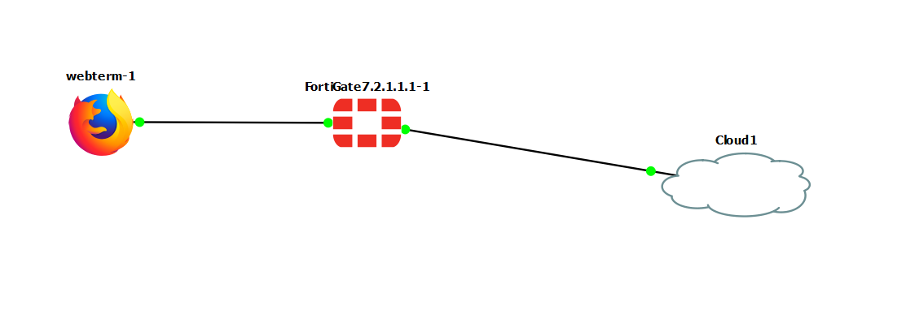
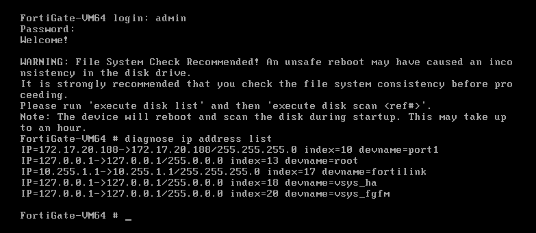
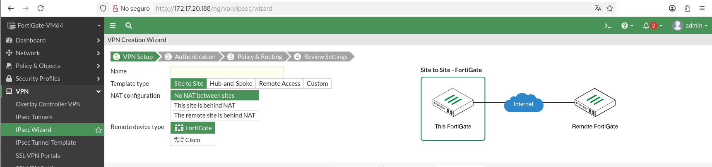
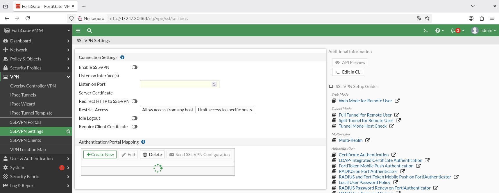
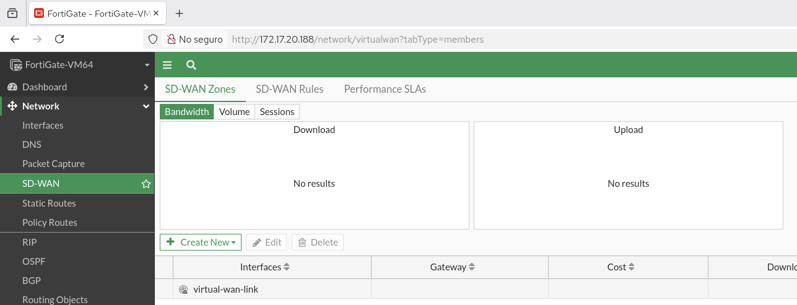

# Bitácora de Exploración Funcional: FortiGate VM en Redes de Banda Ancha

**Estudiante:** Juan Felipe Becerra Briceño  
**Código / ID:** 1701821
**Fecha:** 15/10/2026
**Asignatura:** Redes de Banda Ancha  

---

## 1. Topología y Verificación de Entorno

* **Topología en GNS3:**
  
  *Evidencia visual de la infraestructura simulada en GNS3, mostrando el nodo FortiGate VM interconectado con las redes LAN y enlaces WAN.*

* **Dashboard de FortiOS:**
  
  *Panel principal de administración gráfica donde se valida el Hostname (`FortiGate-VM64`), la versión de firmware FortiOS y el estado de recursos del sistema (CPU, RAM).*

---

## 2. Reconocimiento Módulo por Módulo de la GUI de FortiOS

A continuación se detalla la función técnica y el impacto en redes de banda ancha de cada uno de los 9 módulos principales de la interfaz web gráfica:

### 2.1. Dashboard
* **Función Técnica:** Centro de monitoreo y telemetría en tiempo real del sistema. Muestra widgets configurables sobre el uso de recursos (CPU, memoria, disco), tráfico activo por interfaz, estado de sesiones y alertas del sistema.
* **Impacto en Banda Ancha:** Permite auditar el comportamiento del plano de control y plano de datos. En enlaces de alta capacidad, ayuda a identificar cuellos de botella de procesamiento de paquetes por segundo (PPS) o saturación de la tabla de sesiones de la red perimetral.

### 2.2. Network
* **Función Técnica:** Módulo de administración de la infraestructura de capa 2 y capa 3. Permite parametrizar interfaces físicas y virtuales (VLANs, agregación 802.3ad, Loopback), enrutamiento estático y dinámico (OSPF, BGP, RIP), servidor DHCP, DNS y la arquitectura **SD-WAN**.
* **Impacto en Banda Ancha:** Es el pilar del transporte de datos. Define cómo el firewall interactúa con la infraestructura del proveedor de servicios (ISP), gestionando direccionamiento IP, tamaños de MTU/MSS y la abstracción de múltiples enlaces físicos para optimizar el transporte de banda ancha.

### 2.3. Policy & Objects
* **Función Técnica:** Permite definir la matriz de control de acceso mediante reglas de firewall IPv4/IPv6, políticas de DoS, traducción de direcciones de red (NAT/PAT) y la creación de objetos reutilizables (Addresses, Services, Schedules, IP Pools y Protocol Options).
* **Impacto en Banda Ancha:** Regula la utilización del canal mediante inspección de estados (*stateful inspection*). La configuración eficiente de NAT e IP Pools evita el agotamiento de puertos en conexiones masivas sobre enlaces simétricos y asimétricos.

### 2.4. Security Profiles
* **Función Técnica:** Agrupa las capacidades de inspección profunda y seguridad UTM (*Unified Threat Management*), incluyendo Antivirus, Web Filter, DNS Filter, Application Control, IPS (Intrusion Prevention System) e inspección SSL/TLS.
* **Impacto en Banda Ancha:** La inspección de contenido a velocidades gigabit demanda una alta eficiencia del motor de procesamiento. Permite restringir tráfico no operativo (streaming, P2P) que degrada el ancho de banda útil en conexiones corporativas.

### 2.5. VPN (Virtual Private Network)
* **Función Técnica:** Orquestación de túneles cifrados para transporte seguro. Soporta tecnologías IPsec (asistente IPsec Wizard y configuración manual Custom para arquitecturas Site-to-Site y Remote Access) y SSL-VPN (Portales y Ajustes para acceso cliente-servidor).
* **Impacto en Banda Ancha:** Proporciona confidencialidad e integridad sobre medios de transporte públicos e inseguros. Requiere un cálculo preciso del *overhead* de encapsulación (ESP/TLS) para evitar la fragmentación de paquetes en enlaces WAN.

### 2.6. User & Authentication
* **Función Técnica:** Gestión de identidades, usuarios locales, grupos de acceso y conectividad con servidores de autenticación externos (LDAP, RADIUS, SAML, FortiToken MFA) e integración con Active Directory (FSSO).
* **Impacto en Banda Ancha:** Asocia el consumo de ancho de banda y la aplicación de políticas de seguridad a identidades de usuario específicas en lugar de direcciones IP estáticas, posibilitando el control perimetral basado en roles.

### 2.7. System
* **Función Técnica:** Administración global del dispositivo. Incluye la gestión de administradores, certificados digitales, ajustes del sistema, actualización de firmware, licencias y la configuración de Alta Disponibilidad (HA - Active/Passive o Active/Active).
* **Impacto en Banda Ancha:** Garantiza la continuidad del servicio (*uptime*) y la resiliencia en la frontera de la red mediante esquemas de redundancia de hardware y sincronización de sesiones en entornos de alto tráfico.

### 2.8. Security Fabric
* **Función Técnica:** Arquitectura de telemetría y visibilidad unificada de Fortinet. Muestra la topología lógica y física de la red, sincroniza la inteligencia de amenazas entre múltiples dispositivos y se integra con análisis centralizado (FortiAnalyzer / FortiManager).
* **Impacto en Banda Ancha:** Brinda visibilidad de capa 2 a capa 7 sobre el comportamiento global de la red de banda ancha, permitiendo detectar anomalías de tráfico y distribuir dinámicamente la carga de trabajo perimetral.

### 2.9. Log & Report
* **Función Técnica:** Recolección, almacenamiento y visualización de eventos de red, seguridad, tráfico y sistema. Facilita la auditoría mediante gráficos, consultas filtradas y reenvío de registros a servidores Syslog o FortiAnalyzer.
* **Impacto en Banda Ancha:** Indispensable para el análisis a posteriori de patrones de consumo de ancho de banda, identificación de picos de tráfico anomalías y verificación del cumplimiento de políticas de tráfico perimetral.

---

## 3. Tecnologías de VPN y Cifrado Perimetral

### 3.1. IPsec Wizard y Túneles Personalizados
* **Evidencia gráfica:**
  
  *Configuración de parámetros de Fase 1 y Fase 2 en el asistente de IPsec.*

* **Definición técnica:**
  * **Fase 1 (IKE SA):** Establece un canal seguro y autenticado entre los extremos VPN negociando algoritmos de cifrado (AES), autenticación (SHA) y grupos Diffie-Hellman (DH) para el intercambio de claves.
  * **Fase 2 (IPsec SA):** Define los parámetros de seguridad para la protección del tráfico de datos real, negociando la encapsulación ESP y los selectores de tráfico (*Proxy IDs*).
  * **Selectores de Tráfico:** Subredes locales y remotas autorizadas para atravesar el túnel cifrado.

* **Impacto en Redes de Banda Ancha:**
  La encapsulación IPsec agrega encabezados adicionales (ESP, IP, IV) que incrementan el tamaño del paquete. En enlaces de alta velocidad, es crítico ajustar adecuadamente la **MTU** (*Maximum Transmission Unit*) y el **MSS** (*Maximum Segment Size*) para evitar la fragmentación de paquetes a nivel IP, la cual degrada sensiblemente el *throughput* y eleva la latencia.

### 3.2. SSL-VPN (Portales y Configuraciones)
* **Evidencia gráfica:**
  
  *Configuración del pool de direcciones IP, puertos de escucha y portales SSL-VPN.*

* **Definición técnica:**
  * **Web Mode:** Acceso mediante navegador web sin instalar software cliente. Limitado a aplicaciones basadas en web (HTTP/HTTPS, SSH, RDP encapsulado).
  * **Tunnel Mode:** Requiere cliente dedicado (FortiClient). Crea un adaptador de red virtual en el equipo remoto, permitiendo el transporte completo de tráfico IP (capa 3).

* **Impacto en Redes de Banda Ancha:**
  En escenarios de teletrabajo masivo, las conexiones SSL-VPN concentradas en la sede principal impactan directamente el ancho de banda *upstream* del enlace del centro de datos. Se requiere modelar el tráfico y habilitar mecanismos como *Split Tunneling* para derivar la navegación a Internet directamente por la conexión local del usuario y preservar la banda ancha corporativa.

---

## 4. Arquitectura SD-WAN (Gestión Dinámica de Enlaces)

### 4.1. Zonas e Interfaces Miembro
* **Evidencia gráfica:**
  
  *Agrupación de interfaces WAN físicas/virtuales dentro de una zona lógica SD-WAN.*

* **Concepto técnico:**
  La abstracción de interfaces permite agrupar múltiples enlaces de banda ancha heterogéneos (fibra óptica, módem de cable, 4G/5G, enlace satelital) dentro de una única interfaz lógica (`virtual-wan-link`), simplificando el diseño de políticas de firewall y enrutamiento.

### 4.2. Performance SLA y Mecanismos de Calidad de Enlace
* **Evidencia gráfica:**
  
  *Parametrización de servidores de prueba (probes) y umbrales de Latencia, Jitter y Loss.*

* **Concepto técnico:**
  Monitorea continuamente la calidad de cada enlace miembro enviando paquetes de prueba (*probes* ICMP, HTTP o DNS) hacia servidores de destino. Evalúa métricas críticas:
  * **Latencia:** Tiempo de ida y vuelta (*RTT*) del paquete.
  * **Jitter:** Variación en el tiempo de llegada de los paquetes.
  * **Packet Loss:** Porcentaje de paquetes perdidos en el tránsito.

* **Impacto en Redes de Banda Ancha:**
  Reemplaza el enrutamiento estático tradicional por un esquema dinámico y medible. Si un enlace de banda ancha sufre degradación (p. ej. alto *jitter* por saturación), el sistema conmuta automáticamente las aplicaciones sensibles (VoIP, video) a un enlace alternativo sin perder la sesión.

### 4.3. Estrategias de Reglas SD-WAN
* **Evidencia gráfica:**
  
  *Reglas de selección de interfaz basadas en calidad de servicio y SLA.*

* **Concepto técnico:**
  * **Manual:** Asigna el tráfico a una interfaz preferida fija.
  * **Best Quality:** Elige automáticamente la interfaz con mejor métrica (latencia, jitter o ancho de banda disponible).
  * **Lowest Cost:** Prioriza enlaces de menor costo financiero mientras cumplan con el SLA exigido.
  * **Maximize Bandwidth (SLA):** Distribuye la carga en modo *Round-Robin* o balanceo dinámico entre todas las interfaces que cumplan con el Performance SLA objetivo.

---

## 5. Control de Tráfico Perimetral y Calidad de Servicio (QoS)

### 5.1. Traffic Shaping
* **Evidencia gráfica:**
  
  *Configuración de asignación de ancho de banda garantizado, máximo y prioridades.*

* **Concepto técnico y aplicación:**
  El modelado de tráfico permite asignar prioridades a las colas de salida y definir restricciones de velocidad:
  * **Guaranteed Bandwidth:** Ancho de banda mínimo reservado para tráfico crítico.
  * **Maximum Bandwidth:** Límite máximo de consumo permitido para evitar la saturación de la interfaz.
  * **Traffic Priority:** Priorización de paquetes (High, Medium, Low) en la cola de salida.

  En enlaces de banda ancha con asimetría (p. ej. alta velocidad de bajada y baja velocidad de subida), el *Traffic Shaping* evita la saturación del canal *upstream*, previniendo la degradación de las confirmaciones TCP (*TCP ACKs*) y manteniendo la estabilidad general de la red.

---

## 6. Conclusiones Personales

1. **El Firewall como Orquestador de Banda Ancha:** En las redes modernas, el Next-Generation Firewall (NGFW) ha dejado de ser una simple barrera de filtrado de paquetes para convertirse en el núcleo centralizador de transporte, agregando inteligencia sobre la calidad de servicio y disponibilidad de los enlaces WAN.
2. **Relevancia del Enrutamiento Basado en Aplicación (SD-WAN):** La integración de SD-WAN en el sistema operativo FortiOS demuestra que la medición objetiva de métricas de transporte (latencia, jitter, pérdida de paquetes) es indispensable para maximizar el retorno de inversión en enlaces heterogéneos de banda ancha.
3. **Cifrado Adaptativo y Rendimiento:** La implementación de túneles VPN (IPsec y SSL) sobre canales de datos de alta velocidad requiere una planificación rigurosa del procesamiento del dispositivo e inspección de paquetes, balanceando la confidencialidad de la información con el mantenimiento del rendimiento de red.
