# Bitácora de Exploración Funcional: FortiGate VM en Redes de Banda Ancha

**Estudiante:** Julián Camilo Moreno Valderrama  
**Código / ID:** 1701805  
**Fecha:** 15 de octubre de 2026  
**Asignatura:** Banda Ancha  

---

## 1. Topología y Verificación de Entorno

Para esta práctica utilicé FortiGate en GNS3. Conecté port1 al nodo NAT1 y port2 a Webterm, desde donde ingresé a la administración por la dirección **https://192.168.20.1**. La versión utilizada fue FortiOS 7.4.12.

**Topología del laboratorio:**

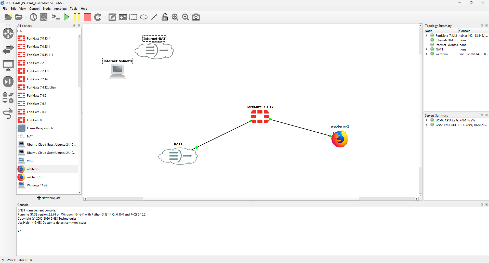

**Dashboard con la identificación del equipo y su versión:**

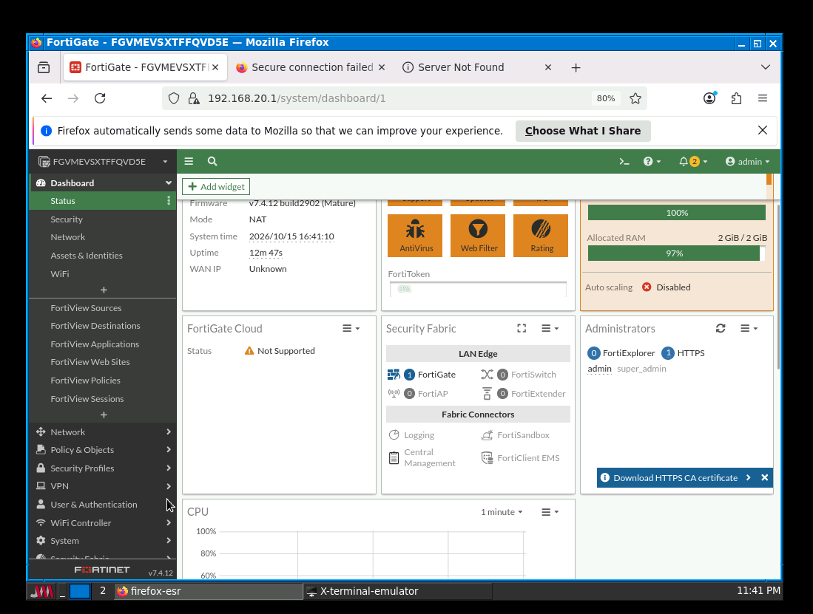

---

## 2. Tecnologías de VPN y Cifrado Perimetral

### 2.1 IPsec Wizard y Túneles Personalizados

En el asistente revisé las opciones **Site to Site**, que conecta dos sedes; **Hub-and-Spoke**, que conecta varias sucursales con una sede central; y **Remote Access**, para usuarios remotos. También revisé **Custom**, que permite configurar los parámetros por separado.

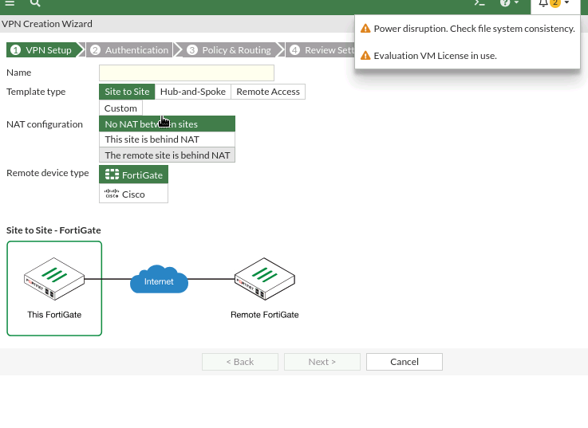

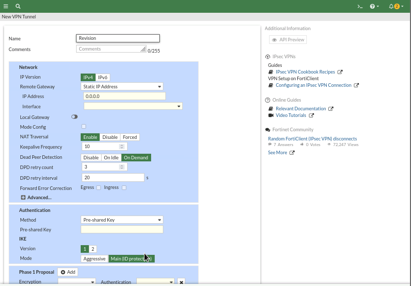

**Definición técnica.** La Fase 1 establece un canal seguro entre los equipos mediante IKE. Allí se autentican y acuerdan cómo proteger la comunicación. Diffie-Hellman permite obtener un secreto compartido sin enviarlo directamente por la red. [Fortinet: configuración de Fase 1](https://docs.fortinet.com/document/fortigate/7.4.2/administration-guide/790613/phase-1-configuration).

La Fase 2 define cómo se protege el tráfico que pasa por la VPN. Los **selectores** indican las redes locales y remotas que usarán el túnel. **ESP** es el protocolo que encapsula y protege esos datos. [Fortinet: configuración de Fase 2](https://docs.fortinet.com/document/fortigate/8.0.0/administration-guide/604285/phase-2-configuration). En esta práctica revisé los formularios, pero no establecí una VPN entre dos equipos.

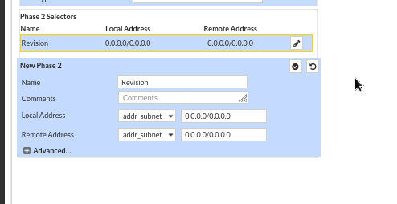

**Impacto en redes de banda ancha.** IPsec permite conectar sedes por Internet protegiendo los datos para que terceros no puedan leerlos o modificarlos durante el recorrido.

El túnel agrega información a cada paquete. Por eso hay que considerar la **MTU**, que es el tamaño máximo de paquete que admite el enlace, y el **MSS**, que limita los datos de cada segmento TCP. Si el paquete queda demasiado grande, puede fragmentarse o descartarse. Ajustar estos tamaños ayuda a evitar retransmisiones, aunque se tenga una conexión rápida. [Fortinet: fragmentación en IPsec](https://docs.fortinet.com/document/fortigate/7.2.0/secgw-for-mobile-networks-deployment/325893/ipsec-and-packet-fragmentation) y [ajuste del MSS](https://community.fortinet.com/fortigate-3/technical-tip-setting-tcp-mss-value-96548).

### 2.2 SSL-VPN (Portales y Configuraciones)

Revisé el portal **full-access** y las opciones de conexión SSL-VPN.

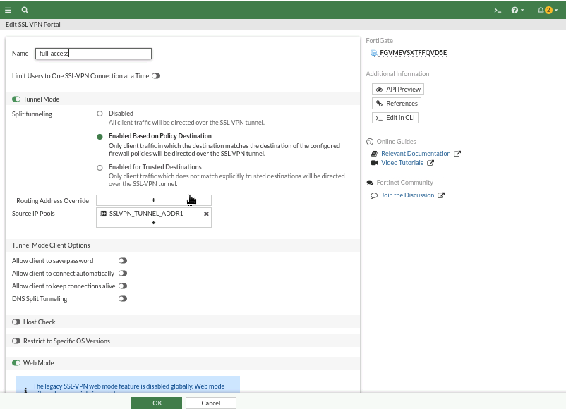

**Definición técnica.** En **Web Mode**, el usuario entra desde el navegador y accede a los recursos publicados en el portal. En **Tunnel Mode**, utiliza un cliente como FortiClient, que crea un adaptador virtual para conectarse a los recursos permitidos de la empresa. [Fortinet: modos de SSL-VPN](https://docs.fortinet.com/document/fortigate/7.4.0/administration-guide/869159/ssl-vpn-best-practices).

El **IP Pool** asigna direcciones a los usuarios del túnel. En el portal aparece SSLVPN_TUNNEL_ADDR1. También está habilitado el split tunneling por destino de las políticas, que envía por la VPN solo el tráfico correspondiente a esos destinos. [Fortinet: asignación de IP y split tunneling](https://docs.fortinet.com/document/fortigate/7.4.0/administration-guide/869159/ssl-vpn-best-practices).

En mi equipo, Web Mode muestra un aviso de que está deshabilitado globalmente. Por eso, que aparezca su opción en el portal no significa que esté funcionando.

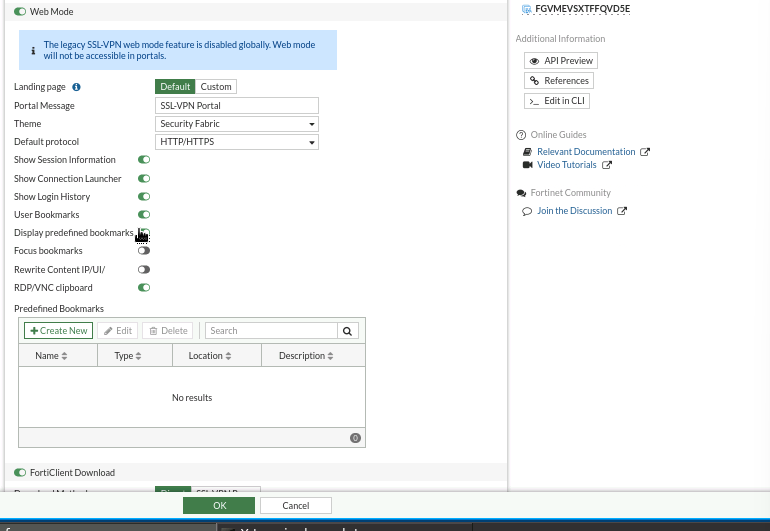

En SSL-VPN Settings se muestra el rango **10.212.134.200–10.212.134.210** para clientes y el puerto de escucha **443**. También aparece un conflicto con el puerto HTTPS de administración y falta seleccionar la interfaz de escucha. La configuración quedó como exploración; no realicé una conexión remota.

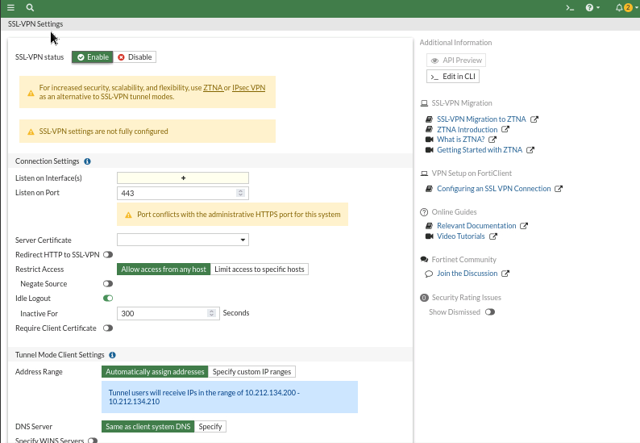

**Impacto en redes de banda ancha.** Cuando un trabajador descarga un archivo de la empresa, consume la subida del enlace de la empresa. Si muchos usuarios se conectan al mismo tiempo, esa subida se reparte entre todos. Por eso hay que calcular cuántos usuarios estarán activos y qué aplicaciones usarán, especialmente en conexiones donde la subida es menor que la bajada.

---

## 3. Arquitectura SD-WAN (Gestión Dinámica de Enlaces)

### 3.1 Zonas e Interfaces Miembro

En SD-WAN agregué **port1** a la zona **virtual-wan-link**, con la puerta de enlace **192.168.42.1**.

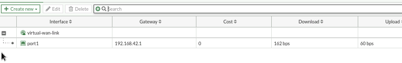

**Concepto técnico.** Una zona agrupa varios enlaces para administrarlos con reglas comunes. Por ejemplo, una empresa puede tener fibra, cable módem y satélite de baja órbita en la misma zona, aunque cada uno tenga distinta velocidad, costo y calidad. [Fortinet: miembros y zonas SD-WAN](https://docs.fortinet.com/document/fortigate/7.4.10/administration-guide/942095/sd-wan-members-and-zones).

Esto permite elegir la salida según el tráfico. En mi laboratorio solo hay un enlace WAN, así que no comprobé balanceo ni cambio automático entre dos enlaces.

### 3.2 Performance SLA y Mecanismos de Calidad de Enlace

Revisé el perfil **Default_Google Search**, que utiliza HTTPS hacia www.google.com. Sus límites configurados son **250 ms de latencia**, **50 ms de jitter** y **5 % de pérdida**. Estos números son objetivos de la configuración, no resultados medidos.

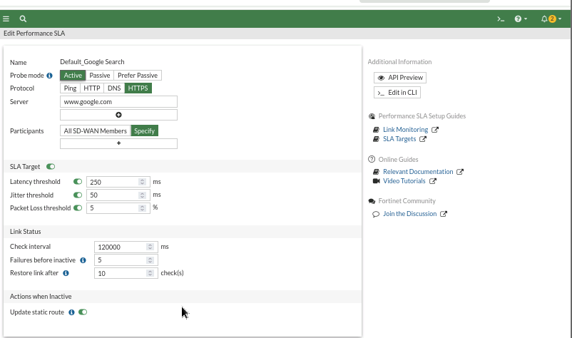

**Concepto técnico.** La latencia es el tiempo de respuesta; el jitter es la variación de ese tiempo; y la pérdida indica qué porcentaje de paquetes no recibe respuesta.

Las sondas hacen pruebas periódicas para conocer el estado del enlace. Ping comprueba una respuesta de red, HTTP comprueba un servicio web y DNS realiza una consulta de nombres. [Fortinet: monitoreo de calidad del enlace](https://docs.fortinet.com/document/fortigate/7.4.7/administration-guide/580649).

**Impacto en redes de banda ancha.** Una ruta estática por sí sola no revisa si un enlace está lento o pierde paquetes. Con los SLA, SD-WAN puede tomar esas condiciones en cuenta para elegir otra salida disponible. Esto ayuda a las llamadas VoIP y videoconferencias, que pueden presentar cortes cuando el enlace se satura, aunque todavía tenga conexión.

### 3.3 Estrategias de Reglas SD-WAN

En la creación de reglas revisé las formas de seleccionar la interfaz de salida.

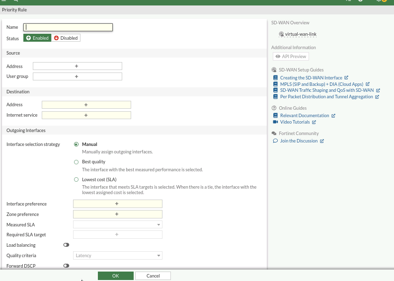

| Estrategia | Cómo funciona |
| --- | --- |
| Manual | Usa las interfaces según la preferencia definida por el administrador. |
| Best Quality | Escoge el enlace con mejor calidad según la medida seleccionada, como latencia. |
| Lowest Cost (SLA) | Escoge el de menor costo entre los que cumplen los objetivos del SLA. |
| Maximize Bandwidth (SLA) | Reparte el tráfico entre enlaces que cumplen el SLA para aprovechar su capacidad. |

Las diferencias se resumen a partir de [Fortinet: estrategias SD-WAN](https://docs.fortinet.com/document/fortigate/7.4.0/sd-wan-sd-branch-architecture-for-mssps/902869/basic-sd-wan-configuration).

En esta versión, la opción de balanceo aparece como **Load balancing**, en lugar de una cuarta estrategia independiente. Para balancear según objetivos SLA se utiliza dentro de Lowest Cost (SLA). [Fortinet: estrategia de balanceo](https://docs.fortinet.com/document/fortigate/7.4.8/administration-guide/708464/load-balancing-strategy).

Guardé la regla **SDWAN-Google-Quality** para Google-Web, con Best Quality, el criterio de latencia y el SLA Default_Google Search. La tabla muestra port1 como miembro.

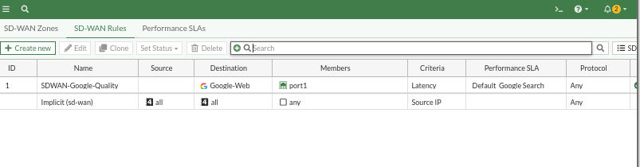

**Aplicación en banda ancha.** Con dos enlaces se puede crear una regla que envíe el tráfico recreativo al secundario y dejar el principal para trabajo, llamadas y clases virtuales. Así se reduce la carga del enlace principal. Este caso es una aplicación de lo aprendido; no lo probé porque mi topología tiene una sola salida WAN.

---

## 4. Control de Tráfico Perimetral y Calidad de Servicio (QoS)

### 4.1 Traffic Shaping

Revisé los límites y prioridades disponibles en Traffic Shapers.

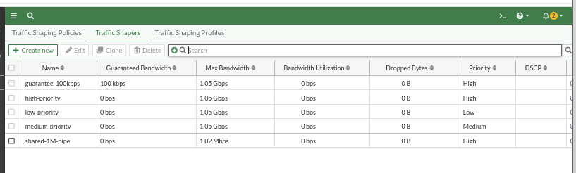

**Concepto técnico y aplicación.** Guaranteed Bandwidth establece un mínimo de ancho de banda para el tráfico, siempre que exista capacidad disponible. Maximum Bandwidth establece el máximo que puede consumir. Las prioridades **High, Medium y Low** indican qué tráfico se atiende primero cuando hay competencia por el enlace. [Fortinet: ancho de banda y prioridades del shaper](https://docs.fortinet.com/document/fortigate/7.6.6/administration-guide/933502/shared-traffic-shaper).

En la captura, el objeto guarante-100kbps muestra **100 kbps garantizados**. También aparecen objetos con prioridades alta, media y baja. Revisé estos valores, pero no apliqué una política de limitación.

En una red con más bajada que subida, subir archivos puede ocupar toda la capacidad de salida y afectar las llamadas. Limitar esas transferencias y dar prioridad a la voz ayuda a mantener el servicio. Los límites por usuario también ayudan a que una sola persona no consuma todo el canal. Las garantías deben ajustarse a la capacidad real del enlace.

### 4.2 Interfaces y Políticas de Firewall

En **Static** se asigna manualmente la dirección IP; en **DHCP**, la interfaz recibe la configuración de un servidor. [Fortinet: configuración de interfaces](https://docs.fortinet.com/document/fortigate/7.4.8/administration-guide/574723/interface-settings). En mi laboratorio port1 usa DHCP y port2 tiene la dirección estática **192.168.20.1/24**, con acceso por ping y HTTPS.

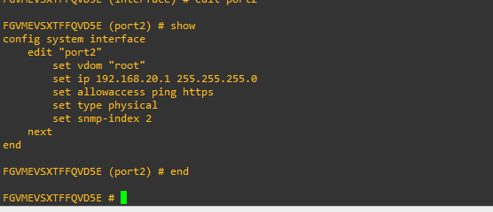

En las políticas de firewall, los campos principales son:

- **Incoming Interface:** por dónde entra el tráfico.
- **Outgoing Interface:** por dónde sale.
- **Source:** quién inicia la comunicación.
- **Destination:** hacia dónde se dirige.
- **Service:** qué protocolos y puertos utiliza.
- **Action:** si se permite o se bloquea.
- **NAT:** permite traducir la dirección de origen, por ejemplo, para salir a Internet.

Los campos de la regla se describen en [Fortinet: configuración de una política de firewall](https://docs.fortinet.com/document/fortigate/7.4.4/administration-guide/826586/configuring-a-firewall-policy).

La regla SD-WAN decide qué salida usar, mientras que la política de firewall decide si el tráfico puede pasar. En la lista observada solo aparece la política implícita; no creé una política LAN-WAN.

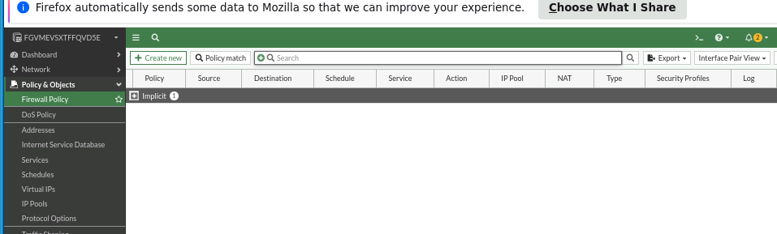

---

## 5. Conclusiones Personales

1. Entendí que el firewall puede reunir varias funciones en una red metropolitana: controlar accesos, conectar usuarios por VPN y administrar las salidas a Internet. No basta con tener un enlace de alta capacidad; también hay que organizar su uso.
2. Las VPN protegen la información que pasa por Internet, pero también consumen recursos. Para conectar varias sedes o trabajadores hay que considerar la subida disponible y el tamaño de los paquetes.
3. SD-WAN y Traffic Shaping ayudan a aprovechar mejor el ancho de banda. Medir la calidad, elegir una salida adecuada y limitar las transferencias grandes puede evitar que las llamadas y otras aplicaciones importantes se vean afectadas.
