# 🛡️ Laboratorio 01: Implementación de Firewall FortiGate, Segmentación LAN y Servidor Syslog en CentOS

Este repositorio documenta el despliegue, configuración y validación de una arquitectura de red virtualizada en **VMware Workstation** compuesta por un firewall perimetral **FortiGate-VM** y un servidor **CentOS Stream 10**, integrando enrutamiento con NAT y recolección centralizada de registros mediante **rsyslog** (puerto 514 UDP/TCP).

---

## 📋 Arquitectura y Direccionamiento IP

| Dispositivo / Interfaz | Rol en la Red | Dirección IP / Máscara | Segmento VMware |
| :--- | :--- | :--- | :--- |
| **FortiGate (`port1`)** | WAN (Salida a Internet) | DHCP / NAT | NAT (VMware) |
| **FortiGate (`port2`)** | Administración / Gestión | `192.168.20.99 / 24` | Host-Only / Bridge |
| **FortiGate (`port3`)** | Gateway LAN Interna | `192.168.10.1 / 24` | LAN Segment (`LAN_FortiGate`) |
| **CentOS (`ens33`)** | Cliente LAN y Servidor Syslog | `192.168.10.5 / 24` | LAN Segment (`LAN_FortiGate`) |

---

## 🚀 Desarrollo del Laboratorio Paso a Paso

### 1. Verificación de Salida a Internet y Acceso Administrativo en FortiGate
Se configuraron los servidores DNS (`8.8.8.8` y `1.1.1.1`) en la consola CLI del firewall (`FortiGate-IvanGarcia`) y se validó la resolución de nombres y conectividad externa hacia Internet (`google.com`) con `0% packet loss`.

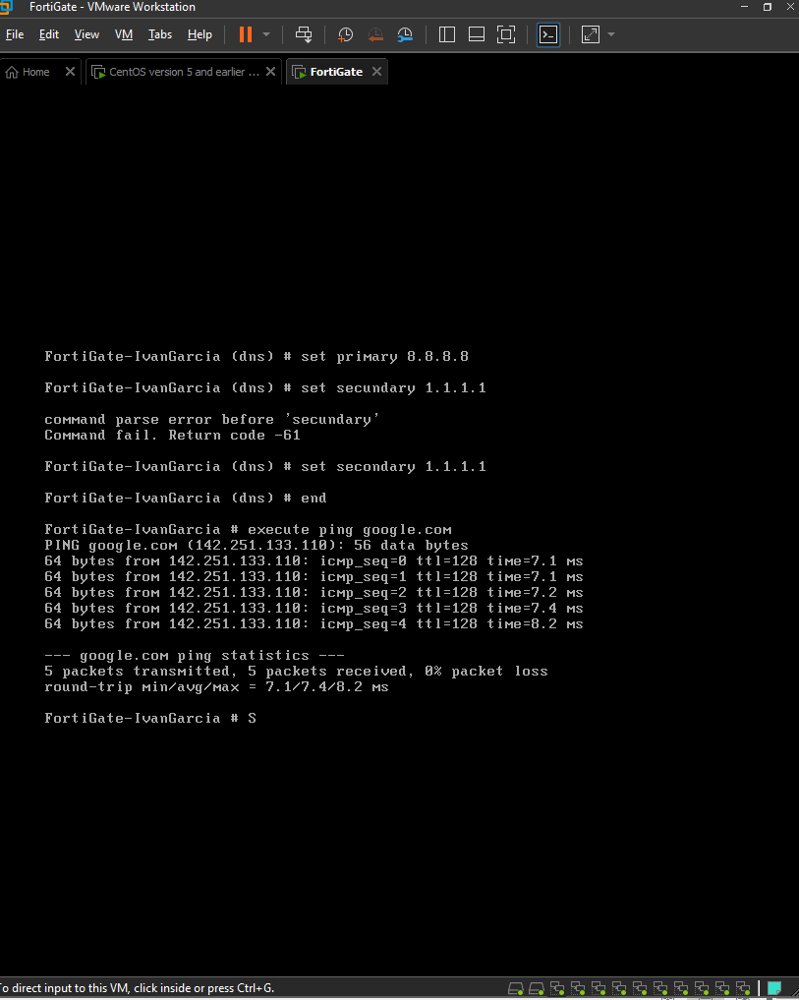

Posteriormente, desde el navegador del equipo anfitrión (máquina física), se comprobó el acceso a la interfaz gráfica de administración web (GUI) a través de HTTPS en la dirección de gestión `https://192.168.20.99`.

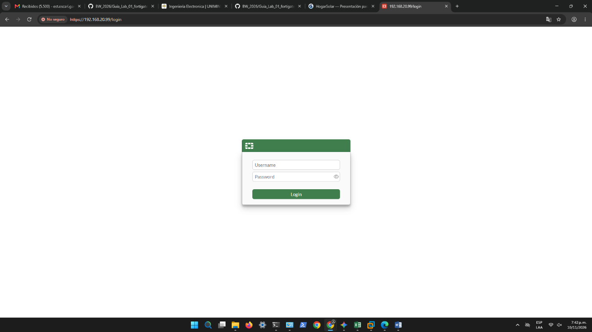

---

### 2. Segmentación LAN y Asignación de IP Estática en CentOS
Se aisló la red interna vinculando la interfaz `port3` del FortiGate y el adaptador de red de CentOS al mismo segmento privado (`LAN_FortiGate`). En CentOS se configuró direccionamiento IPv4 manual en la interfaz `ens33` con la IP estática **`192.168.10.5/24`** y puerta de enlace apuntando a `192.168.10.1`.

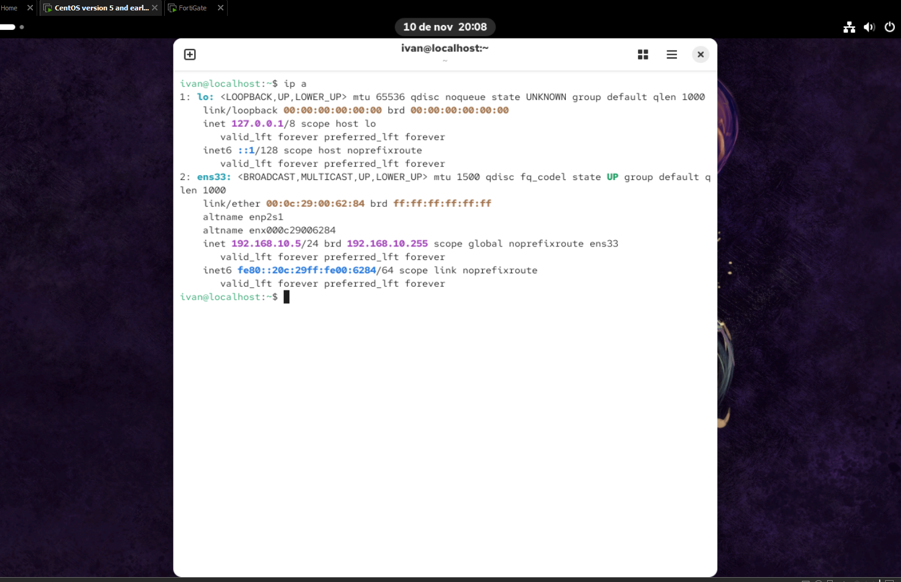

---

### 3. Creación y Ajuste de Política de Firewall (NAT)
Para permitir que los equipos de la red LAN (`port3`) naveguen hacia Internet (`port1`), se configuró la política de firewall **`Port3ToCentos`** bajo el siguiente esquema:
* **Incoming Interface:** `port3`
* **Outgoing Interface:** `port1`
* **Source / Destination / Service:** `all` / `all` / `ALL`
* **Action:** `ACCEPT`
* **NAT:** Habilitado (*Use Outgoing Interface Address*)

*Configuración inicial de interfaces en la política:*
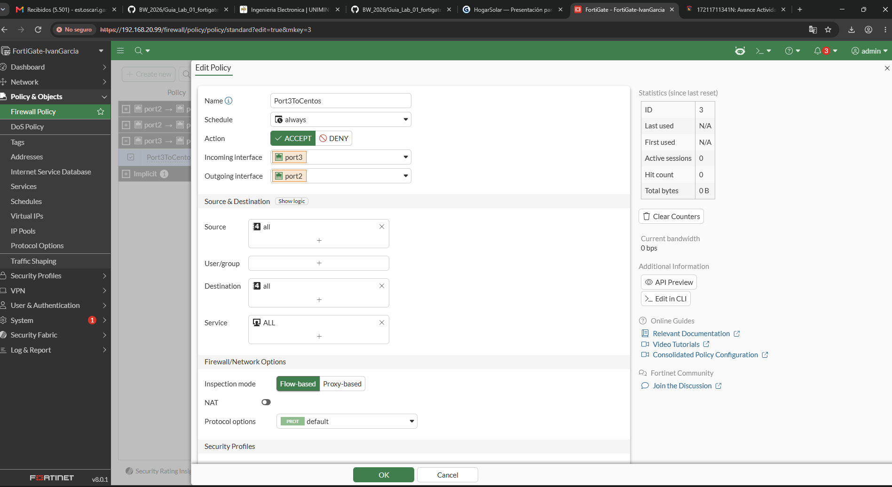

*Ajuste final hacia interfaz WAN (`port1`) con NAT activo y tráfico cursando:*
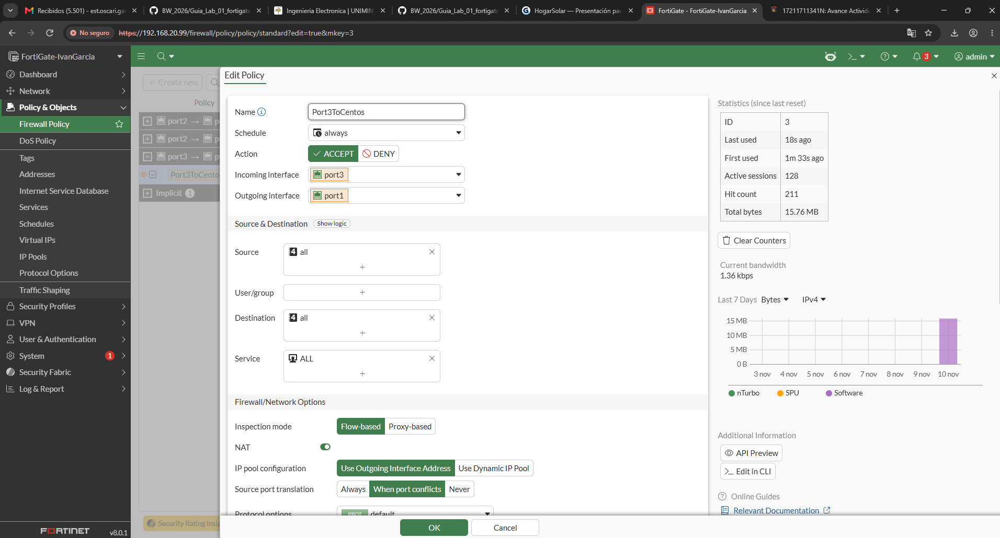

---

### 4. Validación de Conectividad de Red desde CentOS
Con la política activa, se ejecutaron pruebas de conectividad desde la máquina virtual CentOS:
1. **Salida a Internet:** Prueba de `ping google.com` exitosa con resolución DNS y respuesta continua.
   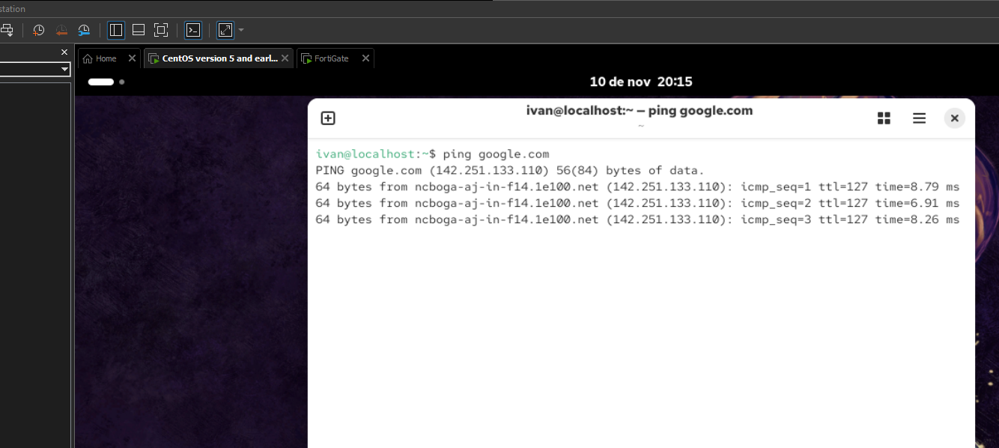
2. **Administración Local:** Acceso exitoso a la consola web del FortiGate directamente desde el navegador de CentOS utilizando la IP del gateway LAN (`https://192.168.10.1`).
   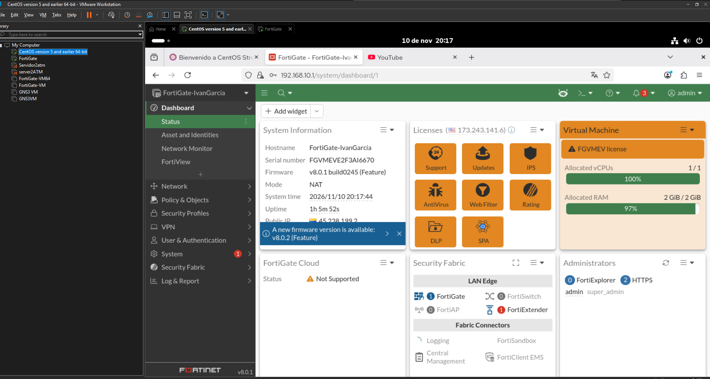

---

### 5. Despliegue de Servidor Centralizado de Logs (`rsyslog`) en CentOS
Se actualizó e instaló el demonio `rsyslog` en CentOS, habilitando su inicio automático con el sistema (`systemctl enable --now rsyslog`) y verificando su estado operativo (`active (running)`).

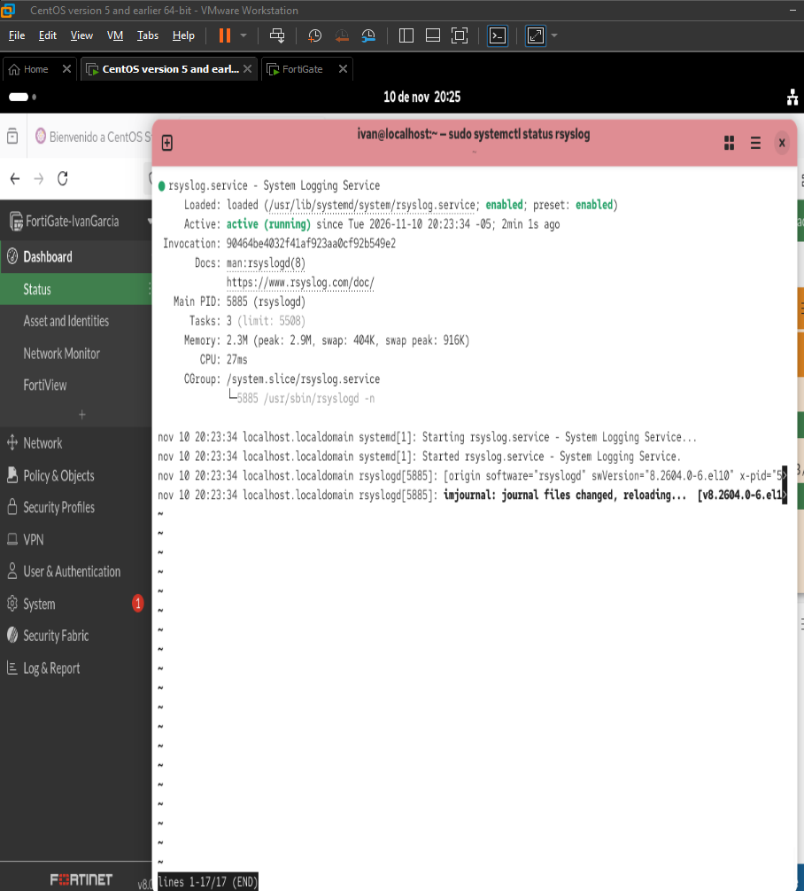

Se descomentarion los módulos de recepción **`imudp`** e **`imtcp`** en `/etc/rsyslog.conf` para escuchar en el puerto **514**, se agregaron las reglas correspondientes en `firewalld` y se verificó mediante `ss -tulnp | grep 514` que los sockets estuvieran activos en escucha.

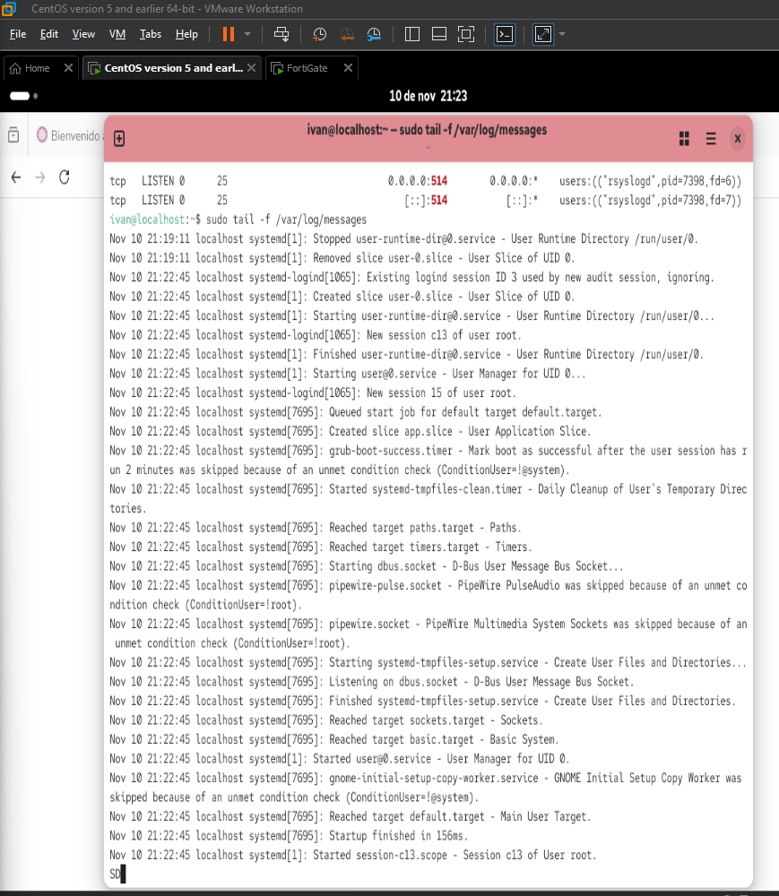

---

### 6. Integración Syslog en FortiGate y Validación de Registros
Desde la consola CLI del FortiGate se habilitó el envío remoto de logs (`config log syslogd setting`) apuntando a la dirección IP estática del servidor CentOS (`192.168.10.5`) mediante protocolo UDP en el puerto 514. *(Nota: Inicialmente se probó con `.50` y posteriormente se ajustó a la IP asignada `.5`)*.

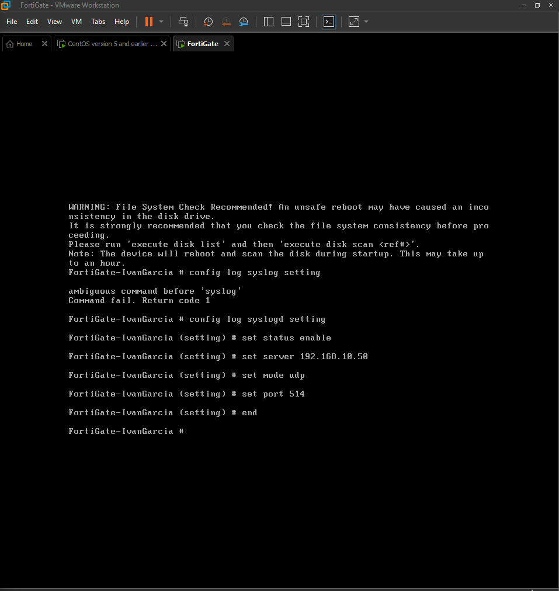

Se validó la conectividad directa entre el firewall y el servidor de logs (`execute ping 192.168.10.5`) obteniendo `0% packet loss`.

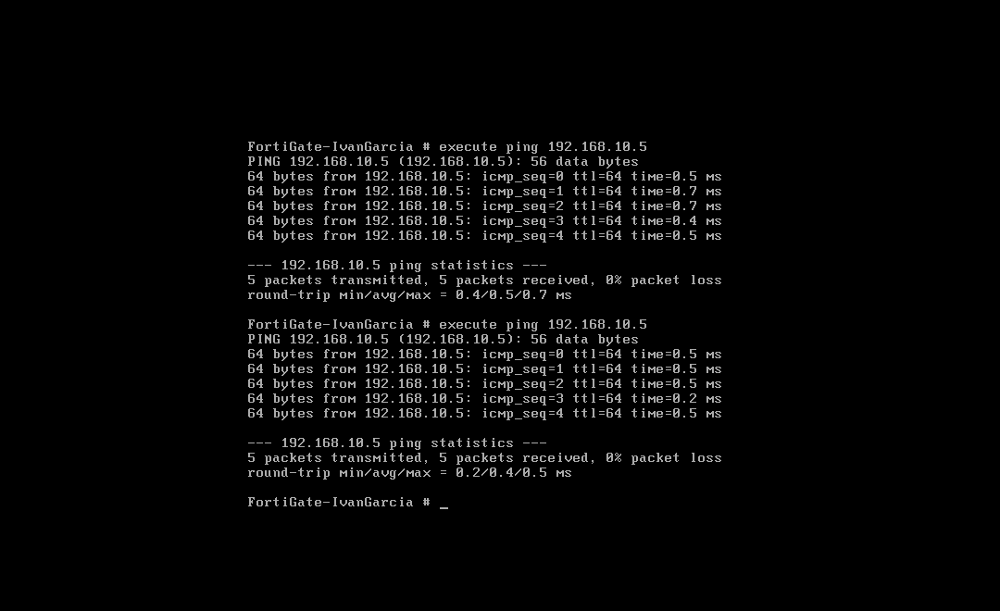

Finalmente, al monitorear el archivo `/var/log/messages` en CentOS, se comprobó la recepción en tiempo real de los registros de tráfico (`type="traffic"`) y eventos generados por `devname="FortiGate-IvanGarcia"`.

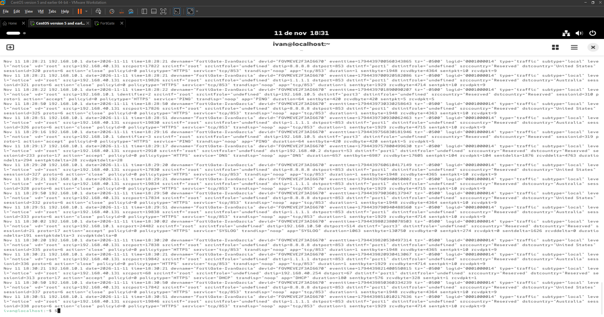

---

## 🛠️ Tecnologías Utilizadas
* **Hipervisor:** VMware Workstation Pro
* **Firewall / UTM:** FortiGate-VM (FortiOS v8.0.1)
* **Sistema Operativo Servidor:** CentOS Stream 10
* **Servicios y Protocolos:** NAT/PAT, Firewall Policies, Syslog (`rsyslog` sobre UDP/TCP 514), ICMP, HTTPS.
