# Laboratorio 01 de FortiGate VM y rsyslog

Juan Felipe Becerra Briceño  
Código 1701821  
Banda Ancha 2026 2  
Universidad Militar Nueva Granada  
11 de noviembre de 2026

## Resumen

Se puso en marcha FortiGate VM, se configuraron parámetros básicos de red y se comprobó la resolución de nombres y la conectividad ICMP desde el equipo. En CentOS Stream 10 se recuperó la conectividad al activar una segunda interfaz y se verificó que rsyslog estaba instalado, habilitado y en ejecución. Ambas pruebas finales de ping registraron cinco respuestas y 0 % de pérdida.

La configuración mostró dos aspectos por revisar: la puerta de enlace escrita para FortiGate no pertenece a la subred de port1 observada posteriormente y la consola presentó una advertencia de licencia. El servicio rsyslog quedó activo; la edición de reglas de reenvío no acredita por sí sola su carga ni la recepción de registros.

## Objetivo

Explorar la instalación y la configuración básica de FortiGate mediante una máquina virtual, verificar sus parámetros de red y comprobar el soporte de rsyslog en CentOS, conforme a la guía del laboratorio [1].

## Entorno y direccionamiento observado

| Componente | Dato registrado |
| --- | --- |
| FortiGate VM | FortiGate-VM64; administración por consola y SSH |
| port1 | DHCP; 172.31.7.63/20; máscara 255.255.240.0 |
| Ruta estática escrita | 0.0.0.0/0 por port1; gateway 172.17.20.1 |
| DNS de FortiGate | Primario 8.8.8.8; secundario 1.1.1.1 |
| Servidor Linux | CentOS Stream 10; usuario felipe |
| Interfaces de CentOS | ens33 192.168.232.135/24; ens36 172.17.20.122/24 |
| rsyslog | 8.2604.0-6.el10.x86_64; enabled y active (running) |

La versión exacta de FortiOS y el modo de conexión bridge del adaptador virtual requieren comprobación adicional. Las direcciones corresponden a las salidas capturadas durante la práctica; no constituyen una topología de tránsito validada.

## 1 Importación de la máquina virtual

Se identificaron los archivos del appliance FortiGate, incluido el descriptor FortiGate-VM64. La guía indica abrir el descriptor para iniciar la importación en VMware. La primera captura registra los archivos disponibles; la segunda muestra la etapa de aceptación del contrato de licencia.

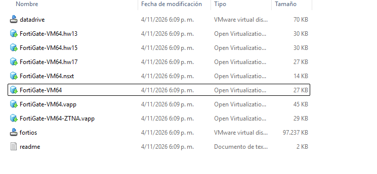

*Figura 1. Archivos de la máquina virtual y descriptor FortiGate-VM64 seleccionado.*

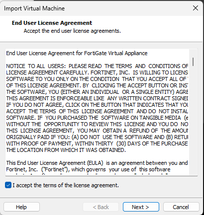

*Figura 2. Ventana de importación del appliance con la aceptación de licencia marcada.*

El acceso posterior a la consola confirma que el appliance llegó a ejecutarse. La validación del hash de descarga y los recursos finalmente asignados a la VM no quedan registrados en estas pantallas.

## 2 Acceso inicial y configuración de port1

Se ingresó con el usuario admin y se completó el flujo de cambio de contraseña exigido en el primer acceso, hasta obtener el prompt de FortiGate. La contraseña no se reproduce en el informe.

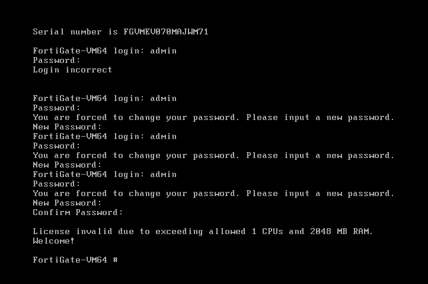

*Figura 3. Acceso a la CLI después del cambio de contraseña y advertencia de licencia.*

La consola informó que la licencia era inválida por exceder los límites permitidos de 1 CPU y 2048 MB de RAM. Este mensaje expresa los límites, pero no identifica la cantidad exacta de recursos asignados ni acredita que la condición se haya corregido.

En port1 se seleccionó DHCP y se habilitó el acceso mediante ping, HTTPS y HTTP. La salida posterior de interfaces confirma que se obtuvo una dirección IPv4 dinámica.

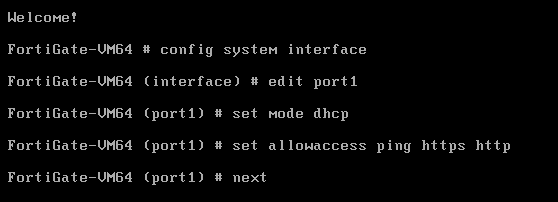

*Figura 4. Configuración de port1 con set mode dhcp y set allowaccess ping https http.*

## 3 Ruta predeterminada y servidores DNS

Se configuró una ruta predeterminada con salida por port1 y puerta de enlace 172.17.20.1. El destino mostrado es 0.0.0.0/0.

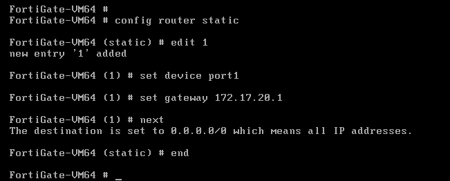

*Figura 5. Comandos de creación de la ruta estática predeterminada.*

Posteriormente se estableció una sesión SSH hacia admin@172.31.7.63. Desde esa sesión se configuraron los servidores DNS 8.8.8.8 y 1.1.1.1 como primario y secundario, respectivamente.

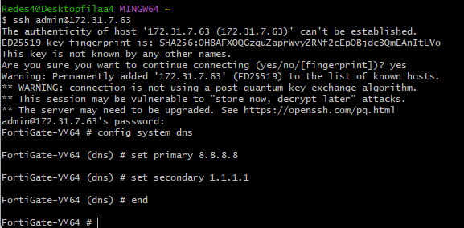

*Figura 6. Acceso SSH a FortiGate y configuración de los servidores DNS.*

La dirección 172.31.7.63/20 pertenece a 172.31.0.0/20, mientras que el gateway 172.17.20.1 está fuera de esa subred. Para determinar la ruta realmente utilizada se necesita consultar la tabla activa. Una interfaz DHCP también puede aprender una ruta predeterminada [2].

## 4 Pruebas de FortiGate

El comando execute ping google.com resolvió el nombre a 142.251.179.100 y obtuvo cinco respuestas de cinco solicitudes, con 0 % de pérdida. Los tiempos mínimo, promedio y máximo fueron 83.2, 83.4 y 83.6 ms, respectivamente.

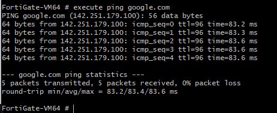

*Figura 7. Resolución de google.com y prueba ICMP exitosa desde FortiGate.*

La consulta get system interface physical mostró port1 en estado up y con la dirección 172.31.7.63 y máscara 255.255.240.0. port2 y port3 también aparecieron up, pero con 0.0.0.0 como dirección IPv4.

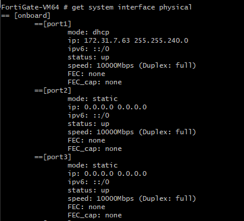

*Figura 8. Estado físico y direccionamiento de las interfaces de FortiGate.*

El ping acredita conectividad iniciada por el propio FortiGate y resolución del nombre durante la prueba. No permite deducir el funcionamiento de NAT o de políticas para tráfico de otros equipos [3]. El acceso a la interfaz web solicitado en la guía queda pendiente de acreditar.

## 5 Preparación de CentOS Stream 10

En CentOS se consultaron las interfaces con ip add. La interfaz ens33 se encontraba activa con la dirección dinámica 192.168.232.135/24. Esa dirección se utilizó para abrir una sesión SSH desde Windows con el usuario felipe.

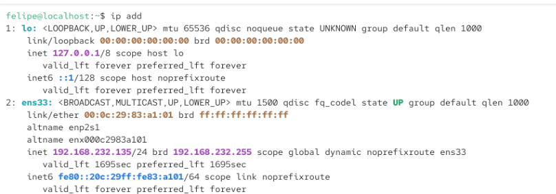

*Figura 9. Dirección IPv4 inicial de CentOS en la interfaz ens33.*

La ejecución de sudo dnf update falló al descargar los metadatos de CentOS Stream 10. La salida mostró Curl error 6 y la imposibilidad de resolver mirrors.centos.org. Por tanto, esta captura no corresponde a una actualización completada.

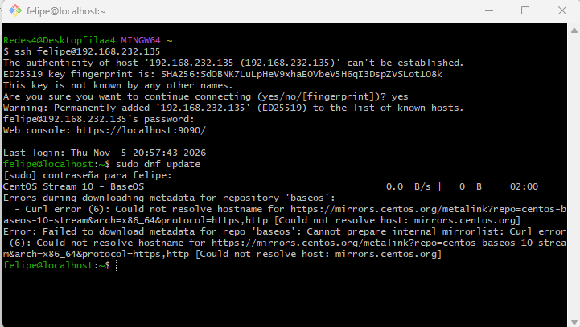

*Figura 10. Acceso SSH a CentOS y fallo de resolución de nombres durante dnf update.*

El error de resolución y el posterior mensaje de red inaccesible motivaron la revisión de las interfaces. La recuperación de conectividad IP se documenta en el siguiente apartado; no se registró una repetición exitosa de dnf update.

## 6 Recuperación de conectividad e instalación de rsyslog

El primer ping a 8.8.8.8 indicó que la red era inaccesible. El intento sudo nmcli connection up ens36 falló porque no existía una conexión con ese nombre. A continuación, sudo nmcli device connect ens36 activó el dispositivo y este obtuvo 172.17.20.122/24 mediante DHCP.

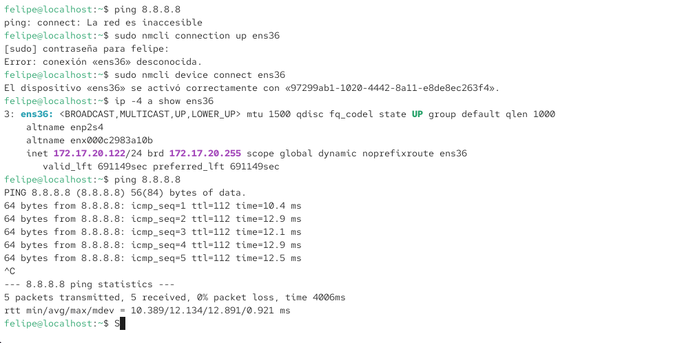

*Figura 11. Activación de ens36 y repetición exitosa del ping a 8.8.8.8.*

La prueba final registró cinco paquetes transmitidos y cinco recibidos, con 0 % de pérdida. El RTT mínimo/promedio/máximo fue 10.389/12.134/12.891 ms y la desviación, 0.921 ms. Al utilizar una dirección numérica, esta prueba verifica conectividad IP, sin confirmar la recuperación de DNS ni la ruta seguida a través de FortiGate.

Se ejecutó sudo dnf install -y rsyslog. El gestor informó que rsyslog-8.2604.0-6.el10.x86_64 ya estaba instalado, resolvió las dependencias y terminó sin acciones pendientes.

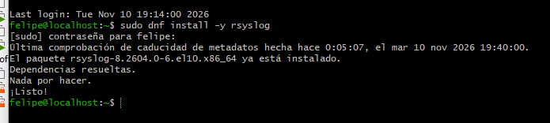

*Figura 12. Comprobación del paquete rsyslog instalado en CentOS.*

## 7 Estado del servicio y reglas de reenvío

Se ejecutaron sudo systemctl enable --now rsyslog y sudo systemctl status rsyslog. La salida mostró enabled y active (running), lo que confirma su habilitación para el arranque y su ejecución en ese momento.

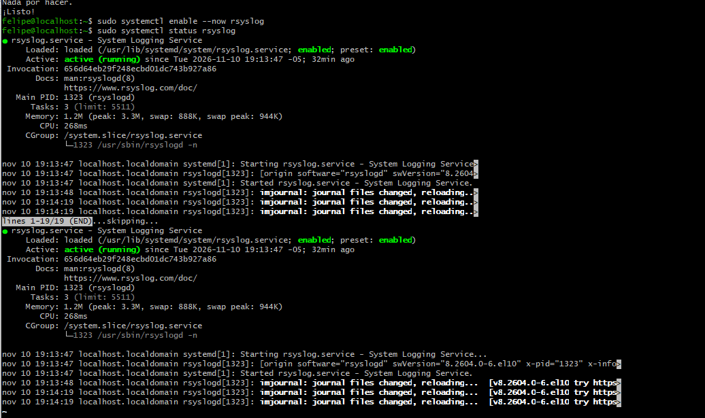

*Figura 13. Servicio rsyslog habilitado y activo en CentOS.*

En /etc/rsyslog.d/forward-to-central.conf se editaron dos acciones dirigidas a 192.168.1.9:514. La sintaxis con un signo @ corresponde a UDP; con dos signos @@ corresponde a TCP [4]. Si ambas reglas quedan activas, se definen dos acciones de envío para los mensajes coincidentes.

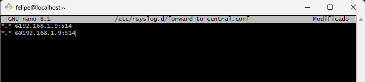

*Figura 14. Edición de reglas de reenvío UDP y TCP; nano indica Modificado.*

El estado Modificado no acredita el guardado ni la carga de la configuración. Las reglas mostradas son de salida: no habilitan un receptor syslog local. Además, 192.168.1.9 no coincide con las IP observadas de CentOS; su función como colector debe verificarse antes de emplearla como destino.

## 8 Resultados frente a la guía

La guía contempla la instalación de FortiGate, su configuración básica y una ampliación con rsyslog. Su alcance final indica validar el soporte de rsyslog [1]. La ejecución del servicio queda comprobada; la integración completa de registros requiere validaciones adicionales.

| Actividad | Resultado de la práctica | Evidencia |
| --- | --- | --- |
| Importación y acceso inicial | Appliance ejecutándose; cambio de contraseña y CLI disponibles. | Figuras 1 a 3 |
| DHCP y dirección de port1 | 172.31.7.63/20; interfaz up. | Figuras 4 y 8 |
| Ruta predeterminada | Configurada; gateway por contrastar con la subred y la tabla activa. | Figura 5 |
| DNS y ping de FortiGate | Nombre resuelto y 5 de 5 respuestas. | Figuras 6 y 7 |
| Acceso web y ajustes de GUI | Pendientes de acreditar. | Sin captura |
| Soporte de rsyslog | Paquete presente; servicio enabled y active (running). | Figuras 12 y 13 |
| Copia previa y receptor Linux | Pendientes de acreditar. | Sin captura |
| Envío remoto | Reglas editadas; guardado y carga por verificar. | Figura 14 |
| Syslog en FortiGate e IP fija del servidor | Pendientes de acreditar. | Sin captura |

## Análisis de las incidencias

La advertencia de licencia exige revisar los recursos de la VM y el licenciamiento aplicable. La discrepancia entre el gateway y la dirección de port1 debe resolverse consultando la tabla de rutas activa; el ping exitoso no identifica qué ruta se utilizó.

En CentOS se observó una recuperación de conectividad después de activar ens36. La prueba a 8.8.8.8 confirma respuesta IP, pero no permite concluir que el tráfico atravesara FortiGate. Para integrar el colector se necesita una dirección estable y alcanzable desde el firewall, como señala la guía.

Un receptor rsyslog necesita entradas configuradas para UDP o TCP, además de reglas que almacenen los mensajes [5]. El estado activo del demonio acredita el soporte del servicio, pero no sustituye la comprobación de puertos en escucha ni de eventos recibidos.

## 9 Conclusiones

La práctica permitió ejecutar FortiGate VM, administrar el equipo por consola y SSH, obtener una IP por DHCP y configurar servidores DNS. La respuesta a google.com con 0 % de pérdida verificó resolución de nombres y conectividad ICMP desde el firewall.

CentOS recuperó conectividad IP tras activar ens36. Se comprobó la presencia de rsyslog y su estado habilitado y activo, cumpliendo la comprobación de soporte del servicio planteada en la guía.

El montaje requiere revisar la licencia y la coherencia del gateway de FortiGate. Las reglas de reenvío quedaron documentadas en el editor, mientras que la recepción centralizada de eventos, la configuración syslog del firewall y la dirección estática del colector requieren evidencia adicional.

## Validaciones para cerrar la integración

Las siguientes comprobaciones son acciones propuestas; no corresponden a comandos ejecutados en las capturas. Deben acompañarse de acceso web, confirmación del adaptador bridge, copia de la configuración de rsyslog y definición de una IP fija válida para el servidor.

```text
FortiGate
get router info routing-table all
show router static
show full-configuration log syslogd setting

CentOS
sudo rsyslogd -N1
systemctl status rsyslog --no-pager
sudo ss -lntup
```

Tras guardar y cargar la configuración elegida, se debe generar un evento identificable y comprobar su recepción y almacenamiento en el colector. La validación de sintaxis y la existencia de un puerto en escucha no sustituyen esa evidencia.

## Referencias

[1] Jaider Ospina. Guía Lab 01 FortiGate VM JON. Repositorio BW_2026, revisión 724204e7.  
https://github.com/jaiderospina/BW_2026/blob/724204e711982345644f226c482cd2142b493964/Guia_Lab_01_fortigate_VM_JON/README.md

[2] Fortinet. DHCP addressing mode on an interface.  
https://docs.fortinet.com/document/fortigate/7.4.0/administration-guide/796636/dhcp-addressing-mode-on-an-interface

[3] Fortinet. Local out traffic.  
https://docs.fortinet.com/document/fortigate/7.4.6/administration-guide/848980

[4] rsyslog. Actions.  
https://docs.rsyslog.com/doc/configuration/actions.html

[5] rsyslog. UDP Syslog Input Module y TCP Syslog Input Module.  
https://docs.rsyslog.com/doc/configuration/modules/imudp.html  
https://docs.rsyslog.com/doc/configuration/modules/imtcp.html
