# Laboratorio 01 FortiGate VM y rsyslog

**Estudiante:** Julián Camilo Moreno Valderrama

**Código:** 1701805

**Asignatura:** Banda Ancha

**Fecha:** 5 de noviembre de 2026

## Objetivo

Configurar FortiGate en VMware, comprobar el acceso por navegador y enviar sus registros a un servidor Linux con rsyslog.

## 1. Equipos y conexión

Usé dos máquinas virtuales conectadas a la misma red de VMware.

| Equipo | Sistema | Interfaz | Dirección |
| --- | --- | --- | --- |
| FortiGate | FortiOS 7.2.9, build 1688 | port1 | `192.168.125.130/24`, obtenida por DHCP |
| Servidor de registros | Fedora 44 Workstation | ens160 | `192.168.125.10/24`, fija |
| Puerta de enlace de VMware | NAT de VMnet0 | — | `192.168.125.2` |

```text
                         Internet
                            |
                VMware NAT 192.168.125.2
                            |
                   VMnet0 192.168.125.0/24
                    |                   |
             FortiGate                Fedora
         192.168.125.130          192.168.125.10
                    |                   ^
                    +---- UDP 514 ------+
                            registros
```

**Adaptación de la guía:** usé Fedora 44 en lugar de CentOS Stream 10 y una red personalizada VMnet0 con NAT en lugar de puente. El puente no entregaba dirección por DHCP en este equipo. Con NAT pude conectar las dos máquinas y comprobar la salida a Internet. Fedora quedó como receptor final de los registros; no se configuró el reenvío desde Linux a un segundo colector.

**Red NAT y DHCP de VMware.**

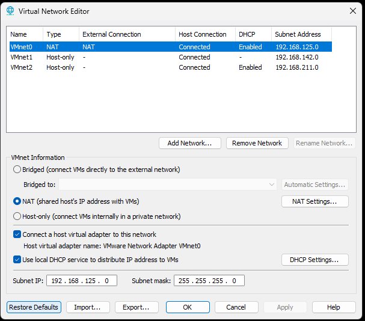

## 2. Preparación de la máquina FortiGate

Descargué la versión 7.2.9 para VMware desde el recurso indicado en la guía. El archivo utilizado fue:

```text
FGT_VM64-v7.2.9.M-build1688-FORTINET.out.ovf.zip
```

Calculé su SHA-256 desde PowerShell:

```powershell
Get-FileHash "$env:USERPROFILE\Downloads\FGT_VM64-v7.2.9.M-build1688-FORTINET.out.ovf.zip" -Algorithm SHA256
```

Resultado:

```text
7020C510519469E7061EF56B4A178742535CCAA745372896BD5FF13D3A4E8324
```

La lectura completa del ZIP terminó sin errores de integridad. La guía no publica un hash de referencia para compararlo; el valor anterior identifica el archivo local revisado.

Revisé el `readme.txt` incluido en el paquete. Allí se explican las diferencias de compatibilidad entre las plantillas OVF. Después de descomprimir el archivo e importar la máquina en VMware, comprobé el arranque de FortiOS 7.2.9. La VM quedó con **1 CPU y 2 GB de RAM**.

Entré por consola con el usuario `admin` y establecí una contraseña de administración.

## 3. Configuración de port1 por DHCP

En los ajustes de la nueva VM conecté el primer adaptador a **Custom → VMnet0 (NAT)**. En FortiGate configuré `port1` para recibir una IP y la puerta de enlace por DHCP. También habilité ping, HTTPS y SSH para las comprobaciones y la administración.

```text
config system interface
    edit "port1"
        set mode dhcp
        set defaultgw enable
        set allowaccess ping https ssh
    next
end
```

Consulté la dirección asignada:

```text
get system interface physical
```

El resultado mostró **port1 activa con `192.168.125.130/24`**.

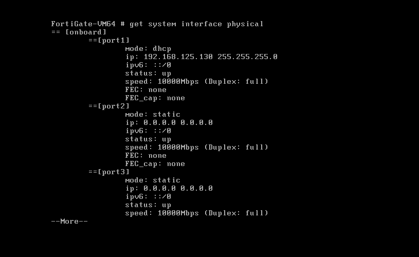

## 4. Ruta de salida y DNS

DHCP también entregó la puerta de enlace. Revisé la ruta con:

```text
get router info routing-table all
```

La tabla mostró la ruta **`0.0.0.0/0` por `192.168.125.2`, usando port1**.

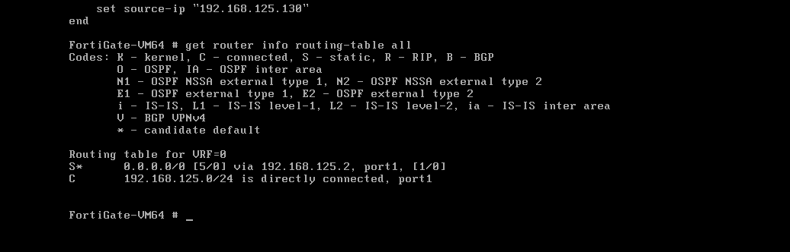

Configuré dos servidores DNS para resolver nombres de Internet:

```text
config system dns
    set primary 8.8.8.8
    set secondary 1.1.1.1
end
```

Comprobé la salida a Internet y la resolución de nombres:

```text
execute ping 8.8.8.8
execute ping example.com
```

El nombre `example.com` se resolvió y respondió los cinco paquetes, sin pérdidas. Esta prueba se hizo antes de completar la activación de la licencia.

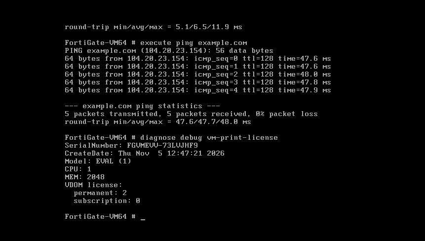

## 5. Acceso web y licencia

Desde el navegador del PC entré a:

```text
https://192.168.125.130
```

Activé la licencia de evaluación con mi cuenta FortiCare y pude acceder al panel de control. La evaluación permite trabajar con las limitaciones de la VM que muestra el panel.

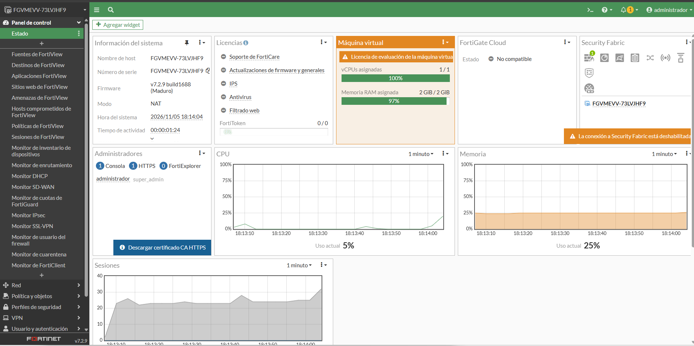

Comprobé el estado final desde la consola:

```text
get system status | grep "License Status"
```

El resultado fue **`License Status: Valid`**.

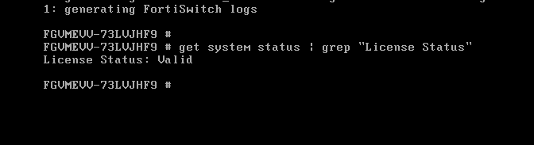

Para administrar por SSH desde PowerShell usé:

```powershell
ssh admin@192.168.125.130
```

## 6. IP fija del servidor Fedora

Verifiqué el sistema operativo y las interfaces:

```bash
cat /etc/os-release
ip -br a
```

La máquina utilizada tiene **Fedora Linux 44 Workstation** y la tarjeta de red se llama `ens160`.

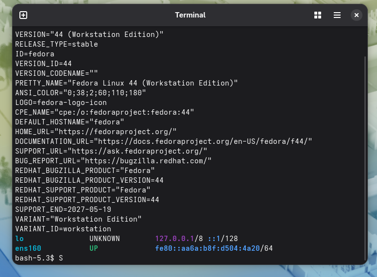

Conecté esta VM a **Custom → VMnet0 (NAT)**. Le asigné una IP fija para mantener estable la dirección del servidor de registros:

```bash
sudo nmcli connection modify "Conexión cableada 1" ipv4.method manual ipv4.addresses 192.168.125.10/24 ipv4.gateway 192.168.125.2 ipv4.dns "8.8.8.8 1.1.1.1"
sudo nmcli connection up "Conexión cableada 1"
```

Revisé la IP y probé la conexión con FortiGate y con Internet:

```bash
ip -4 -br a
ping -c 3 192.168.125.130
ping -c 3 example.com
```

Fedora quedó con **`192.168.125.10/24`**. Ambos pings respondieron los tres paquetes, sin pérdidas.

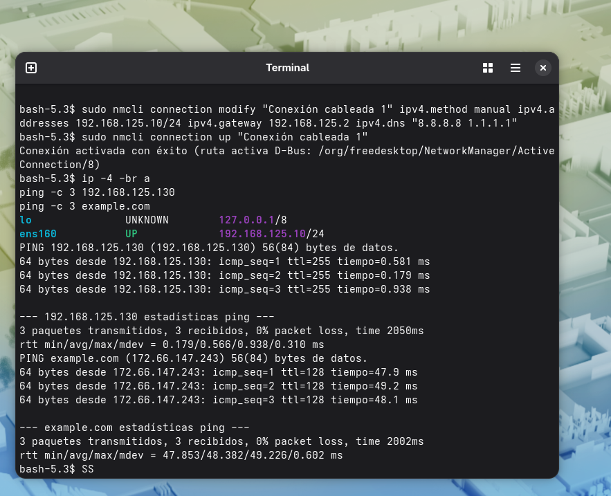

## 7. Instalación y arranque de rsyslog

Rsyslog permite recibir y guardar registros enviados por otros equipos. En Fedora ejecuté:

```bash
sudo dnf install -y rsyslog
sudo systemctl enable --now rsyslog
sudo systemctl status rsyslog --no-pager
```

El gestor de paquetes indicó que rsyslog ya estaba instalado. Después comprobé que el servicio estuviera **habilitado al arrancar** y en estado **`active (running)`**.

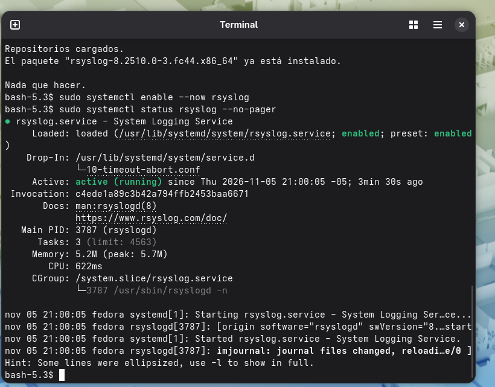

## 8. Recepción y almacenamiento de registros

Antes de agregar la configuración de recepción, hice una copia del archivo original:

```bash
sudo cp -a /etc/rsyslog.conf /etc/rsyslog.conf.bak
```

La configuración de recepción se agregó en un archivo separado, `/etc/rsyslog.d/10-fortigate.conf`. Habilité UDP y TCP en el puerto 514 y una regla para guardar los mensajes de FortiGate en `/var/log/fortigate.log`.

Pegué el siguiente bloque completo en la terminal:

```bash
sudo tee /etc/rsyslog.d/10-fortigate.conf > /dev/null <<'EOF'
module(load="imudp")
input(type="imudp" port="514")

module(load="imtcp")
input(type="imtcp" port="514")

if $fromhost-ip == "192.168.125.130" then {
    action(type="omfile" file="/var/log/fortigate.log")
    stop
}
EOF
```

La regla reconoce la IP de origen `192.168.125.130`. Si esa dirección cambia por DHCP, también debe actualizarse en esta regla y en la configuración de origen del envío.

## 9. Validación del servicio y apertura del puerto

Antes de reiniciar rsyslog comprobé la sintaxis:

```bash
sudo rsyslogd -N1
```

Terminó con **`End of config validation run. Bye.`**, sin errores. Después reinicié el servicio y permití el puerto 514 en el firewall de Fedora:

```bash
sudo systemctl restart rsyslog
sudo firewall-cmd --permanent --add-port=514/udp
sudo firewall-cmd --permanent --add-port=514/tcp
sudo firewall-cmd --reload
sudo ss -tulnp | grep ':514'
```

La consulta mostró a **rsyslog escuchando en UDP y TCP 514**. Para la comunicación con FortiGate utilicé UDP.

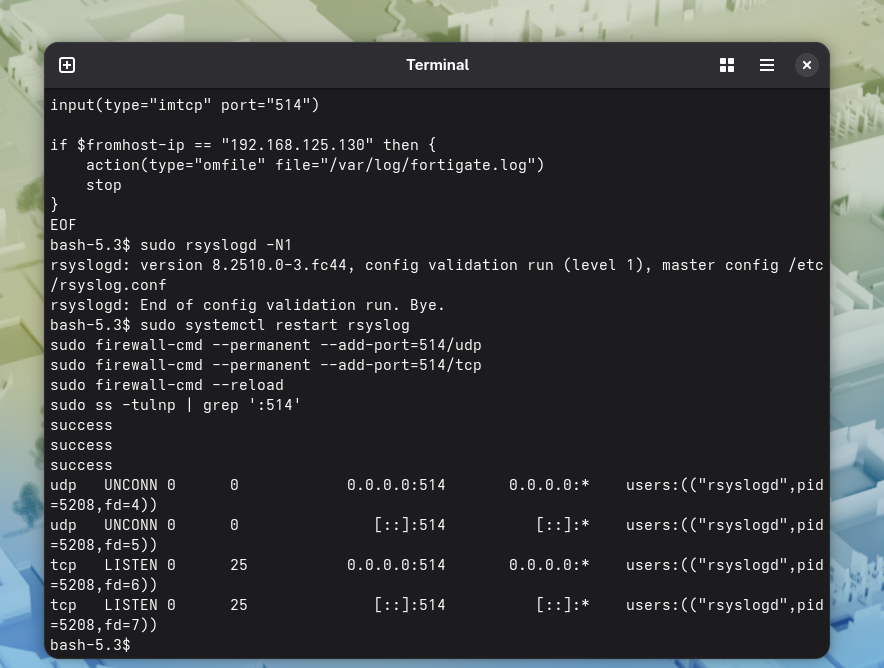

## 10. Envío de registros desde FortiGate

En FortiGate indiqué la IP del servidor Fedora, el protocolo UDP y el puerto 514. También fijé la dirección de origen utilizada para enviar los mensajes.

```text
config log syslogd setting
    set status enable
    set server "192.168.125.10"
    set mode udp
    set port 514
    set source-ip "192.168.125.130"
end

config log syslogd filter
    set severity information
end
```

Revisé el destino y el origen configurados:

```text
show log syslogd setting
```

La salida confirmó el envío habilitado al servidor **`192.168.125.10`**, desde **`192.168.125.130`**. Los valores que conservan su opción predeterminada, como UDP y el puerto 514, no aparecen en esta salida abreviada.

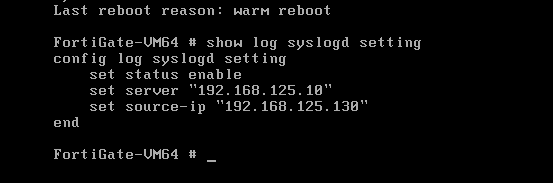

## 11. Prueba de envío y recepción

Generé registros de prueba desde la consola de FortiGate:

```text
diagnose log test
```

Este comando generó distintos tipos de eventos. **Los mensajes de virus, ataques y bloqueos de esta prueba son simulados; no demuestran que hayan ocurrido esos incidentes.**

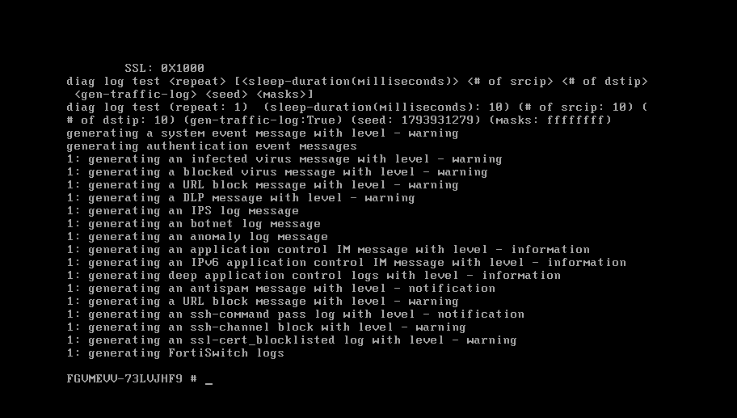

En Fedora consulté el archivo receptor:

```bash
sudo tail -n 20 /var/log/fortigate.log
```

Después de la activación y el reinicio de FortiGate volví a comprobarlo:

```bash
sudo tail -n 5 /var/log/fortigate.log
```

El archivo recibió mensajes nuevos con la dirección de origen **`192.168.125.130`** y el identificador de la VM. Esto confirmó que el envío remoto seguía funcionando.

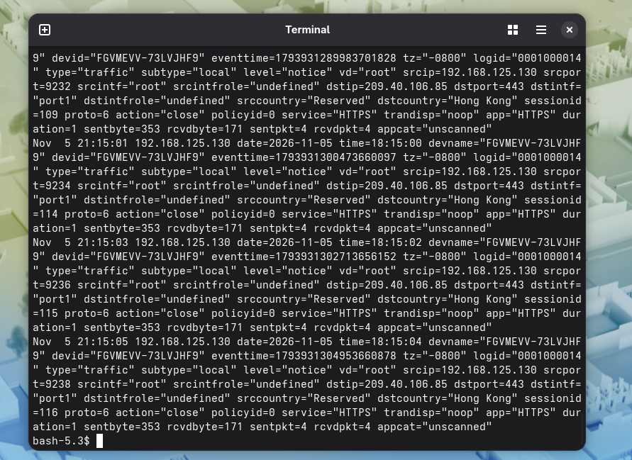

## 12. Resultados

| Comprobación | Resultado observado |
| --- | --- |
| Dirección de port1 | `192.168.125.130/24`, por DHCP |
| Ruta de salida | `0.0.0.0/0` por `192.168.125.2`, usando port1 |
| DNS y conectividad | Resolución de nombres y pings correctos |
| Administración por navegador | Acceso al panel de FortiOS 7.2.9 |
| Licencia de evaluación | `Valid` |
| IP del servidor Linux | `192.168.125.10/24`, fija |
| Servicio rsyslog | Habilitado y `active (running)` |
| Recepción del servidor | Escucha en UDP y TCP 514 |
| Comunicación comprobada | FortiGate → Fedora por UDP 514 |
| Archivo de registros | Mensajes recibidos en `/var/log/fortigate.log` |

Pude administrar FortiGate por navegador y comprobar su conexión con Internet. También configuré Fedora como servidor de registros y verifiqué que guardara los mensajes enviados por FortiGate, incluso después del reinicio por la activación de la licencia.

## Fuentes

- [Guía del laboratorio del profesor](../README.md).
- [Recurso de descarga indicado en la guía](https://virtualizacionyredes.blogspot.com/2021/07/descarga-maquina-virtual-fortigate.html).
- [Fortinet: configuración de syslog en FortiGate](https://community.fortinet.com/fortigate-3/technical-tip-how-to-configure-syslog-on-fortigate-177925).
- [Fortinet: registros generados con diagnose log test](https://community.fortinet.com/fortigate-3/technical-tip-logs-generated-while-using-the-diagnose-log-test-command-137093).
- [Rsyslog: recepción por UDP](https://docs.rsyslog.com/doc/configuration/modules/imudp.html) y [recepción por TCP](https://docs.rsyslog.com/doc/configuration/modules/imtcp.html).
