# Guia Lab 01 fortigate VM JON

https://medium.com/@dhruvpatel1112002/%EF%B8%8F-installing-fortigate-firewall-vm-free-evaluation-on-vmware-setting-up-syslog-on-ubuntu-d519961f9714

Lab 01

Propósito:

Explorar la instalación y configuración básica de Fortigate mediante el uso de máquina virtual.

Recursos:

Descarga de máquinas virtuales:

https://virtualizacionyredes.blogspot.com/2021/07/descarga-maquina-virtual-fortigate.html

Seleccionar la versión de interés, descargar , validar – hash-  y descomprimir.

Leer el README.txt

Dar doble clic en el fichero que se indica en la imagen.


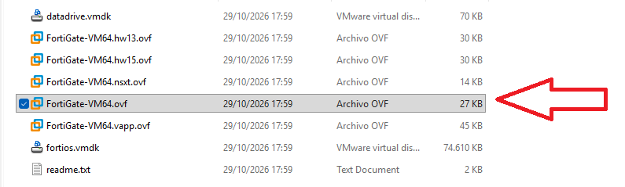

*Figura 01: Imagen 1*

Leer y aceptar términos.


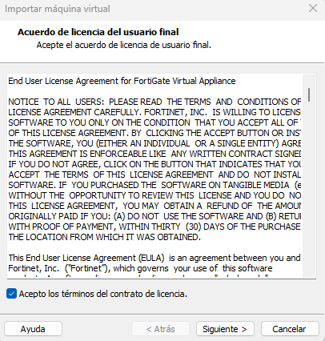

*Figura 02: Imagen 1*

Tras lo anterior se inicia el proceso de importación y una vez finalizado debe exhibirse una imagen similar a la siguiente:


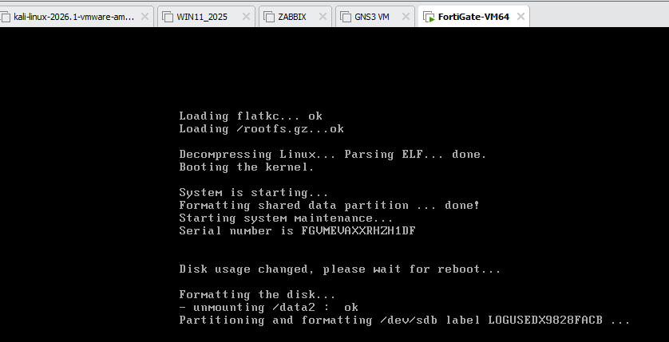

*Figura 03: Imagen 1*

NOTA: La máquina debe haber cargado con interfaz en bridge, en caso de no ser así es necesario asegurarse de ello.

Ingresar configuración:

Ingrese login = admin , password : enter y asignar un passsword.

Configure la interfaz para obtener IP por DHCP tal y como se observa en la imagen.


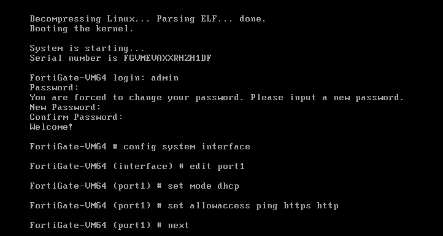

*Figura 04: Imagen 1*

Configure la ruta por defecto:

Ingrese los comandos mostrados en la imagen para configurar el Gateway como ruta por defecto.


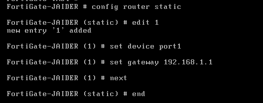

*Figura 05: Imagen 1*

Configurar su DNS.

Ingrese datos de servidores primario y secundario del servicio DNS


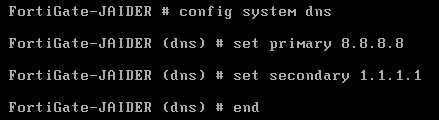

*Figura 06: Imagen 1*

Prueba:

Pruebe la aplicación de  las anteriores configuraciones mediante ping


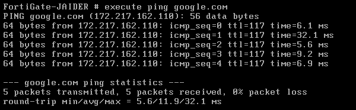

*Figura 07: Imagen 1*

Validar interfaz asignada:

Consulte la ip asignada por DHCP a su servidor


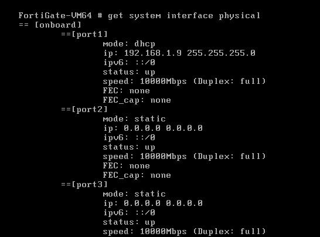

*Figura 08: Imagen 1*

Ingreso por browser:

Ingresar por navegador a la interfaz gráfica, conforme a la IP anteriormente consultada.


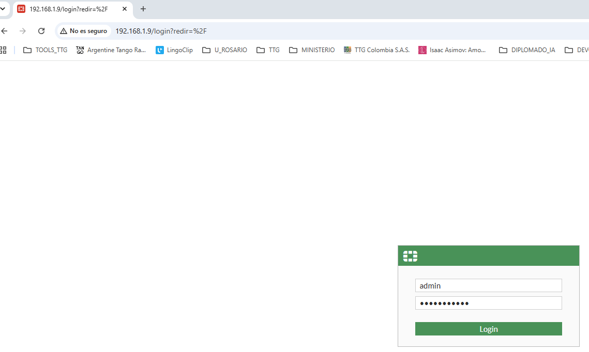

*Figura 09: Imagen 1*

Configure lo solicitado:, según aplique.


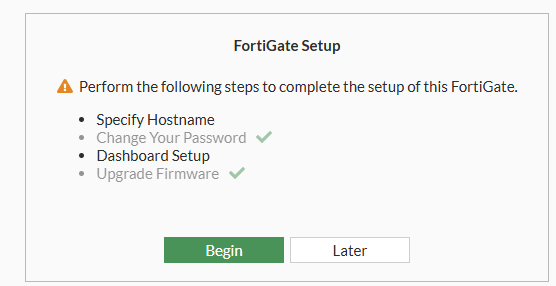

*Figura 10: Imagen 1*

**Ampliación de servicios.**

**rsyslog**

rsyslog es un demonio (servicio) de código abierto para sistemas Linux/Unix que gestiona el envío, recepción, filtrado y almacenamiento de logs del sistema. Es una versión mejorada y más potente del clásico syslog.

-  Instalación sobre Centos.
  
```bash
sudo apt update
sudo apt upgrade -y
sudo dnf install -y Rsyslog
```

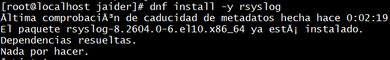

*Figura 11: Imagen 1*

Ver el estado del servicio:


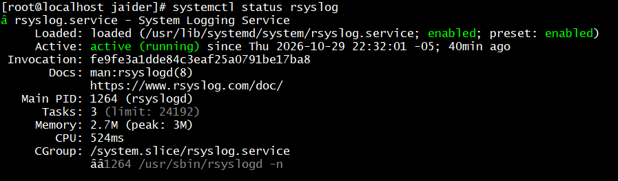

*Figura 12: Imagen 1*

Crear copia antes de modificación alguna.


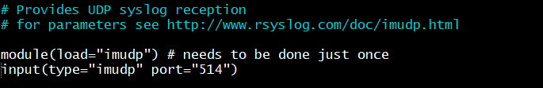

*Figura 13: Imagen 1*


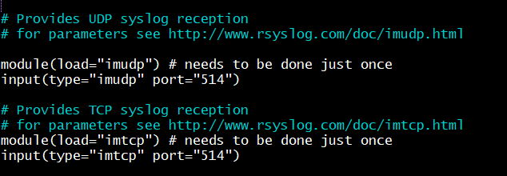

*Figura 14: Imagen 1*


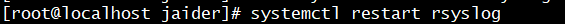

*Figura 15: Imagen 1*


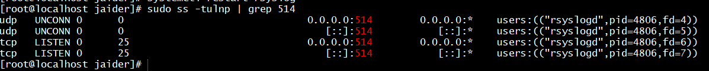

*Figura 16: Imagen 1*

**Envío remoto:**


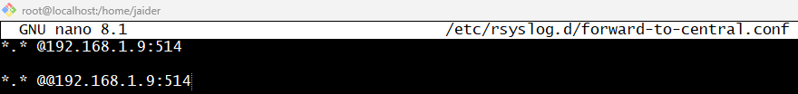

*Figura 17: Imagen 1*

Se cierra aceptando cambios.


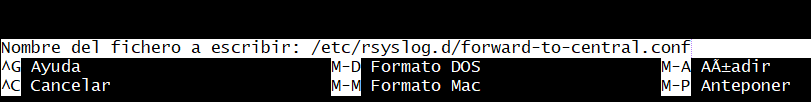

*Figura 18: Imagen 1*

---

## Configurar Fortigate para el servicio.

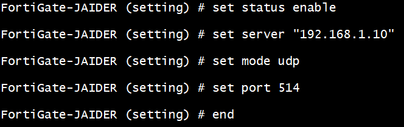

*Figura 19: Imagen 1*

Nota:  La ip configurada corresponde a un servidor, en este caso la MV Centos sobre la que previamente se habilitó syslog;  por ende su dirección debe ser de tipo **estático**. 

Para efectos de  este laboratorio, sólo se validará el soporte de Rsyslog; toda vez que para efectos prácticos un Fortigate se integraría a un SIEM (ELKElastic), como elemntos de cibersegurida encargados de:

- Buscar y filtrar losg.
- Detectar actividad maliciosa.
- Brindar base de conocimiento para analistas **SOC** ye informática forense.


