# Documentación del proyecto por fases

**Grupo 1 · Banda Ancha**  
**Integrantes:** Juan Felipe Becerra Briceño, Fabiana Lopez Piñeros y Julián Camilo Moreno Valderrama.

Este anexo explica cómo configuramos y probamos el laboratorio en GNS3. Las 33 capturas originales siguen el orden de las fases: preparación de las redes, conexión de los servicios y comprobación de los resultados. Cada fase incluye los comandos usados y explica qué muestra la evidencia. También se conservan los intentos que fallaron y las comprobaciones posteriores a los ajustes.

Las capturas conservan las direcciones que tenían los equipos en cada prueba. Algunas muestran PC1 con 10.10.10.100 y PC-SUC con 10.20.10.10. En la revisión final se registraron por DHCP 10.10.10.101 y 10.20.10.100, respectivamente. Para repetir las pruebas en VPCS, primero se ejecuta ip dhcp, luego show ip y después ping. Se usa la dirección recibida en esa nueva prueba, que puede ser distinta de la imagen.

[Informe principal](Informe_Proyecto_SD_WAN_Grupo_1.pdf) · [Anexo en Word](Anexo_Documentacion_Fases_Grupo_1.docx) · [Anexo en PDF](Anexo_Documentacion_Fases_Grupo_1.pdf)

## Recorrido de la documentación

- [Fase 1 · LAN, DHCP y salida a Internet](#fase-1)
- [Fase 2 · Segundo transporte y miembros SD-WAN](#fase-2)
- [Fase 3 · Caída y retorno de la salida a Internet](#fase-3)
- [Fase 4 · Calidad del enlace y selección por SLA](#fase-4)
- [Fase 5 · Segmento y servidor del Data Center](#fase-5)
- [Fase 6 · Túneles GRE y comunicación sucursal–DC](#fase-6)
- [Fase 7 · HTTP del DC y corrección de la política](#fase-7)
- [Fase 8 · Recuperación y retorno de HTTP del DC](#fase-8)
- [Fase 9 · Nube simulada y coincidencia de la regla SD-WAN](#fase-9)
- [Fase 10 · Perfil QoS y comparación de descargas](#fase-10)
- [Fase 11 · Acceso permitido en TCP 80 y prueba de TCP 8080](#fase-11)
- [Fase 12 · Supervisión central de los bordes](#fase-12)

## Fase 1

**LAN, DHCP y salida a Internet**

Configuramos port2 de cada FortiGate como puerta de enlace fija de su red local (LAN) y activamos DHCP para entregar direcciones a los clientes. También creamos las políticas de salida con NAT, que traducen las direcciones privadas al salir. Para comprobar cada VPCS, primero pedimos una dirección por DHCP y revisamos los datos recibidos. Después probamos la puerta de enlace y, desde PC1, la salida a Internet y la resolución de nombres por DNS.

**Comandos en VPCS — PC1:**

```text
ip dhcp
show ip
ping 10.10.10.1
ping 8.8.8.8
ping google.com
```

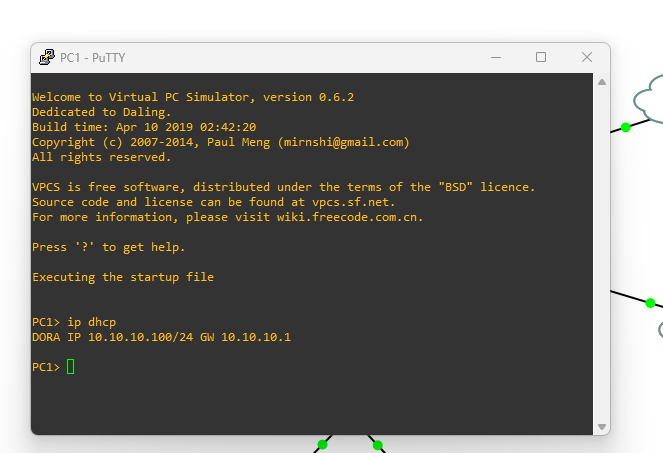

*Captura 01. PC1 solicita DHCP y recibe la concesión histórica 10.10.10.100/24 con gateway 10.10.10.1.*


*Captura 02. La consulta show ip confirma los datos de PC1 y el ping obtiene respuestas de su gateway 10.10.10.1.*

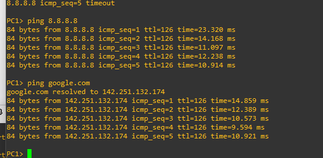

*Captura 03. PC1 recibe respuestas de 8.8.8.8 y resuelve el nombre google.com antes de recibir las respuestas ICMP de ese destino.*

**Resultado:** Las capturas muestran que PC1 recibió una dirección por DHCP, respondió su puerta de enlace y pudo llegar tanto a una IP externa como a un destino por nombre. La última revisión registró PC1 en 10.10.10.101/24 y PC-SUC en 10.20.10.100/24, con puertas de enlace 10.10.10.1 y 10.20.10.1.

**Aclaración:** Las imágenes 01–03 pertenecen a una prueba anterior y conservan PC1 en .100. Esa concesión no debe copiarse como una dirección fija. Para repetir las pruebas en ambos VPCS, primero se ejecutan ip dhcp y show ip; en PC-SUC se comprueba después ping 10.20.10.1.

**Registros que complementan la fase:**

- [README.md](README.md)
- [Comandos_utilizados.md](configs/Comandos_utilizados.md)
- [README.md](registros/README.md)

## Fase 2

**Segundo transporte y miembros SD-WAN**

Añadimos port3 como segundo camino WAN, llamado ISP2, y comprobamos que tuviera salida a Internet. Después agrupamos port1 y port3 en SD-WAN y revisamos sus puertas de enlace y rutas. Configuramos la selección según el cumplimiento del SLA, es decir, los límites de calidad definidos para el enlace, con costos 10 y 20.

**Comandos en FortiGate sede:**

```text
execute ping-options reset
execute ping-options interface port3
execute ping 8.8.8.8
diagnose sys sdwan member
get router info routing-table all
diagnose sys sdwan service 1
diagnose sys sdwan health-check
```

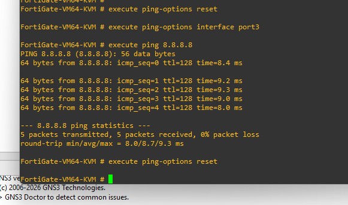

*Captura 04. El ping a 8.8.8.8 forzado por port3 recibe cinco respuestas y muestra 0 % de pérdida.*

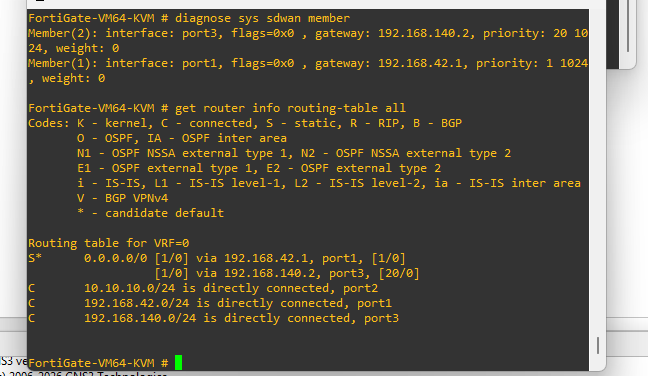

*Captura 05. El diagnóstico enumera port1 y port3 como miembros SD-WAN y la tabla muestra sus rutas por defecto.*

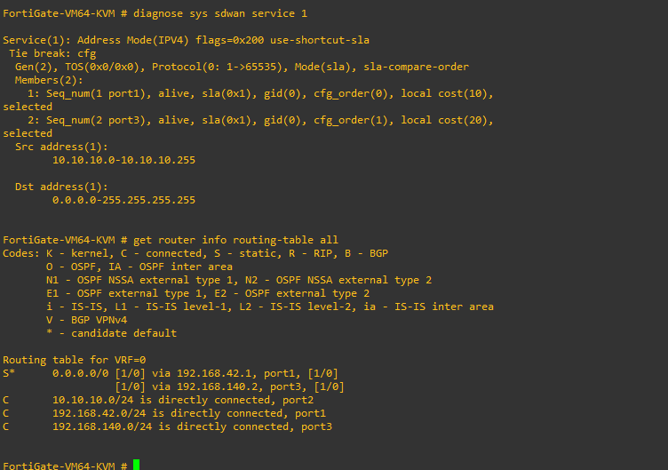

*Captura 08. La regla de servicio 1 muestra que ambos miembros cumplen el SLA, con costos locales 10 para port1 y 20 para port3.*

**Resultado:** Quedaron documentados los dos caminos WAN y su integración en SD-WAN. ISP1 usa el NAT de GNS3 e ISP2 utiliza nodos Cloud conectados a VMnet8.

**Aclaración:** La captura 05 muestra las prioridades de una etapa anterior. Para revisar los ajustes posteriores se deben consultar la captura 08 y los comandos guardados. Los dos caminos funcionan en el mismo entorno virtual; esta prueba no representa dos operadores físicos independientes.

**Registros que complementan la fase:**

- [Comandos_utilizados.md](configs/Comandos_utilizados.md)
- [Diagrama_logico.md](Diagrama_logico.md)
- [gestion-centralizada-fortigate.txt](registros/gestion-centralizada-fortigate.txt)

## Fase 3

**Caída y retorno de la salida a Internet**

Probamos la salida de PC1 cuando ISP1 no estaba disponible y la revisamos otra vez después de recuperarlo. Comparamos el estado del monitor con las capturas de paquetes para saber por cuál puerto salía el tráfico y qué traducción NAT se utilizaba en cada caso.

**Comandos en FortiGate sede:**

```text
diagnose sys sdwan health-check
diagnose sniffer packet any 'icmp and host 8.8.4.4' 4 0 l
diagnose sniffer packet any 'icmp and host 208.67.222.222' 4 0 l
get router info routing-table all
```

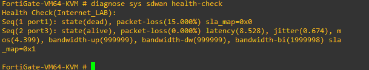

*Captura 10. Internet_LAB muestra port1 como dead, sin disponibilidad, y port3 como alive, disponible y con SLA válido.*

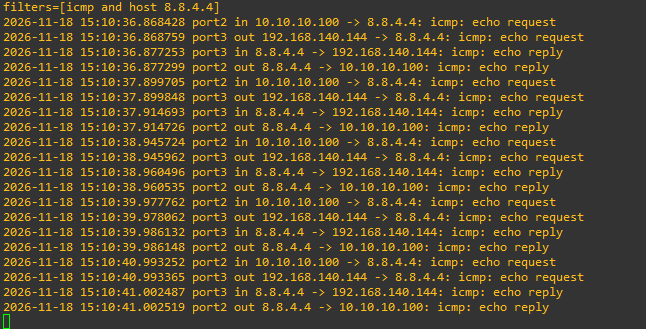

*Captura 11. La traza muestra el tráfico de PC1 hacia 8.8.4.4 saliendo por port3 con NAT a 192.168.140.144 y sus respuestas de vuelta.*

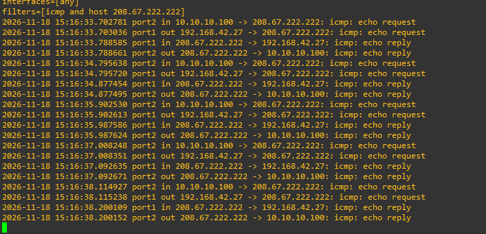

*Captura 15. Tras recuperar ISP1, la traza hacia 208.67.222.222 muestra salida por port1 con NAT a 192.168.42.27.*

**Resultado:** Durante la falla de ISP1, el tráfico hacia Internet salió por ISP2. Después se observó nuevamente la salida por ISP1. Las trazas muestran el puerto utilizado y las respuestas ICMP, por lo que permiten comprobar el recorrido además de la conectividad.

**Aclaración:** Esta fase comprueba Internet desde PC1 con su IP histórica .100. Medir la recuperación de HTTP del DC o comprobar el cambio de camino de la aplicación de nube requiere pruebas distintas; esta secuencia no demuestra esos resultados.

**Registros que complementan la fase:**

- [Comandos_utilizados.md](configs/Comandos_utilizados.md)
- [README.md](README.md)

## Fase 4

**Calidad del enlace y selección por SLA**

Primero guardamos una medición con los enlaces en buen estado. Luego activamos en GNS3 un filtro Delay de 200 ms y revisamos la latencia, el jitter o variación del retardo y la pérdida de paquetes. Comparamos esas medidas con los límites de Internet_LAB: 100 ms, 30 ms y 5 %. También capturamos el tráfico para revisar su salida durante la degradación y comprobamos el estado de los enlaces después de la reparación.

**Comandos en FortiGate sede:**

```text
diagnose sys sdwan health-check
diagnose sys sdwan service 1
diagnose sniffer packet any 'icmp and host 1.0.0.1' 4 0 l
get router info routing-table all
```

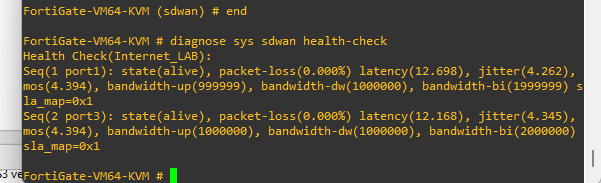

*Captura 07. La medición de referencia muestra port1 y port3 alive, sin pérdida y con SLA válido.*


*Captura 17. El filtro de paquetes de GNS3 muestra Delay activo con latencia configurada en 200 ms y jitter añadido de 0 ms.*

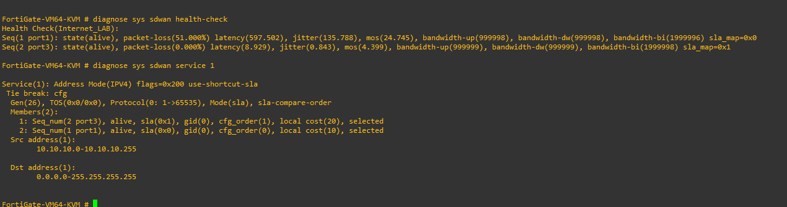

*Captura 19. Port1 sigue disponible, alive, pero supera los límites del SLA, con pérdida y latencia elevadas. Port3 conserva un SLA válido.*


*Captura 20. Durante la degradación, las solicitudes de PC1 hacia 1.0.0.1 salen por port3 y reciben respuestas.*

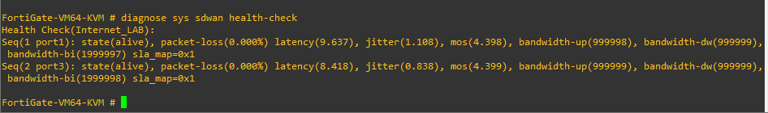

*Captura 26. Después de la reparación, ambos ISP vuelven a aparecer disponibles, alive, con 0 % de pérdida y SLA válido.*

**Resultado:** Las capturas muestran que un enlace puede estar disponible y aun así superar los límites de calidad configurados. Mientras ISP1 estaba degradado, observamos el tráfico de PC1 por ISP2. Después se recuperó el estado saludable de ambos caminos.

**Aclaración:** Los 200 ms corresponden al valor configurado en el filtro, no a la latencia final medida por el monitor. Durante el proceso también hubo problemas de conectividad y una reparación. Por eso no se atribuyen todos los fallos al filtro ni se presenta la secuencia como una prueba repetida bajo condiciones idénticas.

**Registros que complementan la fase:**

- [Comandos_utilizados.md](configs/Comandos_utilizados.md)
- [README.md](README.md)

## Fase 5

**Segmento y servidor del Data Center**

Creamos una red independiente para el centro de datos (DC) en port4 de la sede, con puerta de enlace 10.10.20.1/24. Asignamos 10.10.20.10/24 a DC-SRV y revisamos su interfaz y su ruta por defecto. Finalmente probamos la comunicación con la puerta de enlace.

**Comandos en FortiGate sede:**

```text
show system interface port4
```

**Comandos en DC-SRV:**

```text
ip -4 addr show dev eth0
ip route
ping -c 4 10.10.20.1
```


*Captura 32. Port4 aparece con alias DC, dirección 10.10.20.1/24 y acceso ping habilitado.*

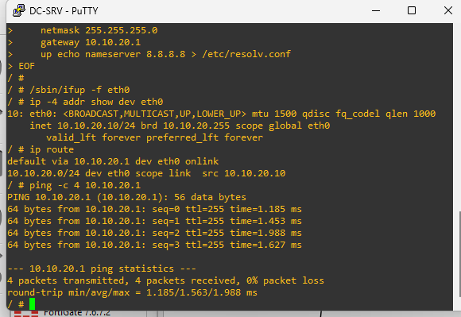

*Captura 35. DC-SRV muestra 10.10.20.10/24, ruta por defecto vía 10.10.20.1 y cuatro respuestas de ese gateway.*

**Resultado:** El servidor quedó en una red separada de los usuarios y obtuvo respuestas de su puerta de enlace, sin pérdida de paquetes en la prueba mostrada. Con esta conexión local comprobada, continuamos con los túneles y el servicio HTTP.

**Aclaración:** Estas imágenes comprueban la dirección y la conectividad local del servidor. El acceso HTTP y la comunicación desde la sucursal requieren las pruebas de las fases siguientes.

**Registros que complementan la fase:**

- [Comandos_utilizados.md](configs/Comandos_utilizados.md)
- [interfaces-DC-SRV.txt](configs/Referencias-tecnicas/docker-http-persistence/interfaces-DC-SRV.txt)
- [verification-after-restart.json](registros/verification-after-restart.json)

## Fase 6

**Túneles GRE y comunicación sucursal–DC**

Conectamos los equipos de borde mediante GRE-ISP1 y luego añadimos GRE-ISP2 como respaldo. Configuramos las rutas entre la red de sucursal y el DC, junto con las políticas que permiten ese tráfico. Para comprobar el recorrido, revisamos los túneles, hicimos ping y capturamos los paquetes.

**Comandos en VPCS — PC-SUC:**

```text
ip dhcp
show ip
ping 10.20.10.1
ping 10.10.20.10
```

**Comandos en FortiGate sede:**

```text
diagnose sys gre list
diagnose sniffer packet any 'icmp and host 10.20.10.10 and host 10.10.20.10' 4 20 1
```

**Comandos en FG-SUC:**

```text
diagnose sys gre keepalive all
get router info routing-table details 10.10.20.10
```


*Captura 38. El diagnóstico de sede identifica GRE-ISP1 con extremo local 192.168.42.27 y remoto 192.168.42.111.*

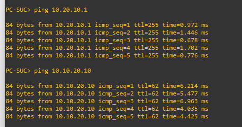

*Captura 41. PC-SUC obtiene respuestas de su gateway 10.20.10.1 y del servidor del DC 10.10.20.10.*


*Captura 42. La traza muestra solicitudes ICMP entrando por GRE-ISP1 y saliendo por port4, con respuestas de vuelta y las IP privadas conservadas.*

**Resultado:** La sucursal alcanzó el DC por GRE-ISP1 y conservó las direcciones privadas de origen y destino. La ruta principal quedó con distancia administrativa 10 y la alternativa GRE-ISP2 con distancia 20; estos valores permiten dar preferencia al primer camino.

**Aclaración:** Las capturas 41–42 corresponden a la prueba anterior de PC-SUC con IP estática 10.20.10.10. En la revisión final recibió .100 por DHCP. Al repetir en VPCS se empieza con ip dhcp y show ip. GRE transporta los paquetes mediante encapsulación, sin cifrarlos; estas capturas ICMP no comprueban HTTP ni confidencialidad.

**Registros que complementan la fase:**

- [Comandos_utilizados.md](configs/Comandos_utilizados.md)
- [README.md](README.md)
- [gestion-centralizada-fortigate.txt](registros/gestion-centralizada-fortigate.txt)

## Fase 7

**HTTP del DC y corrección de la política**

Creamos la página del DC e iniciamos el servidor BusyBox httpd. La página respondió en el propio servidor, pero la primera solicitud con curl desde la sucursal agotó el tiempo de espera. Revisamos FG-SUC y encontramos que SUC_PING_DC solo permitía PING. Añadimos HTTP a esa regla y repetimos la solicitud desde webterm1-2.

**Comandos en DC-SRV:**

```text
/gns3/bin/busybox httpd -p 10.10.20.10:80 -h /root/dc-web-lab
curl -fsS http://10.10.20.10/
```

**Comandos en webterm1-2:**

```text
ip route replace 10.10.20.0/24 via 10.20.10.1
curl -fsS --max-time 5 http://10.10.20.10/
```

**Comandos en FG-SUC:**

```text
show firewall policy | grep -f "SUC_PING_DC"
config firewall policy
    edit 2
        set service "PING" "HTTP"
    next
end
```


*Captura 43. DC-SRV inicia el servidor con la ruta completa de BusyBox y devuelve localmente el HTML de la página del DC.*

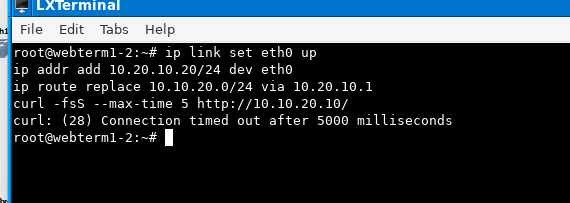

*Captura 44. La primera solicitud con curl desde webterm1-2 a 10.10.20.10 agota el tiempo de espera después de 5000 ms.*

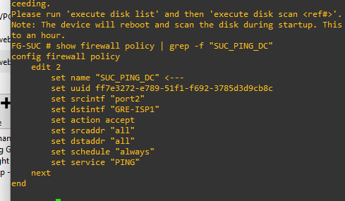

*Captura 45. La regla 2 SUC_PING_DC de FG-SUC muestra como único servicio permitido PING, antes de añadir HTTP.*

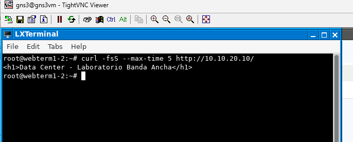

*Captura 48. Después de corregir la política, el cliente de sucursal recibe el HTML del Data Center.*

**Resultado:** Después de corregir la política, el cliente de sucursal pudo recibir la página del DC. Los archivos de interfaces guardan el inicio del servicio HTTP. Además, el registro posterior al arranque confirma HTTP 200 en las comprobaciones de DC-SRV y webterm1-2; ese código indica que la solicitud fue atendida correctamente.

**Aclaración:** Las capturas 44 y 45 muestran el fallo y la política antes de corregirla. La 48 muestra el contenido recibido, pero no una cabecera HTTP 200. El ID 2 pertenece a esta topología y debe comprobarse por nombre antes de reutilizar el bloque. Estos fragmentos de comandos no reemplazan la configuración completa del firewall.

**Registros que complementan la fase:**

- [Comandos_utilizados.md](configs/Comandos_utilizados.md)
- [interfaces-DC-SRV.txt](configs/Referencias-tecnicas/docker-http-persistence/interfaces-DC-SRV.txt)
- [verification-after-restart.json](registros/verification-after-restart.json)

## Fase 8

**Recuperación y retorno de HTTP del DC**

Desde la sucursal dejamos solicitudes HTTP repetidas hacia el DC y desactivamos port1 desde la configuración de FG-SUC. Revisamos si se instalaba la ruta de respaldo. Luego habilitamos port1 y comprobamos los mensajes keepalive, que permiten revisar si el túnel sigue activo, y el regreso de la ruta principal.

**Comandos en webterm1-2:**

```text
while true; do
  printf '%s ' "$(date +%H:%M:%S)"
  curl -s --max-time 2 -o /dev/null -w 'HTTP %{http_code}\n' http://10.10.20.10/
  sleep 1
done
```

**Comandos en FG-SUC:**

```text
config system interface
    edit "port1"
        set status down
    next
end
get router info routing-table all | grep "10.10.20.0"
config system interface
    edit "port1"
        set status up
    next
end
diagnose sys gre keepalive all
```

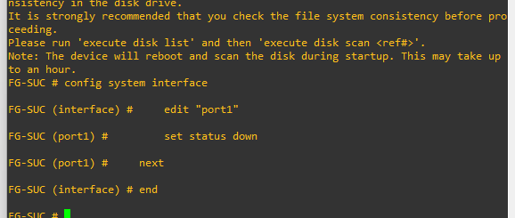

*Captura 50. FG-SUC desactiva administrativamente port1 mediante set status down.*


*Captura 51. El sondeo HTTP muestra respuestas 200, tres intentos con código 000 de curl sin respuesta HTTP y nuevos 200 desde las 01:28:16.*


*Captura 52. La ruta a 10.10.20.0/24 está activa por GRE-ISP2, vía 10.255.2.1 y con distancia 20.*


*Captura 54. Tras restaurar ISP1, el keepalive está alive y la ruta del DC vuelve a GRE-ISP1 con distancia 10.*

**Resultado:** El acceso HTTP al DC se recuperó por GRE-ISP2 y después volvió a utilizar GRE-ISP1. El primer intento fallido comenzó a las 01:28:09 y el primero nuevamente exitoso a las 01:28:16. Entre el inicio de ambos intentos transcurrieron siete segundos.

**Aclaración:** Los siete segundos se calculan entre el inicio de dos solicitudes HTTP. No se registró un instante exacto de caída del enlace para medir desde allí y tampoco se cronometró el retorno. Esta prueba corresponde al DC; no demuestra que la aplicación de nube se recupere ante la misma falla.

**Registros que complementan la fase:**

- [Comandos_utilizados.md](configs/Comandos_utilizados.md)
- [README.md](README.md)

## Fase 9

**Nube simulada y coincidencia de la regla SD-WAN**

Activamos HTTP en CLOUD-SRV y usamos CLOUD-EDGE como puerta de enlace y punto de entrada mediante socat. La primera solicitud a 192.168.42.84 recibió la página, pero no coincidió con la regla específica. Después probamos directamente el destino privado 10.30.10.10. Para ello usamos una ruta /32 vía CLOUD-EDGE, habilitamos el reenvío IPv4 y ajustamos el destino de HTTP_NUBE_ISP1.

**Comandos en CLOUD-SRV:**

```text
/gns3/bin/busybox httpd -p 10.30.10.10:80 -h /root/cloud-web
```

**Comandos en CLOUD-EDGE:**

```text
/bin/sh /root/cloud-ingress.sh
sysctl -w net.ipv4.ip_forward=1
```

**Comandos en webterm1-2:**

```text
curl -fsS --max-time 5 http://192.168.42.84/
ip route replace 10.30.10.10/32 via 10.20.10.1 dev eth0
curl --noproxy '*' -fsS --max-time 8 -o /dev/null -w 'HTTP %{http_code}\n' http://10.30.10.10/
```

**Comandos en FG-SUC:**

```text
get router info routing-table all | grep "10.30.10.10"
diagnose firewall proute list
```


*Captura 66. La solicitud inicial al frontal 192.168.42.84 recibe el HTML que identifica la nube simulada y CLOUD-SRV 10.30.10.10.*

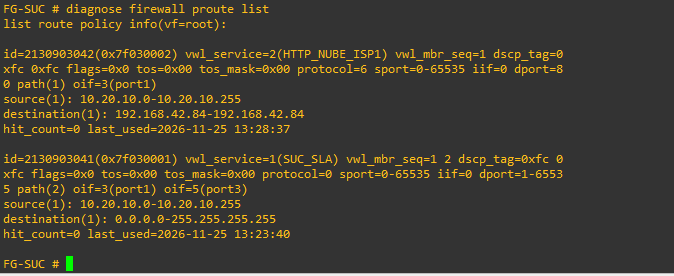

*Captura 67. En la prueba inicial, HTTP_NUBE_ISP1 sigue dirigida al punto de entrada .84 y conserva hit_count=0, sin coincidencias.*


*Captura 70. La prueba corregida muestra una ruta /32 a 10.30.10.10 por port1 y hit_count=1, una coincidencia en HTTP_NUBE_ISP1 para TCP 80.*

**Resultado:** Desde la sucursal, el destino enrutado 10.30.10.10 devolvió HTTP 200. La regla específica registró una coincidencia por el miembro 1, port1. El registro JSON conserva la respuesta HTTP y la captura 70 muestra la selección de la regla; las dos evidencias se complementan.

**Aclaración:** Las capturas 66–67 muestran el intento inicial al punto de entrada y no prueban una coincidencia con la regla. La 70 muestra la selección, pero no la respuesta HTTP. La nube funciona dentro del laboratorio y la regla clasifica por IP y puerto; no se comprobaron reconocimiento profundo de aplicaciones ni cambio de camino de la nube ante una falla. Los últimos ajustes persistentes se revisaron, pero no se reinició otra vez para comprobarlos.

**Registros que complementan la fase:**

- [Comandos_utilizados.md](configs/Comandos_utilizados.md)
- [interfaces-CLOUD-EDGE-routed-cloud.txt](configs/Referencias-tecnicas/cloud-lab/interfaces-CLOUD-EDGE-routed-cloud.txt)
- [interfaces-webterm1-2-routed-cloud.txt](configs/Referencias-tecnicas/cloud-lab/interfaces-webterm1-2-routed-cloud.txt)
- [cloud-ingress.sh](configs/Referencias-tecnicas/cloud-lab/cloud-ingress.sh)
- [wan-cloud-verification.json](registros/wan-cloud-verification.json)
- [sdwan-http-nube-destino-enrutado.json](registros/sdwan-http-nube-destino-enrutado.json)

## Fase 10

**Perfil QoS y comparación de descargas**

Preparamos un archivo de 4 MiB en el DC y otro de 16 MiB en la nube para comparar descargas simultáneas desde la sucursal. En port2 de FG-SUC declaramos primero 8000 y después 4000 kbps. Aplicamos la política de retorno QOS_HTTP_DC y revisamos por separado si una sesión tenía asociado el perfil QOS_DC_ALTA.

**Comandos en DC-SRV:**

```text
dd if=/dev/zero of=/root/dc-web-lab/archivo-qos-dc.bin bs=1M count=4
```

**Comandos en FG-SUC:**

```text
config system interface
    edit "port2"
        set outbandwidth 8000
    next
end
config system interface
    edit "port2"
        set outbandwidth 4000
    next
end
config firewall shaping-policy
    edit 1
        set status disable
    next
end
config firewall shaping-policy
    edit 1
        set status enable
    next
end
diagnose sys session list
```

**Comandos en webterm1-2:**

```text
curl -fsS --max-time 90 -o /dev/null -w 'NUBE: HTTP %{http_code} | %{size_download} bytes | %{time_total} s\n' http://192.168.42.84/archivo-qos.bin &
nube=$!
sleep 1
curl -fsS --max-time 90 -o /dev/null -w 'DC: HTTP %{http_code} | %{size_download} bytes | %{time_total} s\n' http://10.10.20.10/archivo-qos-dc.bin
wait "$nube"
```

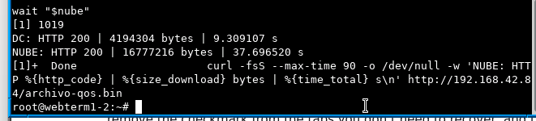

*Captura 61. La referencia de 8000 kbps registra HTTP 200 y tiempos de 9.309107 s para el DC y 37.696520 s para la nube.*


*Captura 62. La segunda corrida de 8000 kbps registra 10.015249 s para el DC y 41.731214 s para la nube, ambas con HTTP 200.*


*Captura 64. La corrida de 4000 kbps termina ambas descargas con HTTP 200: DC en 22.543627 s y nube en 81.394839 s.*

**Resultado:** El diagnóstico de sesión mostró reply-shaper QOS_DC_ALTA y shaping_policy_id 1, lo que confirma la asignación del perfil de calidad de servicio (QoS). Las descargas no fueron más rápidas: a 8000 kbps el DC pasó de 9.309107 a 10.015249 s y la nube de 37.696520 a 41.731214 s. A 4000 kbps el DC pasó de 21.120041 a 22.543627 s: tardó 1.424 s más, equivalente a 6.74 %.

**Aclaración:** La captura 62 muestra los tiempos de descarga; la asignación del shaper o perfil que regula el tráfico se comprueba en el registro de sesión. Para ordenar las corridas de 4000 kbps se usó la confirmación del registro, y falta una referencia completa de nube sin prioridad. Las repeticiones controladas fueron insuficientes para afirmar una mejora. El tiempo total de curl tampoco es una medida del jitter de la red.

**Registros que complementan la fase:**

- [Comandos_utilizados.md](configs/Comandos_utilizados.md)
- [shaper-session-check.json](registros/shaper-session-check.json)
- [comparacion-4Mbps.json](registros/comparacion-4Mbps.json)

## Fase 11

**Acceso permitido en TCP 80 y prueba de TCP 8080**

Iniciamos temporalmente un servicio HTTP del DC en el puerto TCP 8080 y comprobamos que respondiera en el propio servidor. Después probamos desde la sucursal los puertos TCP 80 y TCP 8080, con un tiempo máximo de espera. Al terminar retiramos el servicio temporal. Esta prueba se conserva en un archivo JSON, sin una captura PNG adicional.

**Comandos en DC-SRV:**

```text
/gns3/bin/busybox timeout 35 /gns3/bin/busybox httpd -f -p 10.10.20.10:8080 -h /root/dc-web-lab
curl --noproxy "*" -fsS --max-time 2 -o /dev/null -w "DC_LOCAL_8080=%{http_code}\n" http://10.10.20.10:8080/
```

**Comandos en webterm1-2:**

```text
ip -4 route get 10.10.20.10
curl --noproxy "*" -fsS --max-time 5 -o /dev/null -w "SUC_80=%{http_code}\n" http://10.10.20.10/
curl --noproxy "*" -fsS --connect-timeout 3 --max-time 5 -o /dev/null -w "SUC_8080=%{http_code}\n" http://10.10.20.10:8080/
```

**Resultado:** El servicio en TCP 8080 devolvió HTTP 200 en la prueba local y TCP 80 devolvió HTTP 200 desde la sucursal. En cambio, la solicitud desde sucursal a TCP 8080 agotó la espera después de 3001 ms, con código de salida curl 28. El registro también incluye la retirada del servicio de prueba.

**Aclaración:** La orden de httpd forma parte del lanzamiento temporal guardado; no es un script autónomo. La prueba muestra que el acceso desde sucursal fue distinto para los dos puertos. No se puede identificar cuál de los dos FortiGate descartó TCP 8080 porque no se guardó el registro de descarte de esa ejecución.

**Registros que complementan la fase:**

- [tcp-80-vs-8080.json](registros/tcp-80-vs-8080.json)
- [Comandos_utilizados.md](configs/Comandos_utilizados.md)

## Fase 12

**Supervisión central de los bordes**

Usamos gestionar-bordes.ps1 para consultar desde un punto central los miembros SD-WAN, el estado de los enlaces y el keepalive GRE de la sede y FG-SUC. Antes de ejecutarlo, ambas consolas deben tener una sesión iniciada y mostrar el prompt listo para recibir órdenes. El script solo consulta estados. Sus ejecuciones se documentan mediante archivos TXT, sin una captura PNG adicional.

**Comandos en Windows — PowerShell:**

```text
powershell.exe -NoProfile -ExecutionPolicy RemoteSigned -File .\configs\gestionar-bordes.ps1 -EsperaPromptSegundos 2 -SondearPrompt
```

**Comandos en FortiGate sede y FG-SUC — consultas enviadas por el script:**

```text
diagnose sys sdwan member
diagnose sys sdwan health-check
diagnose sys gre keepalive all
```

**Resultado:** El registro histórico de las 16:44 contiene seis lecturas: tres por cada FortiGate. En la revisión posterior de las 19:05 solo se completaron las tres consultas de FG-SUC, porque la consola de sede no tenía el prompt listo.

**Aclaración:** El intento previo de las 16:38 omitió equipos por falta de inicio de sesión o de un prompt listo, por lo que no se cuenta como una ejecución exitosa. La revisión de tres lecturas no reemplaza la ejecución histórica de seis. El resultado demuestra supervisión central de solo lectura; el script no distribuye ni sincroniza políticas.

**Registros que complementan la fase:**

- [gestionar-bordes.ps1](configs/gestionar-bordes.ps1)
- [gestion-centralizada-fortigate.txt](registros/gestion-centralizada-fortigate.txt)
- [gestion-inventario-verificacion.txt](registros/gestion-inventario-verificacion.txt)
- [README.md](registros/README.md)

## Cierre de la documentación

Las capturas y los registros permiten seguir los ajustes del montaje y comprobar sus resultados. GRE funcionó sin cifrado, las mediciones de QoS no mostraron una mejora y la consulta central fue de solo lectura. Falta anexar la exportación de GNS3 y el video. También se debe importar el proyecto completo y comprobar su arranque para verificar que se pueda restaurar.

[Volver a la entrega del grupo 1](README.md)
