# Documentación del proyecto por fases

**Grupo 1 · Banda Ancha**  
**Integrantes:** Juan Felipe Becerra Briceño, Fabiana Lopez Piñeros y Julián Camilo Moreno Valderrama.

Este anexo muestra el procedimiento del laboratorio mediante 33 capturas originales, ordenadas por fases. En cada fase se explica qué hicimos, qué comandos utilizamos y qué resultado se observó. Incluimos los fallos intermedios que ayudaron a encontrar una causa y su comprobación posterior.

Las capturas conservan las direcciones de su prueba. Algunas usan PC1 10.10.10.100 y PC-SUC 10.20.10.10; la revisión final registró DHCP en 10.10.10.101 y 10.20.10.100, respectivamente. Para repetir las pruebas actuales en VPCS, primero se ejecuta ip dhcp, luego show ip y después ping. No se vuelve a fijar una IP antigua solo para copiar la imagen.

[Informe principal](Informe_Proyecto_SD_WAN_Grupo_1.pdf) · [Anexo en Word](Anexo_Documentacion_Fases_Grupo_1.docx) · [Anexo en PDF](Anexo_Documentacion_Fases_Grupo_1.pdf)

## Recorrido de la documentación

- [Fase 1 · LAN, DHCP y salida a Internet](#fase-1)
- [Fase 2 · Segundo transporte y miembros SD-WAN](#fase-2)
- [Fase 3 · Caída y retorno de la salida a Internet](#fase-3)
- [Fase 4 · Calidad del enlace y selección por SLA](#fase-4)
- [Fase 5 · Segmento y servidor del Data Center](#fase-5)
- [Fase 6 · Túneles GRE y comunicación sucursal–DC](#fase-6)
- [Fase 7 · HTTP del DC y corrección de la política](#fase-7)
- [Fase 8 · Recuperación y retorno de HTTP del DC](#fase-8)
- [Fase 9 · Nube simulada y coincidencia de la regla SD-WAN](#fase-9)
- [Fase 10 · Perfil QoS y comparación de descargas](#fase-10)
- [Fase 11 · Acceso permitido en TCP 80 y prueba de TCP 8080](#fase-11)
- [Fase 12 · Supervisión central de los bordes](#fase-12)

## Fase 1

**LAN, DHCP y salida a Internet**

Se configuró port2 de cada FortiGate como gateway fijo de su LAN y servidor DHCP, junto con las políticas de salida con NAT. En VPCS, el primer paso para comprobar los clientes es pedir DHCP y revisar la concesión; después se prueba el gateway y, desde PC1, Internet y DNS.

**Comandos en VPCS — PC1:**

```text
ip dhcp
show ip
ping 10.10.10.1
ping 8.8.8.8
ping google.com
```


*Captura 01. PC1 solicita DHCP y recibe la concesión histórica 10.10.10.100/24 con gateway 10.10.10.1.*

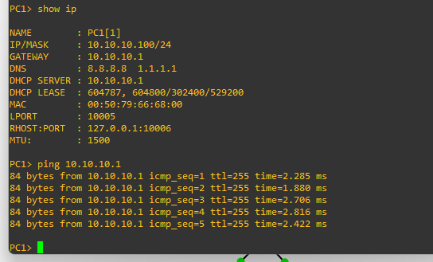

*Captura 02. La consulta show ip confirma los datos de PC1 y el ping obtiene respuestas de su gateway 10.10.10.1.*


*Captura 03. PC1 obtiene respuestas de 8.8.8.8 y resuelve google.com antes de recibir sus respuestas ICMP.*

**Resultado:** Las capturas acreditan DHCP, comunicación con el gateway y salida de PC1 a una IP externa y a un nombre. La última revisión registró PC1 en 10.10.10.101/24 y PC-SUC en 10.20.10.100/24, con gateways 10.10.10.1 y 10.20.10.1.

**Aclaración:** Las imágenes 01–03 conservan PC1 en .100 y son históricas; no se deben copiar esas concesiones como direcciones fijas. Para repetir en ambos VPCS se ejecutan primero ip dhcp y show ip; en PC-SUC se comprueba después ping 10.20.10.1.

**Registros que complementan la fase:**

- [README.md](README.md)
- [Comandos_utilizados.md](configs/Comandos_utilizados.md)
- [README.md](registros/README.md)

## Fase 2

**Segundo transporte y miembros SD-WAN**

Se incorporó port3 como ISP2 y se comprobó su salida a Internet. Luego se reunieron port1 y port3 en SD-WAN, se revisaron sus gateways y rutas y se configuró la selección por SLA con costos 10 y 20.

**Comandos en FortiGate sede:**

```text
execute ping-options reset
execute ping-options interface port3
execute ping 8.8.8.8
diagnose sys sdwan member
get router info routing-table all
diagnose sys sdwan service 1
diagnose sys sdwan health-check
```


*Captura 04. El ping a 8.8.8.8 forzado por port3 recibe cinco respuestas y muestra 0 % de pérdida.*


*Captura 05. El diagnóstico enumera port1 y port3 como miembros SD-WAN y la tabla muestra sus rutas por defecto.*


*Captura 08. La regla de servicio 1 muestra ambos miembros con SLA válido y costos locales 10 para port1 y 20 para port3.*

**Resultado:** Quedaron documentados dos caminos WAN y su integración en SD-WAN. ISP1 usa el NAT de GNS3 e ISP2 utiliza nodos Cloud conectados a VMnet8.

**Aclaración:** La captura 05 conserva prioridades de una etapa previa; los ajustes posteriores se interpretan con la captura 08 y los comandos guardados. Ambos transportes pertenecen al mismo entorno virtual y no equivalen a dos operadores físicos independientes.

**Registros que complementan la fase:**

- [Comandos_utilizados.md](configs/Comandos_utilizados.md)
- [Diagrama_logico.md](Diagrama_logico.md)
- [gestion-centralizada-fortigate.txt](registros/gestion-centralizada-fortigate.txt)

## Fase 3

**Caída y retorno de la salida a Internet**

Se revisó la salida de PC1 cuando ISP1 no estaba disponible y después de recuperarlo. El estado del monitor se contrastó con capturas de paquetes para identificar el puerto de salida y la traducción NAT usada en cada momento.

**Comandos en FortiGate sede:**

```text
diagnose sys sdwan health-check
diagnose sniffer packet any 'icmp and host 8.8.4.4' 4 0 l
diagnose sniffer packet any 'icmp and host 208.67.222.222' 4 0 l
get router info routing-table all
```


*Captura 10. Internet_LAB marca port1 como dead y mantiene port3 alive con SLA válido.*


*Captura 11. La traza muestra el tráfico de PC1 hacia 8.8.4.4 saliendo por port3 con NAT a 192.168.140.144 y sus respuestas de vuelta.*


*Captura 15. Tras recuperar ISP1, la traza hacia 208.67.222.222 muestra salida por port1 con NAT a 192.168.42.27.*

**Resultado:** Se observó salida a Internet por ISP2 durante la indisponibilidad de ISP1 y uso posterior de ISP1. Las trazas permiten reconocer el camino utilizado además de comprobar respuestas ICMP.

**Aclaración:** Esta fase corresponde a Internet desde PC1 con su IP histórica .100; no mide el tiempo de recuperación de HTTP del DC ni acredita conmutación de la aplicación cloud.

**Registros que complementan la fase:**

- [Comandos_utilizados.md](configs/Comandos_utilizados.md)
- [README.md](README.md)

## Fase 4

**Calidad del enlace y selección por SLA**

Se tomó un estado saludable de referencia y se aplicó desde GNS3 un filtro Delay de 200 ms. Se revisaron latencia, jitter y pérdida frente a los umbrales de Internet_LAB: 100 ms, 30 ms y 5 %. También se capturó el tráfico para comprobar la salida durante la degradación y el estado posterior a la reparación.

**Comandos en FortiGate sede:**

```text
diagnose sys sdwan health-check
diagnose sys sdwan service 1
diagnose sniffer packet any 'icmp and host 1.0.0.1' 4 0 l
get router info routing-table all
```


*Captura 07. La medición de referencia muestra port1 y port3 alive, sin pérdida y con SLA válido.*

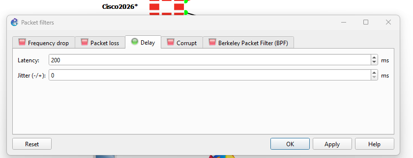

*Captura 17. El filtro de paquetes de GNS3 muestra Delay activo con latencia configurada en 200 ms y jitter añadido de 0 ms.*


*Captura 19. Port1 figura alive pero fuera de SLA, con pérdida y latencia elevadas, mientras port3 conserva SLA válido.*

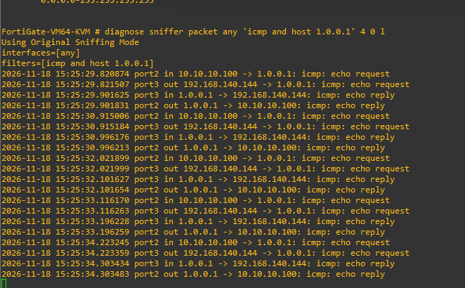

*Captura 20. Durante la degradación, las solicitudes de PC1 hacia 1.0.0.1 salen por port3 y reciben respuestas.*


*Captura 26. La comprobación posterior vuelve a mostrar ambos ISP alive, con 0 % de pérdida y SLA válido.*

**Resultado:** Las evidencias distinguen un enlace disponible de un enlace que cumple la calidad requerida. Durante la degradación se observó el tráfico de PC1 por ISP2 y después se recuperó el estado saludable de ambos caminos.

**Aclaración:** Los 200 ms son el valor del filtro, no la latencia final medida por el monitor. El proceso incluyó problemas intermedios de conectividad y una reparación; no se atribuye cada fallo únicamente al filtro ni se presenta como un ensayo repetido bajo condiciones idénticas.

**Registros que complementan la fase:**

- [Comandos_utilizados.md](configs/Comandos_utilizados.md)
- [README.md](README.md)

## Fase 5

**Segmento y servidor del Data Center**

Se separó el DC de la LAN de usuarios mediante port4 de la sede, con gateway 10.10.20.1/24. Se configuró DC-SRV en 10.10.20.10/24, se revisaron su interfaz y ruta por defecto y se comprobó la comunicación con el gateway.

**Comandos en FortiGate sede:**

```text
show system interface port4
```

**Comandos en DC-SRV:**

```text
ip -4 addr show dev eth0
ip route
ping -c 4 10.10.20.1
```

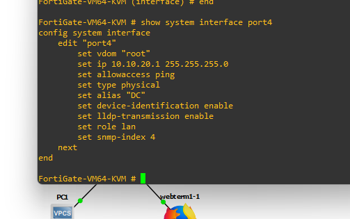

*Captura 32. Port4 aparece con alias DC, dirección 10.10.20.1/24 y acceso ping habilitado.*


*Captura 35. DC-SRV muestra 10.10.20.10/24, ruta por defecto vía 10.10.20.1 y cuatro respuestas de ese gateway.*

**Resultado:** El servidor quedó en un segmento independiente y alcanzó su puerta de enlace sin pérdida en la prueba mostrada. Esta base permitió continuar con los túneles y el servicio HTTP.

**Aclaración:** Estas imágenes comprueban direccionamiento y conectividad local; por sí solas no acreditan acceso HTTP ni acceso desde la sucursal.

**Registros que complementan la fase:**

- [Comandos_utilizados.md](configs/Comandos_utilizados.md)
- [interfaces-DC-SRV.txt](configs/Referencias-tecnicas/docker-http-persistence/interfaces-DC-SRV.txt)
- [verification-after-restart.json](registros/verification-after-restart.json)

## Fase 6

**Túneles GRE y comunicación sucursal–DC**

Se conectaron los bordes mediante GRE-ISP1 y después se añadió GRE-ISP2 como respaldo. Se establecieron rutas entre la LAN de sucursal y el DC y políticas para su tráfico; los diagnósticos de túnel, ping y captura de paquetes se usaron para revisar el recorrido.

**Comandos en VPCS — PC-SUC:**

```text
ip dhcp
show ip
ping 10.20.10.1
ping 10.10.20.10
```

**Comandos en FortiGate sede:**

```text
diagnose sys gre list
diagnose sniffer packet any 'icmp and host 10.20.10.10 and host 10.10.20.10' 4 20 1
```

**Comandos en FG-SUC:**

```text
diagnose sys gre keepalive all
get router info routing-table details 10.10.20.10
```

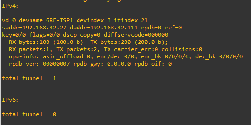

*Captura 38. El diagnóstico de sede identifica GRE-ISP1 con extremo local 192.168.42.27 y remoto 192.168.42.111.*


*Captura 41. PC-SUC obtiene respuestas de su gateway 10.20.10.1 y del servidor del DC 10.10.20.10.*

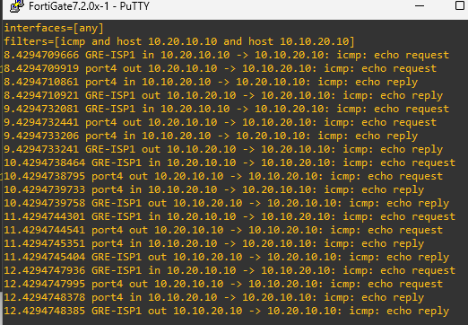

*Captura 42. La traza muestra solicitudes ICMP entrando por GRE-ISP1 y saliendo por port4, con respuestas de vuelta y las IP privadas conservadas.*

**Resultado:** La sucursal alcanzó el DC a través de GRE-ISP1 sin traducción de las direcciones de los extremos. El diseño dejó ese camino con distancia administrativa 10 y GRE-ISP2 como alternativa con distancia 20.

**Aclaración:** La prueba de las capturas 41–42 usó PC-SUC con IP estática histórica 10.20.10.10; la revisión final recibió .100 por DHCP. Al repetir en VPCS se empieza con ip dhcp y show ip. GRE encapsula sin cifrar y estas capturas ICMP no demuestran HTTP ni confidencialidad.

**Registros que complementan la fase:**

- [Comandos_utilizados.md](configs/Comandos_utilizados.md)
- [README.md](README.md)
- [gestion-centralizada-fortigate.txt](registros/gestion-centralizada-fortigate.txt)

## Fase 7

**HTTP del DC y corrección de la política**

Se creó la página del DC y se inició BusyBox httpd. La prueba local respondió, pero el primer curl desde sucursal agotó la espera. Al revisar FG-SUC se encontró SUC_PING_DC limitada a PING; se añadió HTTP a esa regla y se repitió la solicitud desde webterm1-2.

**Comandos en DC-SRV:**

```text
/gns3/bin/busybox httpd -p 10.10.20.10:80 -h /root/dc-web-lab
curl -fsS http://10.10.20.10/
```

**Comandos en webterm1-2:**

```text
ip route replace 10.10.20.0/24 via 10.20.10.1
curl -fsS --max-time 5 http://10.10.20.10/
```

**Comandos en FG-SUC:**

```text
show firewall policy | grep -f "SUC_PING_DC"
config firewall policy
    edit 2
        set service "PING" "HTTP"
    next
end
```

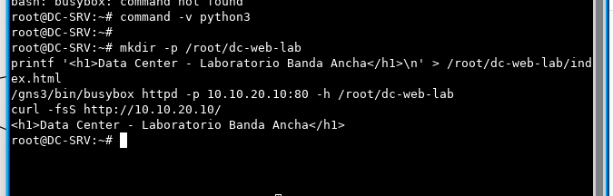

*Captura 43. DC-SRV inicia el servidor con la ruta completa de BusyBox y devuelve localmente el HTML de la página del DC.*


*Captura 44. El primer curl desde webterm1-2 hacia 10.10.20.10 termina con timeout después de 5000 ms.*


*Captura 45. La regla 2 SUC_PING_DC de FG-SUC muestra como único servicio permitido PING, antes de añadir HTTP.*


*Captura 48. Después de corregir la política, el cliente de sucursal recibe el HTML del Data Center.*

**Resultado:** Se pasó de un servicio accesible solo en la prueba local a recibir su página desde sucursal. Los archivos de interfaces conservan el inicio de HTTP y el registro posterior al arranque confirma HTTP 200 de DC-SRV y webterm1-2.

**Aclaración:** Las capturas 44 y 45 son estados intermedios; la 48 muestra contenido recibido, no una cabecera HTTP 200. El ID 2 corresponde a esta topología y debe comprobarse por nombre antes de reutilizar el bloque. Los fragmentos no sustituyen la configuración completa del firewall.

**Registros que complementan la fase:**

- [Comandos_utilizados.md](configs/Comandos_utilizados.md)
- [interfaces-DC-SRV.txt](configs/Referencias-tecnicas/docker-http-persistence/interfaces-DC-SRV.txt)
- [verification-after-restart.json](registros/verification-after-restart.json)

## Fase 8

**Recuperación y retorno de HTTP del DC**

Se repitieron solicitudes HTTP al DC desde sucursal mientras se desactivaba administrativamente port1 en FG-SUC. Se revisó la ruta de respaldo y después se habilitó otra vez port1 para comprobar el keepalive y el regreso de la ruta principal.

**Comandos en webterm1-2:**

```text
while true; do
  printf '%s ' "$(date +%H:%M:%S)"
  curl -s --max-time 2 -o /dev/null -w 'HTTP %{http_code}\n' http://10.10.20.10/
  sleep 1
done
```

**Comandos en FG-SUC:**

```text
config system interface
    edit "port1"
        set status down
    next
end
get router info routing-table all | grep "10.10.20.0"
config system interface
    edit "port1"
        set status up
    next
end
diagnose sys gre keepalive all
```


*Captura 50. FG-SUC desactiva administrativamente port1 mediante set status down.*

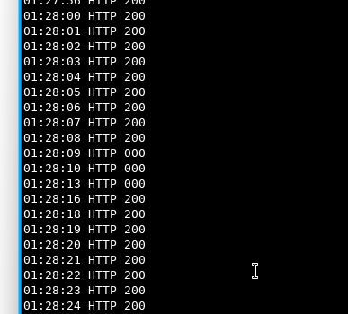

*Captura 51. El sondeo HTTP muestra respuestas 200, tres intentos 000 y nuevos 200 desde las 01:28:16.*

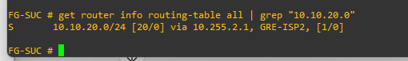

*Captura 52. La ruta a 10.10.20.0/24 está activa por GRE-ISP2, vía 10.255.2.1 y con distancia 20.*

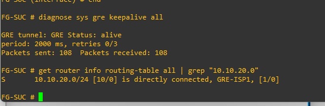

*Captura 54. Tras restaurar ISP1, el keepalive está alive y la ruta del DC vuelve a GRE-ISP1 con distancia 10.*

**Resultado:** HTTP del DC se recuperó mediante GRE-ISP2 y después volvió el camino principal GRE-ISP1. Entre el inicio del primer intento fallido, 01:28:09, y el inicio del primero nuevamente exitoso, 01:28:16, transcurrieron siete segundos.

**Aclaración:** Los siete segundos se calculan entre inicios de intentos HTTP, no desde un instante instrumentado de caída. No se cronometró el retorno. Esta prueba corresponde al DC y no demuestra recuperación de la aplicación cloud ante la misma caída.

**Registros que complementan la fase:**

- [Comandos_utilizados.md](configs/Comandos_utilizados.md)
- [README.md](README.md)

## Fase 9

**Nube simulada y coincidencia de la regla SD-WAN**

Se habilitó HTTP en CLOUD-SRV, con CLOUD-EDGE como gateway y frontal de publicación mediante socat. La primera solicitud al frontal 192.168.42.84 recibió la página, pero no coincidió con la regla específica. Se cambió la prueba al destino privado 10.30.10.10, con ruta /32 vía CLOUD-EDGE, reenvío IPv4 y ajuste del destino de HTTP_NUBE_ISP1.

**Comandos en CLOUD-SRV:**

```text
/gns3/bin/busybox httpd -p 10.30.10.10:80 -h /root/cloud-web
```

**Comandos en CLOUD-EDGE:**

```text
/bin/sh /root/cloud-ingress.sh
sysctl -w net.ipv4.ip_forward=1
```

**Comandos en webterm1-2:**

```text
curl -fsS --max-time 5 http://192.168.42.84/
ip route replace 10.30.10.10/32 via 10.20.10.1 dev eth0
curl --noproxy '*' -fsS --max-time 8 -o /dev/null -w 'HTTP %{http_code}\n' http://10.30.10.10/
```

**Comandos en FG-SUC:**

```text
get router info routing-table all | grep "10.30.10.10"
diagnose firewall proute list
```

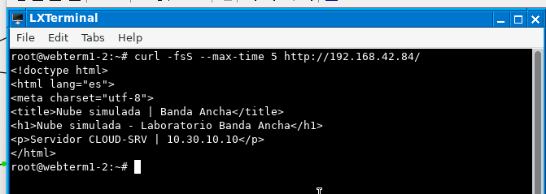

*Captura 66. La solicitud inicial al frontal 192.168.42.84 recibe el HTML que identifica la nube simulada y CLOUD-SRV 10.30.10.10.*


*Captura 67. La regla HTTP_NUBE_ISP1 todavía dirigida al frontal .84 conserva hit_count=0 en la prueba inicial.*

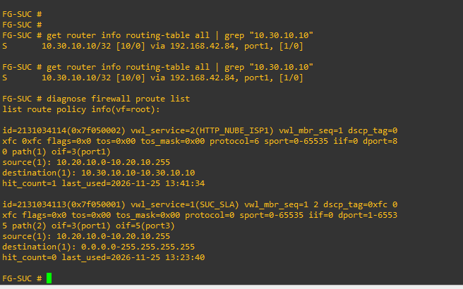

*Captura 70. La prueba corregida muestra ruta /32 a 10.30.10.10 por port1 y hit_count=1 en HTTP_NUBE_ISP1 para TCP 80.*

**Resultado:** El destino enrutado 10.30.10.10 devolvió HTTP 200 desde sucursal y la regla específica registró una coincidencia por el miembro 1, port1. La respuesta HTTP se conserva en el registro JSON y la selección de regla en la captura 70.

**Aclaración:** Las capturas 66–67 son el intento inicial al frontal, no prueba de coincidencia. La 70 no muestra la respuesta HTTP. Se trata de una nube local simulada, con clasificación por IP y puerto; no se demostró conmutación cloud ni reconocimiento profundo de aplicaciones. Los últimos ajustes persistentes se revisaron sin un nuevo reinicio posterior.

**Registros que complementan la fase:**

- [Comandos_utilizados.md](configs/Comandos_utilizados.md)
- [interfaces-CLOUD-EDGE-routed-cloud.txt](configs/Referencias-tecnicas/cloud-lab/interfaces-CLOUD-EDGE-routed-cloud.txt)
- [interfaces-webterm1-2-routed-cloud.txt](configs/Referencias-tecnicas/cloud-lab/interfaces-webterm1-2-routed-cloud.txt)
- [cloud-ingress.sh](configs/Referencias-tecnicas/cloud-lab/cloud-ingress.sh)
- [wan-cloud-verification.json](registros/wan-cloud-verification.json)
- [sdwan-http-nube-destino-enrutado.json](registros/sdwan-http-nube-destino-enrutado.json)

## Fase 10

**Perfil QoS y comparación de descargas**

Se prepararon archivos de 4 MiB en el DC y 16 MiB en la nube y se compararon descargas simultáneas desde sucursal. En port2 de FG-SUC se declararon sucesivamente 8000 y 4000 kbps; se aplicó la política de retorno QOS_HTTP_DC y se verificó por separado la asociación del perfil QOS_DC_ALTA en una sesión.

**Comandos en DC-SRV:**

```text
dd if=/dev/zero of=/root/dc-web-lab/archivo-qos-dc.bin bs=1M count=4
```

**Comandos en FG-SUC:**

```text
config system interface
    edit "port2"
        set outbandwidth 8000
    next
end
config system interface
    edit "port2"
        set outbandwidth 4000
    next
end
config firewall shaping-policy
    edit 1
        set status disable
    next
end
config firewall shaping-policy
    edit 1
        set status enable
    next
end
diagnose sys session list
```

**Comandos en webterm1-2:**

```text
curl -fsS --max-time 90 -o /dev/null -w 'NUBE: HTTP %{http_code} | %{size_download} bytes | %{time_total} s\n' http://192.168.42.84/archivo-qos.bin &
nube=$!
sleep 1
curl -fsS --max-time 90 -o /dev/null -w 'DC: HTTP %{http_code} | %{size_download} bytes | %{time_total} s\n' http://10.10.20.10/archivo-qos-dc.bin
wait "$nube"
```


*Captura 61. La referencia de 8000 kbps registra HTTP 200 y tiempos de 9.309107 s para el DC y 37.696520 s para la nube.*

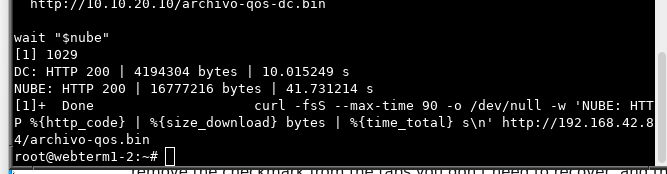

*Captura 62. La segunda corrida de 8000 kbps registra 10.015249 s para el DC y 41.731214 s para la nube, ambas con HTTP 200.*

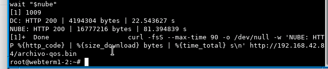

*Captura 64. La corrida de 4000 kbps termina ambas descargas con HTTP 200: DC en 22.543627 s y nube en 81.394839 s.*

**Resultado:** El diagnóstico de sesión registra reply-shaper QOS_DC_ALTA y shaping_policy_id 1. Las descargas no mejoraron: a 8000 kbps el DC pasó de 9.309107 a 10.015249 s y la nube de 37.696520 a 41.731214 s; a 4000 kbps el DC pasó de 21.120041 a 22.543627 s, 1.424 s más, equivalente a 6.74 %.

**Aclaración:** La captura 62 muestra tiempos, no acredita por sí sola la asignación del shaper. El orden de las corridas de 4000 kbps se interpretó con la confirmación del registro y falta una referencia completa de nube sin prioridad. No hubo repeticiones controladas suficientes para afirmar un beneficio; los tiempos de curl no son jitter de red.

**Registros que complementan la fase:**

- [Comandos_utilizados.md](configs/Comandos_utilizados.md)
- [shaper-session-check.json](registros/shaper-session-check.json)
- [comparacion-4Mbps.json](registros/comparacion-4Mbps.json)

## Fase 11

**Acceso permitido en TCP 80 y prueba de TCP 8080**

Se inició temporalmente un servicio HTTP del DC en TCP 8080 y se comprobó primero que respondiera en el propio servidor. Desde sucursal se probaron TCP 80 y TCP 8080 con límites de espera. Al terminar se retiró el servicio temporal; la evidencia se conserva como JSON, sin una captura PNG adicional.

**Comandos en DC-SRV:**

```text
/gns3/bin/busybox timeout 35 /gns3/bin/busybox httpd -f -p 10.10.20.10:8080 -h /root/dc-web-lab
curl --noproxy "*" -fsS --max-time 2 -o /dev/null -w "DC_LOCAL_8080=%{http_code}\n" http://10.10.20.10:8080/
```

**Comandos en webterm1-2:**

```text
ip -4 route get 10.10.20.10
curl --noproxy "*" -fsS --max-time 5 -o /dev/null -w "SUC_80=%{http_code}\n" http://10.10.20.10/
curl --noproxy "*" -fsS --connect-timeout 3 --max-time 5 -o /dev/null -w "SUC_8080=%{http_code}\n" http://10.10.20.10:8080/
```

**Resultado:** TCP 8080 devolvió HTTP 200 localmente y TCP 80 devolvió HTTP 200 desde sucursal. El intento desde sucursal a TCP 8080 agotó la espera después de 3001 ms, con código de salida curl 28; el registro incluye la retirada del servicio de prueba.

**Aclaración:** La orden de httpd es el componente de servicio del lanzamiento temporal guardado, no un script autónomo. La prueba acredita acceso selectivo de extremo a extremo, pero no identifica cuál de los dos FortiGate descartó TCP 8080 porque no se guardó el log de descarte de esa ejecución.

**Registros que complementan la fase:**

- [tcp-80-vs-8080.json](registros/tcp-80-vs-8080.json)
- [Comandos_utilizados.md](configs/Comandos_utilizados.md)

## Fase 12

**Supervisión central de los bordes**

Se utilizó gestionar-bordes.ps1 para consultar desde un punto central los miembros SD-WAN, la salud de los enlaces y el keepalive GRE de sede y FG-SUC. El script requiere consolas previamente autenticadas con prompt listo y solo lee estados; las corridas se documentan mediante TXT, sin PNG adicional.

**Comandos en Windows — PowerShell:**

```text
powershell.exe -NoProfile -ExecutionPolicy RemoteSigned -File .\configs\gestionar-bordes.ps1 -EsperaPromptSegundos 2 -SondearPrompt
```

**Comandos en FortiGate sede y FG-SUC — consultas enviadas por el script:**

```text
diagnose sys sdwan member
diagnose sys sdwan health-check
diagnose sys gre keepalive all
```

**Resultado:** El registro histórico de las 16:44 completó seis lecturas, tres por cada FortiGate. La revisión posterior de las 19:05 completó solamente las tres consultas de FG-SUC porque la consola de sede no tenía el prompt listo.

**Aclaración:** El intento previo de las 16:38 omitió equipos por login o prompt y no se cuenta como éxito. La revisión de tres lecturas no sustituye la corrida histórica de seis. Se demostró supervisión central de solo lectura, sin distribución ni sincronización de políticas.

**Registros que complementan la fase:**

- [gestionar-bordes.ps1](configs/gestionar-bordes.ps1)
- [gestion-centralizada-fortigate.txt](registros/gestion-centralizada-fortigate.txt)
- [gestion-inventario-verificacion.txt](registros/gestion-inventario-verificacion.txt)
- [README.md](registros/README.md)

## Cierre de la documentación

Las imágenes y registros muestran el avance y sus resultados. GRE se utilizó sin cifrado, las mediciones de QoS no demostraron una mejora y la supervisión central fue de solo lectura. La exportación GNS3 y el video siguen pendientes de anexar.

[Volver a la entrega del grupo 1](README.md)
