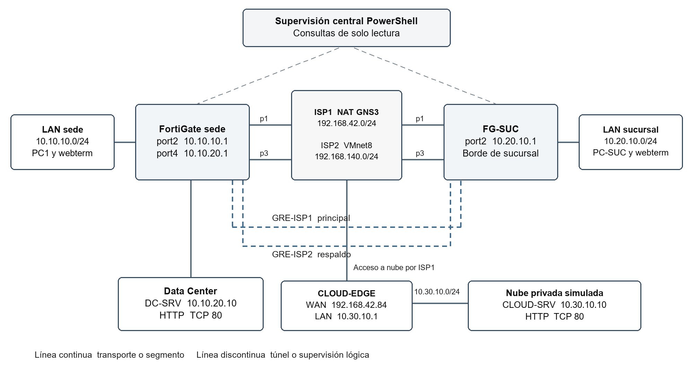
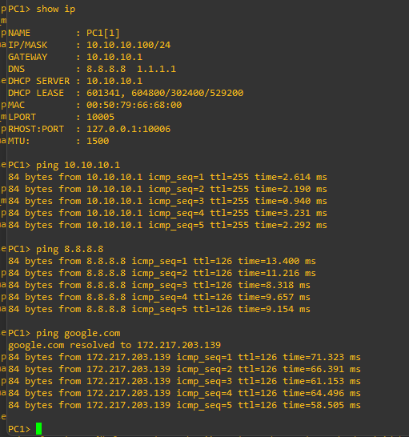
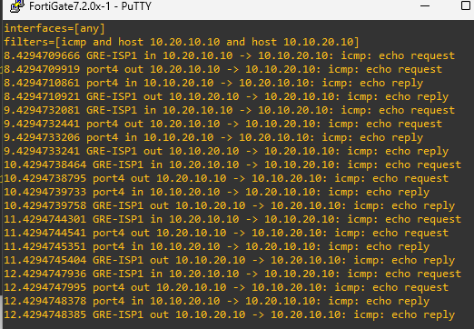
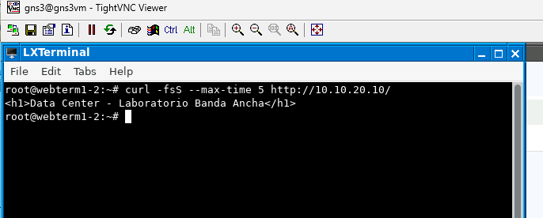
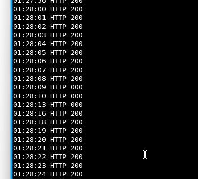
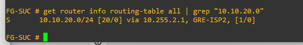
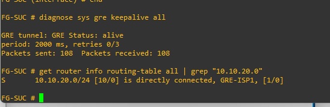
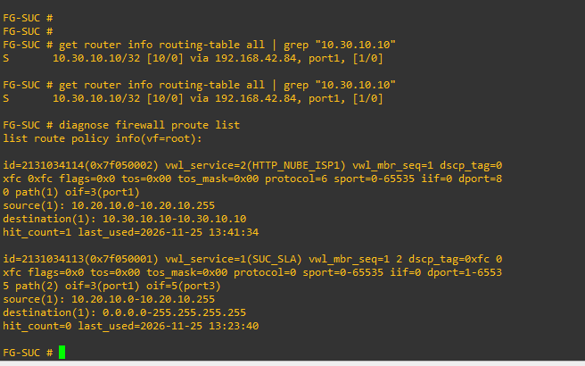
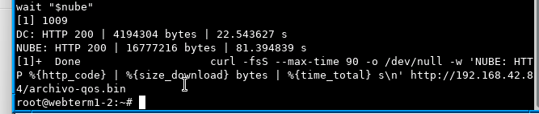

# Proyecto final de Banda Ancha — Grupo 1

## SD-WAN para continuidad del negocio y seguridad en una red híbrida

**Universidad Militar Nueva Granada**  
**Asignatura:** Banda Ancha  
**Docente:** Ing. Jaider Ospina Navas  
**Integrantes:** Julián Camilo Moreno Valderrama, Fabiana Lopez Piñeros y Juan Felipe Becerra Briceño.  
**Fecha de corte:** 25 de noviembre de 2026.

Esta entrega reúne el diseño, los pasos de configuración y los resultados del laboratorio en GNS3. Se diferencian las comprobaciones realizadas de las actividades que siguen pendientes.

| Material | Archivo o carpeta |
| --- | --- |
| Informe | [Word](Informe_Proyecto_SD_WAN_Grupo_1.docx) · [PDF](Informe_Proyecto_SD_WAN_Grupo_1.pdf) |
| Documentación por fases | [Recorrido ilustrado con 33 capturas](Documentacion_por_fases.md) · [Anexo Word](Anexo_Documentacion_Fases_Grupo_1.docx) · [Anexo PDF](Anexo_Documentacion_Fases_Grupo_1.pdf) |
| Diagrama lógico | [Imagen](Diagrama_logico.png) · [Descripción](Diagrama_logico.md) |
| Evidencias | [Capturas originales 01–70](img/) · [Registros de comprobación](registros/) |
| Configuraciones | [Scripts y archivos de configuración](configs/) |
| Proyecto GNS3 | [Estado de la exportación y requisitos](proyecto/README.md) |
| Organización | [Cronograma](Cronograma.md) |

**Pendientes de la entrega:** recibir y verificar la exportación actualizada de GNS3 y añadir el video de funcionamiento. El respaldo de una etapa anterior no sustituye la topología completa.

La [documentación por fases](Documentacion_por_fases.md) amplía el proceso con 33 capturas seleccionadas. Recorre DHCP y LAN, los dos enlaces WAN, calidad y fallos, preparación del DC, sucursal y GRE, corrección del acceso HTTP, caída y retorno del DC, nube, QoS, seguridad y supervisión central. Cada fase explica lo que hicimos, sus comandos, las imágenes y el resultado. Los fallos intermedios se identifican como parte del procedimiento.

## 1. Resumen ejecutivo

Se implementó una sede con Data Center, una sucursal y una aplicación de nube simulada. Dos FortiGate conectan las redes mediante túneles GRE sobre dos transportes WAN. Se comprobó el acceso HTTP al DC y a la nube, la recuperación de la aplicación por el túnel de respaldo y el retorno al camino principal. También se verificó que HTTP en TCP 80 estuviera disponible desde la sucursal mientras un servicio temporal en TCP 8080 no era accesible desde allí.

La regla SD-WAN de HTTP hacia la nube registró una coincidencia al usar el destino enrutado `10.30.10.10`. El perfil de QoS apareció asignado a una sesión, aunque las descargas medidas no fueron más rápidas. La supervisión central obtuvo seis lecturas en una ejecución guardada y tres en una revisión posterior, en la que la consola de sede no estaba lista.

GRE permitió conectar los sitios, pero **no se demostró cifrado**. El script central consulta el estado de los equipos; no distribuye políticas. Estos límites forman parte del resultado y de las mejoras propuestas.

## 2. Problema y objetivos

Una sucursal que depende de un solo enlace puede perder acceso a sus aplicaciones cuando ese camino falla. Además de tener un respaldo, es necesario comprobar cómo se recupera el servicio, qué tráfico puede pasar y cómo se atienden las aplicaciones importantes cuando compiten por la conexión.

**Objetivo general:** implementar y evaluar en GNS3 una red SD-WAN que conecte sede, sucursal, Data Center y nube simulada, considerando continuidad del servicio y control de acceso.

**Objetivos específicos:**

- Configurar dos transportes WAN y rutas alternativas entre los sitios.
- Comprobar servicios HTTP del DC y de una red cloud separada.
- Verificar recuperación, retorno y selección de una regla SD-WAN.
- Aplicar políticas de firewall y evaluar un perfil de QoS.
- Conservar capturas, comandos y registros que permitan revisar los resultados.

SD-WAN permite supervisar la calidad de los enlaces y aplicar reglas de selección. En este montaje, la recuperación hacia el DC también depende de rutas con distinta distancia administrativa y del estado de los túneles GRE; no se atribuye todo el comportamiento a una única regla.

## 3. Diseño de la solución



La sede tiene una LAN de usuarios y un segmento independiente para el DC. La sucursal tiene su propia LAN. Los FortiGate sirven como equipos de borde y firewalls. El primer transporte usa el NAT de GNS3; el segundo utiliza nodos Cloud conectados a VMnet8. Ambos transportes están dentro del mismo entorno de virtualización y no equivalen a dos operadores físicos independientes.

`GRE-ISP1` es el camino preferido hacia el DC y `GRE-ISP2` es el respaldo. Se representa una red WAN de laboratorio; no se implementó un núcleo MPLS real.

| Componente | Función |
| --- | --- |
| FortiGate sede y FG-SUC | Conectar las redes, aplicar políticas, supervisar WAN y terminar los túneles GRE. |
| PC1 y PC-SUC | Probar DHCP y conectividad mediante ICMP. |
| webterm1-1 y webterm1-2 | Ejecutar peticiones HTTP y herramientas de diagnóstico desde sede y sucursal. |
| DC-SRV | Servir la página HTTP del Data Center. |
| CLOUD-EDGE | Conectar el transporte ISP1 con la red privada de la nube; publicar HTTP y reenviar tráfico hacia CLOUD-SRV. |
| CLOUD-SRV | Servir la página de la nube simulada. |
| Script de gestión | Consultar miembros SD-WAN, salud WAN y keepalive GRE de los dos FortiGate. |

Los servidores usan contenedores y BusyBox httpd. CLOUD-EDGE también utiliza un relay socat para publicar TCP 80. La nube es una red separada dentro del laboratorio, sin contratación de una plataforma externa. No se implementó un orquestador que distribuya configuraciones: cada FortiGate se configuró individualmente.

### Direccionamiento

| Segmento o equipo | Dirección registrada | Tipo o aclaración |
| --- | --- | --- |
| LAN sede | `10.10.10.0/24`; gateway `10.10.10.1` en port2 | Gateway fijo; DHCP para clientes. |
| PC1 | `10.10.10.101/24` | Última concesión DHCP registrada en la revisión final del equipo. |
| Data Center | `10.10.20.0/24`; gateway `10.10.20.1` en port4 | Segmento independiente. |
| DC-SRV | `10.10.20.10/24` | Servidor HTTP. |
| LAN sucursal | `10.20.10.0/24`; gateway `10.20.10.1` en port2 | Gateway fijo; DHCP para clientes. |
| PC-SUC | `10.20.10.100/24` | Última concesión DHCP registrada en la revisión final del equipo. |
| webterm1-2 | `10.20.10.20/24` | Cliente usado en las pruebas HTTP. |
| WAN1 | `192.168.42.0/24`; gateway `192.168.42.1` | Sede observada en `.27` y FG-SUC en `.111`. |
| WAN2 | `192.168.140.0/24`; gateway `192.168.140.2` | Concesiones históricas: sede `.144` y FG-SUC `.145`; revisar después de restaurar. |
| GRE de respaldo | Siguiente salto `10.255.2.1` hacia el DC desde sucursal | Interfaz GRE-ISP2. |
| CLOUD-EDGE | `192.168.42.84/24` hacia ISP1; `10.30.10.1/24` hacia cloud | Dirección frontal observada y gateway de la red privada. |
| CLOUD-SRV | `10.30.10.10/24` | Aplicación HTTP de nube. |

Las direcciones WAN y la dirección frontal de CLOUD-EDGE deben revisarse al recuperar el proyecto. Las capturas conservan sus datos originales: algunas pruebas anteriores usaron PC1 en `10.10.10.100` y PC-SUC con IP estática `10.20.10.10`. Eso no cambia las concesiones DHCP más recientes de la tabla.

## 4. Implementación paso a paso

### Paso 1. Preparar la LAN y comprobar salida a Internet

En port2 de cada FortiGate se definieron la puerta de enlace y el servicio DHCP de su LAN. También se configuraron políticas de salida con NAT. Después se comprobó que los clientes recibieran dirección y alcanzaran su gateway. Desde PC1 se verificaron además `8.8.8.8` y `google.com`.

**Para comenzar las pruebas, primero se pide DHCP en cada VPCS**, tanto en PC1 como en PC-SUC:

```text
ip dhcp
show ip
```

Se comprueban la IP, la máscara y el gateway recibidos. En PC1, el gateway debe ser `10.10.10.1`; en PC-SUC, `10.20.10.1`. Las IP de los clientes pueden cambiar con cada concesión: no se copian como fijas las direcciones de las capturas anteriores.

Después, desde PC1:

```text
ping 10.10.10.1
ping 8.8.8.8
ping google.com
```

Y desde PC-SUC, tras solicitar y comprobar su DHCP:

```text
ping 10.20.10.1
ping 10.10.20.10
```



La captura anterior corresponde a una concesión de una prueba previa; las IP actuales de PC1 y PC-SUC están diferenciadas en el direccionamiento.

### Paso 2. Configurar y supervisar los dos transportes WAN

La sede usa port1 y port3 como miembros SD-WAN. El monitor `Internet_LAB` consulta `8.8.8.8` y `1.1.1.1`, con umbrales de 100 ms de latencia, 30 ms de jitter y 5 % de pérdida. La selección Lowest Cost utiliza costos 10 y 20. FG-SUC tiene sus miembros WAN y la regla general `SUC_SLA`.

Para revisar el estado se utilizaron estos diagnósticos de FortiOS:

```text
diagnose sys sdwan member
diagnose sys sdwan health-check
```

El [estado normal de ambos ISP](img/28-SLA-ambos-ISP-verificacion.png) se conserva como evidencia adicional.

### Paso 3. Integrar el DC y los túneles GRE

Se configuró el DC en port4 de la sede y el servidor `10.10.20.10`. Los túneles GRE permiten alcanzar esa red desde sucursal. La ruta preferida usa GRE-ISP1 con distancia administrativa 10; la alternativa usa GRE-ISP2 con distancia 20.

Para revisar la ruta elegida y el estado del túnel se usaron:

```text
get router info routing-table details 10.10.20.10
diagnose sys gre keepalive all
```

El diagnóstico de tráfico mostró entrada por GRE-ISP1, salida por port4 y respuestas en sentido contrario, conservando las direcciones de los extremos.



Aquí PC-SUC aparece con la IP estática histórica `10.20.10.10`. La captura acredita ese ensayo; no se presenta como una prueba ejecutada con la última concesión DHCP.

### Paso 4. Habilitar y probar la aplicación HTTP del DC

Se inició la página del DC con BusyBox httpd. Al principio, FG-SUC permitía PING pero la petición HTTP fallaba. Se amplió `SUC_PING_DC` a PING y HTTP; la política `GRE_PING_DC` de la sede ya permitía ambos servicios.

En FG-SUC se añadió HTTP a la regla 2 existente:

```text
config firewall policy
    edit 2
        set service "PING" "HTTP"
    next
end
```

El número 2 corresponde a `SUC_PING_DC` en este montaje; se debe comprobar su nombre antes de reutilizar el bloque en otra topología.

En DC-SRV se conservó este archivo de interfaces para recuperar la dirección y el servicio HTTP:

```text
auto eth0
iface eth0 inet static
    address 10.10.20.10
    netmask 255.255.255.0
    gateway 10.10.20.1
    up echo nameserver 8.8.8.8 > /etc/resolv.conf
    post-up /usr/bin/curl --noproxy '*' -fsS --max-time 2 http://10.10.20.10/ >/dev/null 2>&1 || /gns3/bin/busybox httpd -p 10.10.20.10:80 -h /root/dc-web-lab
```

El [archivo guardado de DC-SRV](configs/Referencias-tecnicas/docker-http-persistence/interfaces-DC-SRV.txt) contiene esa configuración. Desde el contenedor de sucursal se comprobó el servicio con:

```sh
curl --noproxy "*" -fsS --max-time 5 -D - http://10.10.20.10/
```



Los archivos de interfaces y los scripts guardados permiten recuperar direcciones, rutas e inicio de httpd. Tras detener y arrancar los contenedores, DC-SRV y el cliente de sucursal volvieron a obtener HTTP 200. El [registro posterior al arranque](registros/verification-after-restart.json) conserva esa comprobación.

### Paso 5. Separar servicios permitidos y restringidos

Se habilitó temporalmente HTTP en TCP 8080 en el propio DC y se comprobó que respondiera localmente. Desde sucursal, TCP 80 devolvió 200 y TCP 8080 agotó la espera después de 3001 ms. El servicio temporal se retiró al terminar.

La prueba demuestra acceso selectivo de extremo a extremo. No permite identificar cuál de los dos FortiGate descartó TCP 8080 porque esa ejecución no conservó el registro de descarte del firewall. Los comandos y las respuestas están en [TCP 80 frente a TCP 8080](registros/tcp-80-vs-8080.json).

### Paso 6. Comprobar caída, recuperación y retorno

Se desactivó administrativamente ISP1 en FG-SUC mientras se repetían peticiones HTTP al DC. Después de varios intentos fallidos, volvió el servicio mediante GRE-ISP2.





Hubo HTTP 200 a las 01:28:08; el primer intento fallido comenzó a las 01:28:09 y el primer intento nuevamente exitoso a las 01:28:16. Los **7 segundos** son el intervalo entre el inicio de esos dos intentos, no una medición exacta desde el instante en que cayó el enlace.

Al habilitar de nuevo ISP1 se recuperó el keepalive y se reinstaló la ruta por GRE-ISP1. Las peticiones posteriores devolvieron HTTP 200. No se cronometró el retorno. Esta prueba corresponde al acceso al DC; no demuestra recuperación del servicio cloud ante la misma caída.



### Paso 7. Integrar la nube y verificar su regla SD-WAN

Primero se probó HTTP a través del frontal `192.168.42.84` de CLOUD-EDGE. El servicio respondió, pero la traza utilizó una ruta directamente conectada por port1 y la regla específica conservó contador cero. Las [capturas 67–69](img/) documentan ese intento y no se usan como prueba de coincidencia de la regla.

La comprobación posterior usó `10.30.10.10` como destino y una ruta /32 vía `192.168.42.84`. La regla `HTTP_NUBE_ISP1` registró origen `10.20.10.0/24`, TCP 80, miembro 1 por port1 y `hit_count=1`.

```sh
ip -4 route get 10.30.10.10
curl --noproxy "*" -fsS -D - --max-time 7 http://10.30.10.10/
```



En CLOUD-EDGE se guardó el siguiente bloque de interfaces:

```text
auto eth0
iface eth0 inet dhcp

auto eth1
iface eth1 inet static
    address 10.30.10.1
    netmask 255.255.255.0
    post-up /bin/sh /root/cloud-ingress.sh
    post-up echo 1 > /proc/sys/net/ipv4/ip_forward
```

El [archivo de CLOUD-EDGE](configs/Referencias-tecnicas/cloud-lab/interfaces-CLOUD-EDGE-routed-cloud.txt) conserva estos ajustes. En el cliente de sucursal se guardó, entre otras, esta ruta:

```text
post-up /sbin/ip route replace 10.30.10.10/32 via 10.20.10.1 dev eth0
```

El [archivo de webterm1-2](configs/Referencias-tecnicas/cloud-lab/interfaces-webterm1-2-routed-cloud.txt) contiene la dirección del cliente y sus rutas. El cliente recibió HTTP 200 y el HTML de CLOUD-SRV. El [registro del destino enrutado](registros/sdwan-http-nube-destino-enrutado.json) permite comprobar la respuesta. La ruta del cliente y el reenvío IPv4 de CLOUD-EDGE quedaron guardados con lectura de comprobación y validación en seco; no se hizo un reinicio adicional para verificar esos últimos cambios.

### Paso 8. Aplicar y evaluar QoS

Una sesión del DC mostró `reply-shaper QOS_DC_ALTA` y `shaping_policy_id 1`. Se confirma así la asignación del perfil, según el [diagnóstico de sesión](registros/shaper-session-check.json). Luego se compararon descargas del DC de 4 MiB y de nube de 16 MiB.

| Ancho declarado | DC de referencia | DC tras priorización | Nube de referencia | Nube tras priorización |
| --- | ---: | ---: | ---: | ---: |
| 8000 kbps | 9.309107 s | 10.015249 s | 37.696520 s | 41.731214 s |
| 4000 kbps | 21.120041 s | 22.543627 s | Sin registro completo | 81.394839 s |



Las comparaciones **no mostraron una reducción del tiempo de descarga**. En 4000 kbps, el DC tardó 1.424 s más, equivalente a 6.74 %. La referencia y la priorización de esa corrida se interpretaron según el orden confirmado en el registro; no son una comparación repetida y controlada.

Diez peticiones HTTP sin carga devolvieron 200, con tiempo total curl promedio de 3.502 ms, mínimo de 2.636 y máximo de 4.258 ms. Estos tiempos HTTP no representan una medición de jitter de red. Para evaluar una mejora de QoS hacen falta varias repeticiones bajo la misma carga y el mismo cuello de botella, con medidas de latencia, pérdida y jitter. Véase también la [comparación de 4 Mbps](registros/comparacion-4Mbps.json).

### Paso 9. Consultar ambos bordes desde un punto central

El [script de gestión](configs/gestionar-bordes.ps1) obtiene tres diagnósticos por FortiGate: miembros SD-WAN, salud WAN y keepalive GRE. Trabaja sobre consolas con sesión ya iniciada. No envía credenciales ni modifica configuraciones.

```text
diagnose sys sdwan member
diagnose sys sdwan health-check
diagnose sys gre keepalive all
```

Desde la carpeta de esta entrega, la ejecución documentada es:

```powershell
powershell.exe -NoProfile -ExecutionPolicy RemoteSigned -File .\configs\gestionar-bordes.ps1 -EsperaPromptSegundos 2 -SondearPrompt
```

Antes de repetirla deben verificarse la dirección del servidor GNS3, el proyecto y las consolas indicados en el script. Ambas consolas deben mostrar un prompt `#` en blanco; no se debe escribir en ellas durante la consulta.

El [registro guardado](registros/gestion-centralizada-fortigate.txt) completó seis lecturas, tres por equipo. En una revisión posterior solo se completaron las tres de FG-SUC porque la consola de sede quedó sin prompt listo. Aunque hubo otras verificaciones manuales de WAN y GRE, no se presenta esa última ejecución central como seis de seis. El resultado demuestra **supervisión central de solo lectura**, no distribución ni sincronización de políticas.

## 5. Balance de las pruebas

| Comprobación | Resultado acreditado | Límite |
| --- | --- | --- |
| DHCP y conectividad de clientes | Últimas concesiones PC1 `.101` y PC-SUC `.100`; respuestas a sus gateways y pruebas de conectividad registradas. | Las capturas históricas conservan otras IP. |
| HTTP del DC y de nube | HTTP 200 desde sucursal; también se comprobó el DC desde la sede. | La nube es una simulación local. |
| Caída y retorno | Recuperación del DC por GRE-ISP2 y posterior retorno a GRE-ISP1. | Los 7 s se calculan entre inicios de intentos HTTP; no se midió el retorno. |
| Segmentación | TCP 80 disponible y TCP 8080 inaccesible desde sucursal mientras respondía localmente. | No se identificó el firewall que hizo el descarte en esa corrida. |
| Regla de nube | `hit_count=1` y HTTP 200 con destino `10.30.10.10`. | La prueba inicial al frontal no coincidía con la regla. |
| QoS | Perfil asociado a una sesión real. | Las descargas no mejoraron; falta una comparación repetida bajo carga controlada. |
| Gestión central | Una ejecución de seis lecturas y una revisión posterior de tres. | Requiere consolas listas y no aplica políticas. |
| Protección del tráfico | Comunicación entre sedes por GRE. | GRE encapsula; no se demostró cifrado. |

La [guía de las ocho capturas principales](img/README.md) explica qué demuestra cada imagen y cómo se complementa con los registros. Las [70 capturas originales](img/) conservan también los ensayos previos. Las imágenes no se editaron para cambiar direcciones o resultados.

## 6. Conclusiones y trabajo pendiente

Se logró conectar sede, sucursal, Data Center y nube simulada, y comprobar sus aplicaciones mediante HTTP. Las pruebas muestran que la aplicación del DC pudo recuperarse por el túnel alterno y volver al camino principal. También se acreditaron acceso selectivo a servicios, coincidencia de una regla específica de nube y consulta central del estado de los bordes.

El laboratorio permitió distinguir entre una configuración aplicada y un beneficio medido: el shaper aparece en la sesión, pero las descargas no mejoraron. Del mismo modo, tener un túnel GRE no demuestra confidencialidad, y leer los dos equipos desde un script no equivale a distribuir políticas desde un controlador.

Para cerrar la entrega se necesita:

1. Recibir la exportación completa y actualizada de GNS3, importarla y verificar sus 16 nodos, 13 enlaces, archivos persistentes y dependencias. Probar también, después del arranque, la última ruta cloud y el reenvío IPv4 guardado.
2. Incorporar el video que muestre conectividad, caída y recuperación, reglas de acceso, nube y el resultado real de QoS.
3. Revisar el material base de presentación recibido y ensayar la sustentación del equipo con una duración máxima de 20 minutos.

Como mejoras técnicas se proponen cifrar el tráfico sensible, repetir QoS con carga controlada y evaluar una administración que distribuya políticas. Estas mejoras no se presentan como funciones ya implementadas.

## 7. Referencias

- Ospina Navas, J. *Proyecto final de Banda Ancha: Implementación de SD-WAN para Continuidad del Negocio y Seguridad en un Escenario Híbrido (Data Center + Cloud)*. Guía suministrada para la asignatura.
- [Fortinet. Configuración de reglas SD-WAN, FortiOS 7.2.0](https://docs.fortinet.com/document/fortigate/7.2.0/administration-guide/380145/configuring-sd-wan-rules).
- [GNS3. Docker support in GNS3](https://docs.gns3.com/docs/emulators/docker-support-in-gns3).
- [RFC Editor. RFC 2784 sobre encapsulación GRE](https://www.rfc-editor.org/rfc/rfc2784.html).
- [Fortinet. Traffic shaping, FortiOS 7.2.0](https://docs.fortinet.com/document/fortigate/7.2.0/administration-guide/297431/traffic-shaping).
- Evidencia primaria del grupo: [capturas 01–70](img/), [registros de comprobación](registros/) y [configuraciones utilizadas](configs/). Las conclusiones se apoyan en esos resultados; la documentación técnica se utiliza como referencia de funcionamiento.
