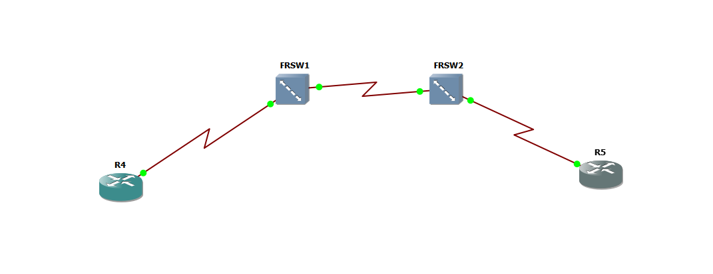
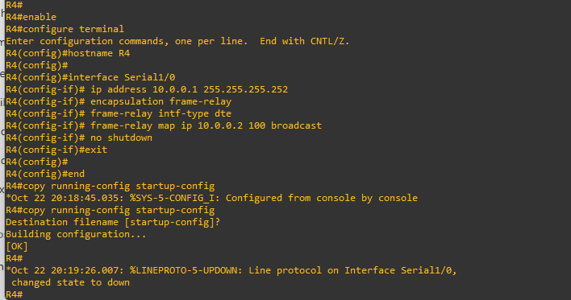
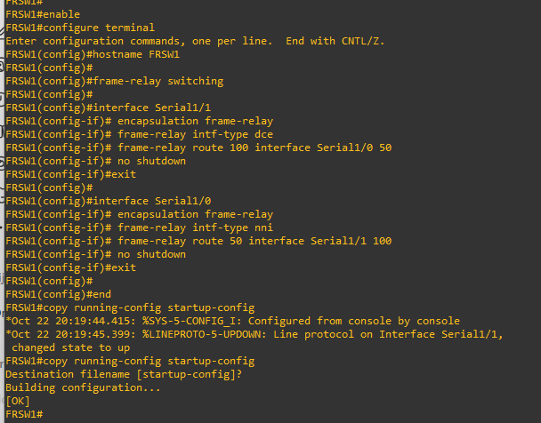
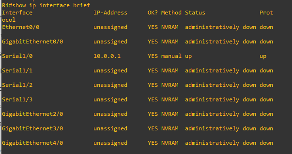
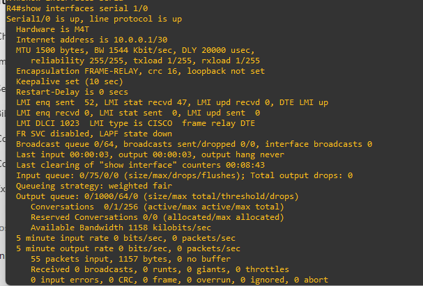
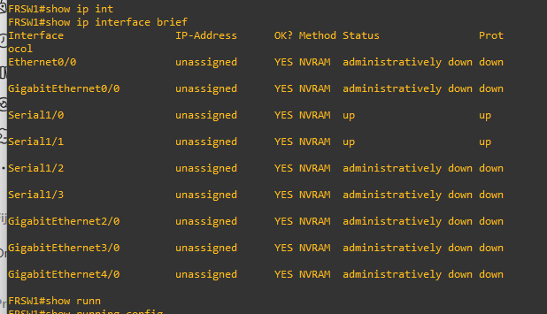
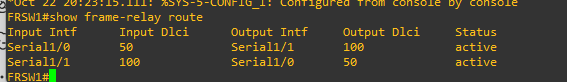
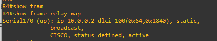
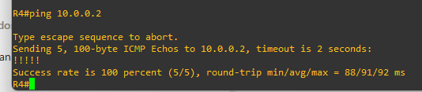
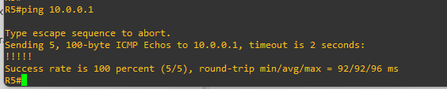

# Laboratorio Frame Relay en GNS3

**Estudiante:** Juan Felipe Becerra\
**Asignatura:** Banda Ancha

---

## 1. Topología y direcciones

La práctica conecta R4 con R5 por medio de dos switches: FRSW1 y FRSW2. Estos forman la nube Frame Relay por donde pasan los datos entre los routers.



| Equipo | Interfaz | Dirección IP | Función |
| --- | --- | --- | --- |
| R4 | Serial1/0 | 10.0.0.1/30 | Cliente DTE, DLCI 100 |
| FRSW1 | Serial1/1 | Sin IP | Hacia R4, DCE, DLCI 100 |
| FRSW1 | Serial1/0 | Sin IP | Hacia FRSW2, NNI, DLCI 50 |
| FRSW2 | Serial1/0 | Sin IP | Hacia FRSW1, NNI, DLCI 50 |
| FRSW2 | Serial1/1 | Sin IP | Hacia R5, DCE, DLCI 100 |
| R5 | Serial1/0 | 10.0.0.2/30 | Cliente DTE, DLCI 100 |

## 2. Configuración

### Router R4

Configuré la IP 10.0.0.1 en Serial1/0. El mapa indica que para llegar a R5, con IP 10.0.0.2, se debe usar el DLCI 100.

```cisco
enable
configure terminal
hostname R4
interface Serial1/0
 ip address 10.0.0.1 255.255.255.252
 encapsulation frame-relay
 frame-relay intf-type dte
 frame-relay map ip 10.0.0.2 100 broadcast
 no shutdown
end
copy running-config startup-config
```

La captura muestra los comandos y la confirmación **[OK]** al guardar.



### Switch FRSW1

Activé la conmutación Frame Relay. La interfaz hacia R4 usa DCE y la interfaz hacia FRSW2 usa NNI. Las dos rutas permiten pasar de DLCI 100 a 50 y hacer el recorrido de regreso.

```cisco
enable
configure terminal
hostname FRSW1
frame-relay switching
interface Serial1/1
 encapsulation frame-relay
 frame-relay intf-type dce
 frame-relay route 100 interface Serial1/0 50
 no shutdown
exit
interface Serial1/0
 encapsulation frame-relay
 frame-relay intf-type nni
 frame-relay route 50 interface Serial1/1 100
 no shutdown
end
copy running-config startup-config
```



### Switch FRSW2

Según la guía, FRSW2 debe recibir las tramas por el enlace con FRSW1 y enviarlas hacia R5. Este bloque resume la configuración indicada para ese equipo; no se incluye una captura de su configuración.

```cisco
enable
configure terminal
hostname FRSW2
frame-relay switching
interface Serial1/0
 encapsulation frame-relay
 frame-relay intf-type nni
 frame-relay route 50 interface Serial1/1 100
 no shutdown
exit
interface Serial1/1
 encapsulation frame-relay
 frame-relay intf-type dce
 frame-relay route 100 interface Serial1/0 50
 no shutdown
end
copy running-config startup-config
```

### Router R5

R5 usa la IP 10.0.0.2. Según la guía, su mapa debe apuntar a 10.0.0.1 por el DLCI 100. El siguiente bloque es la configuración de referencia; la evidencia disponible de R5 es el ping de regreso.

```cisco
enable
configure terminal
hostname R5
interface Serial1/0
 ip address 10.0.0.2 255.255.255.252
 encapsulation frame-relay
 frame-relay intf-type dte
 frame-relay map ip 10.0.0.1 100 broadcast
 no shutdown
end
copy running-config startup-config
```

## 3. Comprobaciones

### Estado de R4

Con `show ip interface brief` se observa que Serial1/0 tiene la IP 10.0.0.1 y está **up/up**.



Con `show interfaces Serial1/0` también se ve la máscara /30, la encapsulación **FRAME-RELAY**, el tipo **DTE** y cero errores de entrada en esa revisión.



### Estado y rutas de FRSW1

Las interfaces Serial1/0 y Serial1/1 aparecen **up/up**. No tienen IP porque en este laboratorio se usan para conmutar las tramas.



El comando `show frame-relay route` muestra las dos rutas en estado **active**: de DLCI 50 a 100 y de 100 a 50.



### Mapa de R4

Con `show frame-relay map` comprobé que la IP 10.0.0.2 está asociada al DLCI 100. El mapa aparece estático y activo.



El mapa relaciona la IP del destino con el circuito que se usa para llegar a él. La opción `broadcast` permite enviar tráfico de difusión por ese circuito. [Cisco: mapas Frame Relay](https://www.cisco.com/c/en/us/support/docs/wan/frame-relay/16563-12.html).

### Ping de R4 a R5

Desde R4 ejecuté `ping 10.0.0.2`. La prueba recibió **5 de 5 respuestas**, con un resultado del **100 %**.



### Ping de R5 a R4

Desde R5 ejecuté `ping 10.0.0.1`. También recibió **5 de 5 respuestas**. Con esto se comprobó la comunicación en ambos sentidos durante las pruebas.



---

## 4. Actividades prácticas

### Actividad 1. Interpretación de los DLCI

**1. ¿Por qué los routers R4 y R5 utilizan DLCI 100?**

Porque ese es el número asignado al circuito en cada enlace de cliente. Puede repetirse porque el DLCI tiene significado local dentro de su enlace. [Cisco: identificación local de los circuitos](https://www.cisco.com/c/en/us/support/docs/wan/frame-relay/16563-12.html).

**2. ¿Por qué el enlace entre FRSW1 y FRSW2 utiliza DLCI 50?**

Porque se eligió el 50 para identificar el circuito entre los switches. Las rutas relacionan ese número con el DLCI 100 de los clientes.

**3. ¿Por qué el DLCI no debe interpretarse como una dirección IP?**

La IP identifica una interfaz del router dentro de la red. El DLCI identifica un circuito en un enlace Frame Relay. Por eso cumplen funciones distintas.

**4. ¿Qué función cumple el cambio de DLCI dentro de la nube?**

Permite que cada switch envíe la trama por el siguiente enlace con el DLCI correspondiente. En esta práctica el recorrido es **100 → 50 → 100**.

### Actividad 2. Análisis del comando de conmutación

```cisco
frame-relay route 100 interface Serial1/0 50
```

| Pregunta | Respuesta |
| --- | --- |
| 1. ¿Cuál es el DLCI de entrada? | 100. El comando se aplica en Serial1/1 en esta topología. |
| 2. ¿Por cuál interfaz sale la trama? | Por Serial1/0. |
| 3. ¿Cuál es el DLCI de salida? | 50. |
| 4. ¿Qué ocurriría si se omite la asociación de retorno? | Faltaría el camino de regreso y el ping no se completaría. |

La ruta de regreso se configura en Serial1/0 con `frame-relay route 50 interface Serial1/1 100`. [Cisco: conmutación Frame Relay](https://www.cisco.com/c/en/us/td/docs/ios-xml/ios/wan_frly/configuration/12-4t/wan-frly-12-4t-book/wan-cfg-frm-rly.html).

### Actividad 3. Diagnóstico de errores

Si el mapa de R4 estuviera activo, pero el ping a R5 fallara, revisaría lo siguiente:

| Orden | Comando y equipo | Qué permite revisar |
| --- | --- | --- |
| 1 | `show ip interface brief` en los cuatro equipos | Muestra las IP y el estado de las interfaces. Si las seriales están up/up y las IP son correctas, descarto una interfaz apagada o una IP mal puesta. |
| 2 | `show interfaces Serial1/0` en R4 y R5 | Muestra la encapsulación y los errores. Si no aparece Frame Relay o aumentan los errores, revisaría ese enlace. |
| 3 | `show frame-relay map` en R4 y R5 | Permite comprobar que cada IP remota esté asociada al DLCI correcto y que el mapa esté activo. Hay que revisar los dos routers. |
| 4 | `show frame-relay route` en FRSW1 y FRSW2 | Muestra las interfaces y los DLCI de entrada y salida. Si las rutas coinciden con la topología y están activas, descarto una asociación faltante o equivocada. |
| 5 | `ping 10.0.0.2` desde R4 y `ping 10.0.0.1` desde R5 | Después de corregir el problema, comprobaría que ambos routers respondan. |

Estos comandos permiten revisar dónde está la falla antes de cambiar la configuración. [Cisco: diagnóstico de Frame Relay](https://www.cisco.com/en/US/docs/internetworking/troubleshooting/guide/tr1918.html).

### Actividad 4. Modificación del laboratorio

Propongo agregar **R6** como tercera sede. Conectaría su Serial1/0 a Serial1/2 de FRSW2. Esta modificación es una propuesta y no forma parte de las pruebas mostradas.

Cambiaría la máscara de los clientes a **255.255.255.248 (/29)** para usar la dirección **10.0.0.3** en R6. Con la máscara /30 original, esa dirección es el broadcast y no se puede asignar a un router.

| Router | IP en Serial1/0 | Nuevos mapas IP–DLCI |
| --- | --- | --- |
| R4 | 10.0.0.1/29 | 10.0.0.3 por DLCI 101 |
| R5 | 10.0.0.2/29 | 10.0.0.3 por DLCI 101 |
| R6 | 10.0.0.3/29 | 10.0.0.1 por DLCI 200 y 10.0.0.2 por DLCI 201 |

Mantendría el circuito entre R4 y R5. Para los nuevos mapas usaría `frame-relay map ip <IP remota> <DLCI> broadcast` con los valores de la tabla. R6 tendría el tipo DTE y Serial1/2 de FRSW2 sería DCE. En ambas interfaces usaría `encapsulation frame-relay` y `no shutdown`.

Agregaría estas rutas:

| Equipo | Interfaz donde se configura | Comando |
| --- | --- | --- |
| FRSW1 | Serial1/1 | `frame-relay route 101 interface Serial1/0 51` |
| FRSW1 | Serial1/0 | `frame-relay route 51 interface Serial1/1 101` |
| FRSW2 | Serial1/0 | `frame-relay route 51 interface Serial1/2 200` |
| FRSW2 | Serial1/2 | `frame-relay route 200 interface Serial1/0 51` |
| FRSW2 | Serial1/1 | `frame-relay route 101 interface Serial1/2 201` |
| FRSW2 | Serial1/2 | `frame-relay route 201 interface Serial1/1 101` |

Así, R4 llegaría a R6 por **101 → 51 → 200** y R5 por **101 → 201**. Las rutas incluyen el regreso.

Para verificarlo usaría `show frame-relay route` en los switches y `show frame-relay map` en los routers. Haría ping a 10.0.0.3 desde R4 y R5, y desde R6 haría ping a 10.0.0.1 y 10.0.0.2.

---

## 5. Preguntas de evaluación

| N.º | Pregunta | Respuesta |
| --- | --- | --- |
| 1 | ¿Cuál es la función principal de `frame-relay switching`? | **B.** Habilitar la conmutación Frame Relay en el router. |
| 2 | ¿Qué representa el DLCI 50 en este laboratorio? | **C.** El identificador del circuito virtual entre los switches. |
| 3 | ¿Qué hace `frame-relay map ip 10.0.0.2 100 broadcast`? | **A.** Asociar la IP 10.0.0.2 con el DLCI 100. |
| 4 | ¿Por qué se necesitan dos asociaciones `frame-relay route` por switch? | **B.** Para enviar las tramas en ambos sentidos. |
| 5 | ¿Qué verifica `show frame-relay route`? | **C.** Las asociaciones de conmutación entre interfaces y DLCI. |
| 6 | ¿Qué diferencia existe entre DTE y NNI en esta práctica? | **A.** DTE corresponde al cliente y NNI al enlace entre los switches. |
| 7 | ¿Qué indican cinco signos de exclamación en el ping? | **C.** Que se recibieron cinco respuestas ICMP satisfactorias. |

## 6. Conclusión

La práctica muestra cómo los mapas IP–DLCI y las rutas de los switches permiten comunicar los routers. En las pruebas, R4 y R5 recibieron cinco respuestas de cinco en ambos sentidos. También entendí que cada circuito necesita su camino de ida y de regreso.
