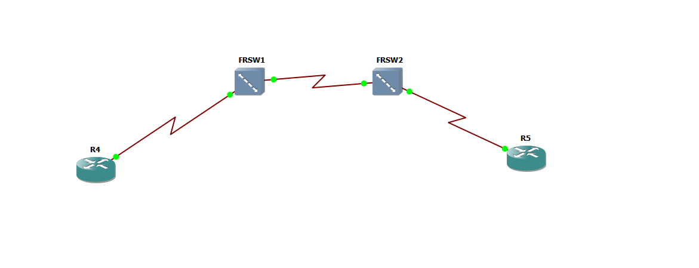
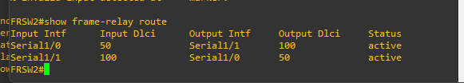

# Laboratorio Frame Relay con dos switches Cisco en GNS3

**Estudiante:** Julián Camilo Moreno Valderrama\
**Código estudiantil:** 1701805\
**Asignatura:** Banda Ancha\
**Fecha:** 22 de octubre de 2026

---

## 1. Desarrollo del laboratorio

Conecté los routers R4 y R5 por medio de FRSW1 y FRSW2, que funcionan como la nube Frame Relay. Utilicé GNS3 y routers Cisco 7200 con IOS 12.4(25g).

**Topología de la práctica:**



| Equipo | Interfaz | Dirección IP | Función y DLCI |
| --- | --- | --- | --- |
| R4 | Serial1/0 | 10.0.0.1/30 | Cliente DTE, DLCI 100 |
| FRSW1 | Serial1/1 | Sin IP | Hacia R4, DCE, DLCI 100 |
| FRSW1 | Serial1/0 | Sin IP | Hacia FRSW2, NNI, DLCI 50 |
| FRSW2 | Serial1/0 | Sin IP | Hacia FRSW1, NNI, DLCI 50 |
| FRSW2 | Serial1/1 | Sin IP | Hacia R5, DCE, DLCI 100 |
| R5 | Serial1/0 | 10.0.0.2/30 | Cliente DTE, DLCI 100 |

### Configuración de R4

Le asigné la IP 10.0.0.1 a la interfaz que va hacia FRSW1. El mapa indica que para llegar a R5 (10.0.0.2) debe usar el DLCI 100.

```cisco
configure terminal
interface Serial1/0
 ip address 10.0.0.1 255.255.255.252
 encapsulation frame-relay
 frame-relay map ip 10.0.0.2 100 broadcast
 no shutdown
end
write memory
```

### Configuración de FRSW1

Habilité la conmutación Frame Relay. Serial1/1 recibe las tramas de R4 con DLCI 100 y las envía a FRSW2 por Serial1/0 con DLCI 50. La segunda ruta permite el regreso.

```cisco
configure terminal
frame-relay switching
interface Serial1/0
 encapsulation frame-relay
 frame-relay intf-type nni
 frame-relay route 50 interface Serial1/1 100
 no shutdown
interface Serial1/1
 encapsulation frame-relay
 frame-relay intf-type dce
 frame-relay route 100 interface Serial1/0 50
 no shutdown
end
write memory
```

### Configuración de FRSW2

Este switch recibe el circuito desde FRSW1 por Serial1/0 y lo entrega a R5 por Serial1/1. También tiene la ruta contraria para que R5 pueda responder.

```cisco
configure terminal
frame-relay switching
interface Serial1/0
 encapsulation frame-relay
 frame-relay intf-type nni
 frame-relay route 50 interface Serial1/1 100
 no shutdown
interface Serial1/1
 encapsulation frame-relay
 frame-relay intf-type dce
 frame-relay route 100 interface Serial1/0 50
 no shutdown
end
write memory
```

### Configuración de R5

Le asigné la IP 10.0.0.2 a la interfaz conectada con FRSW2. Su mapa usa el DLCI 100 para enviar tráfico hacia R4 (10.0.0.1).

```cisco
configure terminal
interface Serial1/0
 ip address 10.0.0.2 255.255.255.252
 encapsulation frame-relay
 frame-relay map ip 10.0.0.1 100 broadcast
 no shutdown
end
write memory
```

Durante la configuración, `frame-relay intf-type` no se reconocía porque faltaba aplicar `encapsulation frame-relay` en la interfaz. Después de agregarlo, aparecieron las opciones DTE, DCE y NNI.

**Configuraciones completas guardadas:** [R4](configs/R4.cfg), [R5](configs/R5.cfg), [FRSW1](configs/FRSW1.cfg) y [FRSW2](configs/FRSW2.cfg).\
**Proyecto:** [Frame Relay en GNS3](FrameRelay-JulianMoreno.gns3project). Para abrirlo se necesita la imagen `c7200-a3jk9s-mz.124-25g.image` instalada en GNS3.

---

## 2. Verificación

### Rutas en FRSW1 y FRSW2

Con `show frame-relay route` comprobé que las dos rutas de cada switch estaban en estado **active**. Una lleva las tramas de Serial1/1 con DLCI 100 hacia Serial1/0 con DLCI 50; la otra hace el recorrido contrario.

**Rutas activas en FRSW1:**


**Rutas activas en FRSW2:**



### Mapa de R4

El comando `show frame-relay map` mostró este resultado:

```text
Serial1/0 (up): ip 10.0.0.2 dlci 100(0x64,0x1840), static,
              broadcast,
              CISCO, status defined, active
```

La interfaz estaba activa y tenía un mapa estático hacia R5 por el DLCI 100. La opción `broadcast` permite enviar por ese circuito el tráfico de difusión y multidifusión que corresponda. [Cisco: mapas Frame Relay y opción broadcast](https://www.cisco.com/c/en/us/support/docs/wan/frame-relay/16563-12.html).

### Ping en ambos sentidos

Desde R4 hice ping a 10.0.0.2 y recibí **5 de 5 respuestas**.


Desde R5 repetí la prueba hacia 10.0.0.1. El resultado guardado en la consola fue:

```text
R5#ping 10.0.0.1
Sending 5, 100-byte ICMP Echos to 10.0.0.1, timeout is 2 seconds:
!!!!!
Success rate is 100 percent (5/5), round-trip min/avg/max = 80/92/104 ms
```

Con estas pruebas comprobé que R4 y R5 podían comunicarse a través de los dos switches.

---

## 3. Actividades prácticas

### Actividad 1. Interpretación de los DLCI

**1. ¿Por qué los routers R4 y R5 utilizan DLCI 100?**

Porque ese fue el número asignado al circuito en cada enlace hacia la nube. Pueden usar el mismo número porque el DLCI tiene significado local. No es obligatorio que ambos extremos tengan el mismo valor.

**2. ¿Por qué el enlace entre FRSW1 y FRSW2 utiliza DLCI 50?**

Porque se eligió el 50 para identificar el circuito en ese enlace. Los switches tienen las asociaciones necesarias para pasar de 100 a 50 y de 50 a 100.

**3. ¿Por qué el DLCI no debe interpretarse como una dirección IP?**

Porque identifica un circuito virtual de capa 2 dentro de un enlace. La IP identifica una interfaz en una red de capa 3, como 10.0.0.1 en R4. [Cisco: significado local del DLCI](https://www.cisco.com/c/en/us/support/docs/wan/frame-relay/16563-12.html).

**4. ¿Qué función cumple el cambio de DLCI dentro de la nube?**

Permite que cada switch use el identificador asignado al siguiente enlace y envíe la trama hacia su destino. En esta práctica el recorrido es 100 → 50 → 100.

### Actividad 2. Análisis del comando de conmutación

Comando de la guía:

```text
frame-relay route 100 interface Serial1/0 50
```

| Pregunta | Respuesta |
| --- | --- |
| 1. ¿Cuál es el DLCI de entrada? | 100, en la interfaz donde se configura el comando; en esta práctica, Serial1/1. |
| 2. ¿Por cuál interfaz sale la trama? | Por Serial1/0. |
| 3. ¿Cuál es el DLCI de salida? | 50. |
| 4. ¿Qué ocurriría si se omite la asociación de retorno? | Faltaría el camino de regreso. Un ping no se completaría porque necesita que vuelva la respuesta. |

La asociación de retorno se configura en Serial1/0 con `frame-relay route 50 interface Serial1/1 100`. [Cisco: conmutación Frame Relay](https://www.cisco.com/c/en/us/td/docs/ios-xml/ios/wan_frly/configuration/12-4t/wan-frly-12-4t-book/wan-cfg-frm-rly.html).

### Actividad 3. Diagnóstico de errores

Si el mapa de R4 aparece activo, pero el ping hacia R5 falla, seguiría esta secuencia:

| Paso | Comando y equipo | Qué revisaría |
| --- | --- | --- |
| 1 | `show ip interface brief` en los cuatro equipos | Que las seriales usadas estén up/up y que R4 y R5 tengan las IP correctas. Esto permite detectar interfaces apagadas o direcciones equivocadas. |
| 2 | `show interfaces Serial1/0` en R4 y R5 | La encapsulación Frame Relay, el estado del protocolo y los contadores de errores. Así revisaría si el problema está en el enlace. |
| 3 | `show frame-relay map` en R4 y R5 | Que cada IP remota esté asociada al DLCI 100 y aparezca activa. El mapa correcto de R4 no confirma el de R5. |
| 4 | `show frame-relay route` en FRSW1 y FRSW2 | Que existan las dos asociaciones 100 ↔ 50 con las interfaces correctas. Esto permite detectar una ruta de retorno faltante. |
| 5 | `show running-config` en los cuatro equipos | La máscara, los mapas y cualquier diferencia con la guía. Si lo anterior está bien, también revisaría si hay alguna lista de acceso bloqueando ICMP. |
| 6 | `ping 10.0.0.2` desde R4 y `ping 10.0.0.1` desde R5 | Repetiría la prueba después de corregir el problema para comprobar ambos sentidos. |

Estos comandos permiten revisar el enlace, los circuitos y la comunicación IP por separado. [Cisco: diagnóstico de Frame Relay](https://www.cisco.com/en/US/docs/internetworking/troubleshooting/guide/tr1918.html).

### Actividad 4. Modificación del laboratorio

Propongo agregar **R6** como tercera sede y conectar su Serial1/0 a Serial1/2 de FRSW2. Esta es una propuesta; no la ejecuté en la práctica.

Cambiaría la máscara de las seriales de R4 y R5 a **255.255.255.248 (/29)** y asignaría **10.0.0.3/29** a R6. La red 10.0.0.0/29 permite las direcciones .1 a .6. Con la máscara /30 original, .3 era la dirección de broadcast y no servía para otro router.

| Router | IP propuesta en Serial1/0 | Mapa nuevo para llegar a la otra sede |
| --- | --- | --- |
| R4 | 10.0.0.1/29 | 10.0.0.3 por DLCI 101 |
| R5 | 10.0.0.2/29 | 10.0.0.3 por DLCI 101 |
| R6 | 10.0.0.3/29 | 10.0.0.1 por DLCI 200 y 10.0.0.2 por DLCI 201 |

Mantendría el circuito existente entre R4 y R5. Para los nuevos mapas usaría `frame-relay map ip <IP remota> <DLCI> broadcast` con los valores de la tabla. R6 sería DTE y Serial1/2 de FRSW2 sería DCE; ambas interfaces usarían `encapsulation frame-relay` y `no shutdown`.

Agregaría estas asociaciones en los switches:

| Switch | Interfaz donde se configura | Comando nuevo |
| --- | --- | --- |
| FRSW1 | Serial1/1 | `frame-relay route 101 interface Serial1/0 51` |
| FRSW1 | Serial1/0 | `frame-relay route 51 interface Serial1/1 101` |
| FRSW2 | Serial1/0 | `frame-relay route 51 interface Serial1/2 200` |
| FRSW2 | Serial1/2 | `frame-relay route 200 interface Serial1/0 51` |
| FRSW2 | Serial1/1 | `frame-relay route 101 interface Serial1/2 201` |
| FRSW2 | Serial1/2 | `frame-relay route 201 interface Serial1/1 101` |

Así, R4 llegaría a R6 por los DLCI **101 → 51 → 200**. R5 llegaría a R6 dentro de FRSW2 por **101 → 201**. Cada recorrido tiene su asociación de regreso.

Para comprobarlo usaría `show frame-relay route` en los switches y `show frame-relay map` en los tres routers. Haría `ping 10.0.0.3` desde R4 y R5; desde R6 probaría `ping 10.0.0.1` y `ping 10.0.0.2`.

---

## 4. Preguntas de evaluación

| N.º | Pregunta | Respuesta |
| --- | --- | --- |
| 1 | ¿Cuál es la función principal de `frame-relay switching`? | **B.** Habilitar la conmutación Frame Relay en el router. |
| 2 | ¿Qué representa el DLCI 50 en este laboratorio? | **C.** El identificador del circuito virtual en el enlace entre switches. |
| 3 | ¿Qué hace `frame-relay map ip 10.0.0.2 100 broadcast`? | **A.** Asocia la dirección IP 10.0.0.2 con el DLCI 100. |
| 4 | ¿Por qué se necesitan dos asociaciones `frame-relay route` por switch? | **B.** Para reenviar las tramas en ambos sentidos. |
| 5 | ¿Qué verifica `show frame-relay route`? | **C.** Las asociaciones de conmutación entre interfaces y DLCI. |
| 6 | ¿Qué diferencia existe entre DTE y NNI en esta práctica? | **A.** DTE corresponde al cliente y NNI al enlace entre switches de la nube. |
| 7 | ¿Qué indican cinco signos de exclamación en el ping? | **C.** Que se recibieron cinco respuestas ICMP satisfactorias. |

---

## 5. Conclusión

Entendí que la IP y el DLCI cumplen funciones distintas: la IP identifica una interfaz del router dentro de la red y el DLCI indica el circuito que se usa en cada enlace. También comprobé que se necesitan las rutas de ida y regreso. Al final, los mapas y las rutas quedaron activos y los pings respondieron 5 de 5 en ambos sentidos.
