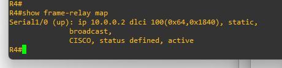
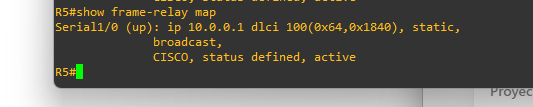
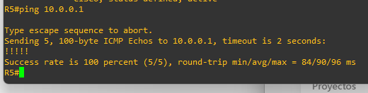

# Laboratorio Frame Relay con dos switches Cisco en GNS3

**Estudiante:** Julián Camilo Moreno Valderrama\
**Código estudiantil:** 1701805\
**Asignatura:** Banda Ancha\
**Fecha:** 22 de octubre de 2026

---

## 1. Desarrollo del laboratorio

Conecté R4 y R5 a través de FRSW1 y FRSW2 para formar la nube Frame Relay. Hice la práctica en GNS3 con routers Cisco 7200 e IOS 12.4(25g).

**Topología de la práctica:**


| Equipo | Interfaz | Dirección IP | Función y DLCI |
| --- | --- | --- | --- |
| R4 | Serial1/0 | 10.0.0.1/30 | Cliente DTE, DLCI 100 |
| FRSW1 | Serial1/1 | Sin IP | Hacia R4, DCE, DLCI 100 |
| FRSW1 | Serial1/0 | Sin IP | Hacia FRSW2, NNI, DLCI 50 |
| FRSW2 | Serial1/0 | Sin IP | Hacia FRSW1, NNI, DLCI 50 |
| FRSW2 | Serial1/1 | Sin IP | Hacia R5, DCE, DLCI 100 |
| R5 | Serial1/0 | 10.0.0.2/30 | Cliente DTE, DLCI 100 |

### Configuración de R4

Le puse la IP 10.0.0.1 a la interfaz conectada con FRSW1. El mapa le indica a R4 que use el DLCI 100 para llegar a R5.

```cisco
configure terminal
interface Serial1/0
 ip address 10.0.0.1 255.255.255.252
 encapsulation frame-relay
 frame-relay intf-type dte
 frame-relay map ip 10.0.0.2 100 broadcast
 no shutdown
end
write memory
```

### Configuración de FRSW1

Activé la conmutación Frame Relay en FRSW1. Las tramas llegan desde R4 por Serial1/1 con DLCI 100 y salen hacia FRSW2 por Serial1/0 con DLCI 50. También configuré el camino de regreso.

```cisco
configure terminal
frame-relay switching
interface Serial1/0
 encapsulation frame-relay
 frame-relay intf-type nni
 frame-relay route 50 interface Serial1/1 100
 no shutdown
interface Serial1/1
 encapsulation frame-relay
 frame-relay intf-type dce
 frame-relay route 100 interface Serial1/0 50
 no shutdown
end
write memory
```

### Configuración de FRSW2

FRSW2 recibe las tramas de FRSW1 por Serial1/0 y las envía a R5 por Serial1/1. Configuré la ruta contraria para que R5 pueda responder.

```cisco
configure terminal
frame-relay switching
interface Serial1/0
 encapsulation frame-relay
 frame-relay intf-type nni
 frame-relay route 50 interface Serial1/1 100
 no shutdown
interface Serial1/1
 encapsulation frame-relay
 frame-relay intf-type dce
 frame-relay route 100 interface Serial1/0 50
 no shutdown
end
write memory
```

### Configuración de R5

Le puse la IP 10.0.0.2 a la interfaz conectada con FRSW2. El mapa le indica a R5 que use el DLCI 100 para llegar a R4.

```cisco
configure terminal
interface Serial1/0
 ip address 10.0.0.2 255.255.255.252
 encapsulation frame-relay
 frame-relay intf-type dte
 frame-relay map ip 10.0.0.1 100 broadcast
 no shutdown
end
write memory
```

Al principio, el equipo no aceptó `frame-relay intf-type` porque faltaba `encapsulation frame-relay`. Lo corregí y pude continuar. También ejecuté `frame-relay intf-type dte` en R4 y R5. IOS lo aceptó, pero no aparece en `show running-config` porque DTE ya es el valor predeterminado.

**Configuraciones completas guardadas:** [R4](configs/R4.cfg), [R5](configs/R5.cfg), [FRSW1](configs/FRSW1.cfg) y [FRSW2](configs/FRSW2.cfg).\
**Proyecto:** [Frame Relay en GNS3](FrameRelay-JulianMoreno.gns3project). Para abrirlo se necesita la imagen `c7200-a3jk9s-mz.124-25g.image` instalada en GNS3.

---

## 2. Verificación

### Rutas en FRSW1 y FRSW2

Con `show frame-relay route` comprobé que cada switch tiene dos rutas en estado **active**: una de ida y otra de regreso.

**Rutas activas en FRSW1:**


**Rutas activas en FRSW2:**


### Mapas de R4 y R5

En R4, `show frame-relay map` mostró el mapa hacia 10.0.0.2:



El mapa de R4 estaba activo y relacionaba la IP de R5 con el DLCI 100. `broadcast` permite enviar por ese circuito los mensajes de difusión necesarios. [Cisco: mapas Frame Relay y opción broadcast](https://www.cisco.com/c/en/us/support/docs/wan/frame-relay/16563-12.html).

En R5 comprobé el mapa de regreso hacia 10.0.0.1 con el mismo comando:



Los dos mapas aparecieron activos.

### Ping en ambos sentidos

Desde R4 hice ping a 10.0.0.2 y recibí **5 de 5 respuestas**.


Desde R5 repetí el ping hacia 10.0.0.1 y también recibí **5 de 5 respuestas**.



Los pings confirmaron que R4 y R5 se comunican en ambos sentidos.

---

## 3. Actividades prácticas

### Actividad 1. Interpretación de los DLCI

**1. ¿Por qué los routers R4 y R5 utilizan DLCI 100?**

Porque en cada enlace hacia la nube se usó el DLCI 100. El número solo tiene valor en su propio enlace, por eso puede repetirse en R4 y R5.

**2. ¿Por qué el enlace entre FRSW1 y FRSW2 utiliza DLCI 50?**

Porque el DLCI 50 identifica el circuito entre los dos switches. Las rutas de cada switch permiten cambiar entre 100 y 50.

**3. ¿Por qué el DLCI no debe interpretarse como una dirección IP?**

Porque el DLCI identifica el circuito que se usa en un enlace, mientras que la IP identifica la interfaz del router dentro de la red. [Cisco: significado local del DLCI](https://www.cisco.com/c/en/us/support/docs/wan/frame-relay/16563-12.html).

**4. ¿Qué función cumple el cambio de DLCI dentro de la nube?**

Permite que la trama avance por cada enlace con el número que le corresponde. Aquí el recorrido es **100 → 50 → 100**.

### Actividad 2. Análisis del comando de conmutación

Comando de la guía:

```text
frame-relay route 100 interface Serial1/0 50
```

| Pregunta | Respuesta |
| --- | --- |
| 1. ¿Cuál es el DLCI de entrada? | 100, en la interfaz donde se configura el comando; en esta práctica, Serial1/1. |
| 2. ¿Por cuál interfaz sale la trama? | Por Serial1/0. |
| 3. ¿Cuál es el DLCI de salida? | 50. |
| 4. ¿Qué ocurriría si se omite la asociación de retorno? | La respuesta no tendría una ruta de regreso y el ping fallaría. |

La asociación de retorno se configura en Serial1/0 con `frame-relay route 50 interface Serial1/1 100`. [Cisco: conmutación Frame Relay](https://www.cisco.com/c/en/us/td/docs/ios-xml/ios/wan_frly/configuration/12-4t/wan-frly-12-4t-book/wan-cfg-frm-rly.html).

### Actividad 3. Diagnóstico de errores

Si el mapa de R4 está activo, pero el ping a R5 falla, revisaría esto en orden:

| Paso | Comando y equipo | Qué revisaría |
| --- | --- | --- |
| 1 | `show ip interface brief` en los cuatro equipos | Si las interfaces están activas y las IP son correctas, descarto una interfaz apagada o una IP mal puesta. |
| 2 | `show interfaces Serial1/0` en R4 y R5 | Si aparece Frame Relay y no hay errores en la interfaz, descarto un problema básico en ese enlace. |
| 3 | `show frame-relay map` en R4 y R5 | Si cada IP está asociada al DLCI 100 y los mapas están activos, descarto un mapa incorrecto en los routers. |
| 4 | `show frame-relay route` en FRSW1 y FRSW2 | Si están activas las rutas de ida y regreso, descarto que falte la ruta de retorno en la nube. |
| 5 | `ping 10.0.0.2` desde R4 y `ping 10.0.0.1` desde R5 | Repito los pings para comprobar si la corrección funcionó en ambos sentidos. |

[Cisco: comandos para revisar fallas en Frame Relay](https://www.cisco.com/en/US/docs/internetworking/troubleshooting/guide/tr1918.html).

### Actividad 4. Modificación del laboratorio

Agregaría **R6** como tercera sede y lo conectaría a Serial1/2 de FRSW2. Esta parte es una propuesta; no la configuré en GNS3.

Cambiaría la máscara de R4 y R5 a **255.255.255.248 (/29)** para poder darle **10.0.0.3/29** a R6. Con la máscara original (/30), la dirección .3 no se podía usar para otro router.

| Router | IP propuesta en Serial1/0 | Mapa nuevo para llegar a la otra sede |
| --- | --- | --- |
| R4 | 10.0.0.1/29 | 10.0.0.3 por DLCI 101 |
| R5 | 10.0.0.2/29 | 10.0.0.3 por DLCI 101 |
| R6 | 10.0.0.3/29 | 10.0.0.1 por DLCI 200 y 10.0.0.2 por DLCI 201 |

Dejaría el circuito de R4 a R5 como está. Para los mapas nuevos usaría `frame-relay map ip <IP remota> <DLCI> broadcast` con los valores de la tabla. R6 sería DTE y la interfaz de FRSW2 conectada a él sería DCE. En ambas pondría `encapsulation frame-relay` y `no shutdown`.

Agregaría estas asociaciones en los switches:

| Switch | Interfaz donde se configura | Comando nuevo |
| --- | --- | --- |
| FRSW1 | Serial1/1 | `frame-relay route 101 interface Serial1/0 51` |
| FRSW1 | Serial1/0 | `frame-relay route 51 interface Serial1/1 101` |
| FRSW2 | Serial1/0 | `frame-relay route 51 interface Serial1/2 200` |
| FRSW2 | Serial1/2 | `frame-relay route 200 interface Serial1/0 51` |
| FRSW2 | Serial1/1 | `frame-relay route 101 interface Serial1/2 201` |
| FRSW2 | Serial1/2 | `frame-relay route 201 interface Serial1/1 101` |

Con estas rutas, R4 llegaría a R6 por **101 → 51 → 200**, y R5 llegaría por **101 → 201**. También incluí las rutas de regreso.

Para comprobarlo usaría `show frame-relay route` en los switches y `show frame-relay map` en los tres routers. Haría `ping 10.0.0.3` desde R4 y R5; desde R6 probaría `ping 10.0.0.1` y `ping 10.0.0.2`.

---

## 4. Preguntas de evaluación

| N.º | Pregunta | Respuesta |
| --- | --- | --- |
| 1 | ¿Cuál es la función principal de `frame-relay switching`? | **B.** Habilitar la conmutación Frame Relay en el router. |
| 2 | ¿Qué representa el DLCI 50 en este laboratorio? | **C.** El identificador del circuito virtual en el enlace entre switches. |
| 3 | ¿Qué hace `frame-relay map ip 10.0.0.2 100 broadcast`? | **A.** Asocia la dirección IP 10.0.0.2 con el DLCI 100. |
| 4 | ¿Por qué se necesitan dos asociaciones `frame-relay route` por switch? | **B.** Para reenviar las tramas en ambos sentidos. |
| 5 | ¿Qué verifica `show frame-relay route`? | **C.** Las asociaciones de conmutación entre interfaces y DLCI. |
| 6 | ¿Qué diferencia existe entre DTE y NNI en esta práctica? | **A.** DTE corresponde al cliente y NNI al enlace entre switches de la nube. |
| 7 | ¿Qué indican cinco signos de exclamación en el ping? | **C.** Que se recibieron cinco respuestas ICMP satisfactorias. |

---

## 5. Conclusión

Aprendí que la IP identifica una interfaz del router y el DLCI indica el circuito que usa cada enlace. Las rutas de ida y regreso quedaron activas y los pings respondieron 5 de 5 en los dos sentidos.
