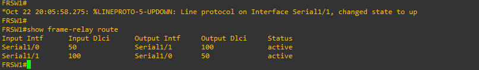
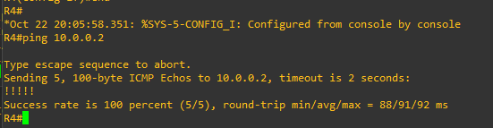

# Taller Frame Relay

Julián Moreno — Banda ancha

Conecté R4 y R5 por medio de dos switches Frame Relay: FRSW1 y FRSW2.
R4 usa la dirección 10.0.0.1/30 y R5 usa 10.0.0.2/30. Los enlaces hacia los clientes usan DLCI 100 y el enlace entre los switches usa DLCI 50.

Las dos rutas de cada switch quedaron activas. Los pings de R4 a R5 y de R5 a R4 respondieron 5 de 5. Las configuraciones quedaron guardadas en los cuatro equipos.

## Archivos

- **FrameRelay-JulianMoreno.gns3project:** proyecto para importar en GNS3.
- **configuraciones:** configuración guardada de R4, R5, FRSW1 y FRSW2.
- **evidencias:** capturas de la topología, las rutas y el ping, junto con los resultados de verificación de los cuatro equipos. El ping de regreso está en `R5-verificacion.txt`.
- **Entrega_FrameRelay_JulianMoreno.zip:** todos los archivos de esta entrega juntos.

Para abrir la práctica, importar el archivo `.gns3project` en GNS3. Se necesita tener instalada la imagen `c7200-a3jk9s-mz.124-25g.image` (IOS 12.4(25g)). La imagen IOS se instala por separado.

