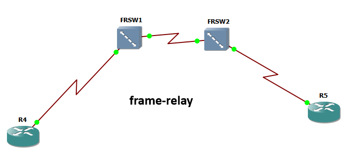

# Guía de laboratorio: Implementación de una nube Frame Relay con dos switches Cisco

## 1. Información general

**Área:** Redes de comunicaciones y conectividad WAN\
**Tecnología:** Frame Relay\
**Modalidad:** Laboratorio práctico de configuración y verificación\
**Plataformas sugeridas:** Cisco Packet Tracer, GNS3 o EVE-NG, según compatibilidad con la imagen IOS.

### 1.1. Objetivo general

Configurar una nube Frame Relay compuesta por dos switches intermedios que permitan establecer una conexión lógica bidireccional entre dos routers clientes, mediante la conmutación de circuitos virtuales identificados por DLCI (*Data-Link Connection Identifier*).

### 1.2. Objetivos específicos

Al finalizar el laboratorio, el estudiante estará en capacidad de:

- Explicar el funcionamiento de Frame Relay en redes WAN.
- Diferenciar los roles DTE, DCE y NNI.
- Configurar interfaces seriales para el transporte de tramas Frame Relay.
- Implementar rutas de conmutación mediante el comando `frame-relay route`.
- Interpretar las tablas de rutas y los mapas de direcciones Frame Relay.
- Verificar la conectividad y diagnosticar errores de configuración.

---

## 2. Fundamentos teóricos

### 2.1. ¿Qué es Frame Relay?

Frame Relay es una tecnología de conmutación de tramas utilizada históricamente en redes WAN para interconectar sedes geográficamente distribuidas.

A diferencia de una conexión dedicada punto a punto, Frame Relay permite transportar tráfico de diferentes conexiones lógicas sobre una infraestructura compartida.

Sus principales conceptos son:

- **Trama:** unidad de datos que se transporta por la red.
- **DLCI:** identificador de una conexión lógica dentro de un enlace Frame Relay.
- **Circuito virtual:** camino lógico que permite transportar tráfico entre dos puntos.
- **DTE:** equipo terminal del cliente que utiliza el servicio WAN.
- **DCE:** equipo o extremo que proporciona la temporización física de una interfaz serial cuando corresponde.
- **NNI:** interfaz de interconexión entre nodos de la red del proveedor.

Frame Relay pertenece principalmente a la capa de enlace de datos del modelo OSI. El DLCI identifica el circuito virtual localmente dentro de la interfaz correspondiente; no es una dirección IP ni un identificador global que deba ser idéntico en toda la red.

> **Nota:** Frame Relay es una tecnología heredada. Su estudio sigue siendo útil para comprender la conmutación WAN, los circuitos virtuales y los principios de encaminamiento en redes de operadores.

### 2.2. Arquitectura del laboratorio

La infraestructura está compuesta por cuatro  dispositivos:



- **R4:** router cliente de la primera sede.
- **FRSW1:** switch Frame Relay de la primera parte de la nube.
- **FRSW2:** switch Frame Relay de la segunda parte de la nube.
- **R5:** router cliente de la segunda sede.

La conexión lógica se representa así:

```
 Sede A                 Nube Frame Relay                 Sede B

   R4                    FRSW1        FRSW2                R5
   |                       |             |                  |
   | S1/0                  | S1/0   S1/0 |             S1/0 |
   +-----------------------+-------------+------------------+
       DLCI 100              DLCI 50          DLCI 100
       IP .0.1                                  IP .0.2
```

La topología física debe construirse con las siguientes conexiones:

```
R4 Serial1/0
     |
     | DLCI 100
     |
FRSW1 Serial1/1
FRSW1 Serial1/0
     |
     | DLCI 50
     |
FRSW2 Serial1/0
FRSW2 Serial1/1
     |
     | DLCI 100
     |
R5 Serial1/0
```

**Importante:** el diagrama es conceptual. Las conexiones físicas exactas deben corresponder con las interfaces utilizadas en los comandos. Si se emplea una topología distinta, será necesario adaptar los nombres de las interfaces.

### 2.3. Plan de direccionamiento y DLCI

| Equipo | Interfaz  | Dirección IP               | DLCI o función      |
| ------ | --------- | -------------------------- | ------------------- |
| R4     | Serial1/0 | 10.0.0.1/30                | DLCI 100            |
| FRSW1  | Serial1/1 | No requerida para conmutar | DLCI de cliente 100 |
| FRSW1  | Serial1/0 | No requerida para conmutar | DLCI de enlace 50   |
| FRSW2  | Serial1/0 | No requerida para conmutar | DLCI de enlace 50   |
| FRSW2  | Serial1/1 | No requerida para conmutar | DLCI de cliente 100 |
| R5     | Serial1/0 | 10.0.0.2/30                | DLCI 100            |

Las direcciones IP de los routers clientes pertenecen a la misma subred `10.0.0.0/30`.

| Dirección | Uso                    |
| --------- | ---------------------- |
| 10.0.0.0  | Dirección de red       |
| 10.0.0.1  | R4                     |
| 10.0.0.2  | R5                     |
| 10.0.0.3  | Broadcast de la subred |

Los switches Frame Relay no necesitan direcciones IP en sus interfaces de conmutación para realizar la función de retransmisión de tramas descrita en este laboratorio.

### 2.4. ¿Cómo se transporta una trama?

El cliente envía una trama con DLCI 100 hacia la nube. FRSW1 recibe esa trama y utiliza una entrada de su tabla de conmutación para enviarla por la interfaz de interconexión, cambiando el DLCI a 50.

FRSW2 recibe la trama por el enlace entre switches y la transmite hacia la interfaz de R5, utilizando nuevamente el DLCI 100.

En el sentido inverso ocurre el proceso equivalente.

```
R4                  FRSW1              FRSW2                  R5
 |                     |                  |                    |
 |---- DLCI 100 ------>|                  |                    |
 |                     |-- DLCI 50 ------>|                    |
 |                     |                  |---- DLCI 100 ----->|
 |                     |                  |                    |
 |<------------------- Tráfico de retorno bidireccional -------|
```

El DLCI puede cambiar en cada segmento de la nube. Por eso, el valor 50 se utiliza en el enlace entre switches, mientras que el valor 100 se utiliza en las interfaces orientadas a los clientes.

---

## 3. Comandos poco frecuentes: explicación teórica

Esta sección explica los comandos que suelen generar más dificultades al configurar Frame Relay.

### 3.1. `frame-relay switching`

**Modo de configuración:** configuración global.

```
FRSW1(config)# frame-relay switching
```

Activa la capacidad de conmutación Frame Relay en el router Cisco, convirtiéndolo funcionalmente en un switch Frame Relay.

Por defecto, un router configurado para operar como DTE no realiza necesariamente la conmutación de circuitos virtuales entre interfaces. Este comando habilita la función de switching requerida por la nube del laboratorio.

**¿Cuándo se utiliza?**

Cuando un router debe recibir tramas Frame Relay por una interfaz y reenviarlas por otra, de acuerdo con una tabla de rutas DLCI.

**Error frecuente:** configurar las interfaces seriales y sus DLCI sin habilitar la función de conmutación global.

### 3.2. `frame-relay intf-type dte`

```
R4(config-if)# frame-relay intf-type dte
```

Define el tipo de interfaz Frame Relay como DTE (*Data Terminal Equipment*).

En este laboratorio, R4 y R5 son equipos clientes que consumen el servicio de la nube Frame Relay.

La distinción entre el rol lógico DTE/DCE y la temporización eléctrica de una interfaz serial es importante: no deben confundirse.

- **DTE:** representa el lado terminal de la conexión Frame Relay.
- **DCE:** representa el lado de red correspondiente al servicio Frame Relay en la interfaz.
- **NNI:** identifica la interconexión entre nodos de la red.

El comando `frame-relay intf-type dte` define el tipo de interfaz Frame Relay, no asigna una dirección IP ni crea un circuito virtual por sí mismo.

### 3.3. `frame-relay intf-type dce`

```
FRSW1(config-if)# frame-relay intf-type dce
```

Configura la interfaz Frame Relay con el rol DCE, normalmente empleado en el lado de la nube que conecta con un DTE cliente.

En el laboratorio, las interfaces Serial1/1 de FRSW1 y FRSW2 miran hacia los routers clientes y se configuran como DCE desde el punto de vista Frame Relay.

Este comando no debe confundirse con la configuración de reloj físico de la interfaz serial. Aunque ambos conceptos pueden aparecer en el mismo equipo, cumplen funciones diferentes.

### 3.4. `frame-relay intf-type nni`

```
FRSW1(config-if)# frame-relay intf-type nni
```

Configura el tipo de interfaz como NNI (*Network-to-Network Interface*), es decir, una interfaz entre dos nodos de la red Frame Relay.

En esta práctica, las interfaces Serial1/0 de FRSW1 y FRSW2 forman el enlace interno de la nube.

El comando permite diferenciar el enlace entre switches de las interfaces que atienden a los clientes.

**Diferencia esencial:**

| Tipo | Función en la práctica                   |
| ---- | ---------------------------------------- |
| DTE  | Conecta el router cliente a la nube      |
| DCE  | Interfaz de la nube orientada al cliente |
| NNI  | Interconecta los switches Frame Relay    |

La disponibilidad y sintaxis de estos comandos pueden variar entre versiones de IOS y plataformas de simulación.

### 3.5. `frame-relay map ip`

```
R4(config-if)# frame-relay map ip 10.0.0.2 100 broadcast
```

Crea una asociación estática entre una dirección IPv4 de destino y un DLCI.

Los elementos del comando son:

- `frame-relay map`: establece una asociación entre un protocolo de capa de red y un DLCI.
- `ip`: especifica el protocolo IPv4.
- `10.0.0.2`: dirección IP del router remoto.
- `100`: DLCI que debe utilizarse para alcanzar ese destino.
- `broadcast`: permite replicar por ese circuito los paquetes de difusión y ciertos paquetes de multidifusión que el IOS trate como broadcast.

En este escenario, R4 conoce explícitamente que debe utilizar el DLCI 100 para alcanzar a R5.

En R5 se configura la asociación inversa:

```
R5(config-if)# frame-relay map ip 10.0.0.1 100 broadcast
```

**¿Por qué se configura en ambos routers?**

Porque la asociación estática es local a cada router. La existencia de un mapa en R4 no crea automáticamente el mapa de R5.

**¿Qué ocurre si se omite `broadcast`?**

La comunicación IP unicast puede funcionar, pero ciertos paquetes de difusión o multidifusión que dependan de esa asociación podrían no transportarse por el circuito como se espera.

### 3.6. `frame-relay route`

Este es el comando central del laboratorio.

```
FRSW1(config-if)# frame-relay route 100 interface Serial1/0 50
```

Crea una entrada de conmutación que asocia un DLCI de entrada con una interfaz de salida y un DLCI de salida.

La estructura general es:

```
frame-relay route <DLCI_ENTRADA> interface <INTERFAZ_SALIDA> <DLCI_SALIDA>
```

Interpretación:

1. Una trama llega por la interfaz donde se ejecuta el comando.
2. La trama se identifica mediante el DLCI de entrada.
3. El switch busca la asociación configurada.
4. Reenvía la trama por la interfaz de salida.
5. Utiliza el DLCI de salida indicado.

En consecuencia:

```
interface Serial1/1
 frame-relay route 100 interface Serial1/0 50
```

Significa: las tramas que lleguen por Serial1/1 con DLCI 100 se reenvían por Serial1/0 con DLCI 50.

La dirección inversa requiere otra entrada:

```
interface Serial1/0
 frame-relay route 50 interface Serial1/1 100
```

Significa: las tramas que lleguen por Serial1/0 con DLCI 50 se reenvían por Serial1/1 con DLCI 100.

**Concepto fundamental:** la primera entrada no configura automáticamente el retorno. La bidireccionalidad requiere las dos asociaciones.

### 3.7. `clock rate`

```
FRSW1(config-if)# clock rate 8064000
```

Configura la velocidad de reloj en un extremo DCE de una conexión serial síncrona compatible.

El valor `8064000` representa 8.064.000 bits por segundo, si la plataforma acepta ese valor.

**Advertencia:** no debe configurarse indiscriminadamente en ambos extremos del mismo enlace físico. Se debe verificar qué extremo proporciona la temporización y qué velocidades soporta la interfaz.

Además, el rol DCE físico del cable serial no es necesariamente lo mismo que el tipo DCE configurado para Frame Relay. La primera cuestión corresponde a la temporización física; la segunda, al rol de la interfaz dentro de la red Frame Relay.

### 3.8. `encapsulation frame-relay`

```
R4(config-if)# encapsulation frame-relay
```

Define Frame Relay como método de encapsulación de la interfaz serial.

Debe ser coherente con la tecnología y la configuración del extremo remoto.

Si la interfaz no utiliza la encapsulación correcta, no podrá transportar correctamente las tramas del servicio Frame Relay.

### 3.9. `show frame-relay route`

```
FRSW1# show frame-relay route
```

Muestra las asociaciones de conmutación Frame Relay configuradas en el equipo.

Permite revisar:

- Interfaz de entrada.
- DLCI de entrada.
- Interfaz de salida.
- DLCI de salida.
- Estado de la asociación.

Es el comando principal para comprobar que el switch conoce las rutas lógicas necesarias para transportar las tramas.

### 3.10. `show frame-relay map`

```
R4# show frame-relay map
```

Muestra las asociaciones entre direcciones de capa de red, como IPv4, y los DLCI configurados en el router cliente.

A diferencia de `show frame-relay route`, este comando permite verificar el mapa del cliente, no la tabla de conmutación de la nube.

### 3.11. `no shutdown`

```
FRSW1(config-if)# no shutdown
```

Habilita administrativamente la interfaz.

Una interfaz correctamente configurada puede permanecer deshabilitada si no se ejecuta este comando. Para comprobar su estado físico y de protocolo se utiliza:

```
show ip interface brief
```

Aunque las interfaces de switching no requieran direcciones IP, el comando permite revisar su estado operativo.

---

## 4. Procedimiento de configuración

### Paso 1. Configurar el router cliente R4

Entrar en la interfaz serial y configurar su dirección IP, encapsulación, tipo de interfaz y mapa estático.

```
enable
configure terminal

interface Serial1/0
 ip address 10.0.0.1 255.255.255.252
 encapsulation frame-relay
 frame-relay intf-type dte
 frame-relay map ip 10.0.0.2 100 broadcast
 no shutdown

end
```

**Explicación:** R4 queda configurado como DTE cliente y utiliza el DLCI 100 para enviar tráfico a la dirección IPv4 de R5.

### Paso 2. Configurar el router cliente R5

```
enable
configure terminal

interface Serial1/0
 ip address 10.0.0.2 255.255.255.252
 encapsulation frame-relay
 frame-relay intf-type dte
 frame-relay map ip 10.0.0.1 100 broadcast
 no shutdown

end
```

**Explicación:** R5 configura el mapa inverso, permitiendo que el tráfico de retorno utilice el DLCI 100.

### Paso 3. Habilitar la conmutación en FRSW1 y FRSW2

En FRSW1:

```
enable
configure terminal

frame-relay switching

end
```

En FRSW2:

```
enable
configure terminal

frame-relay switching

end
```

**Explicación:** ambos routers quedan habilitados para actuar como switches Frame Relay.

### Paso 4. Configurar el enlace entre switches

En FRSW1:

```
configure terminal

interface Serial1/0
 encapsulation frame-relay
 frame-relay intf-type nni
 no shutdown

end
```

En FRSW2:

```
configure terminal

interface Serial1/0
 encapsulation frame-relay
 frame-relay intf-type nni
 no shutdown

end
```

**Temporización física:** si el enlace serial requiere una configuración manual de reloj, identificar primero cuál extremo es DCE físico y configurar `clock rate` únicamente en ese extremo. Por ejemplo, si FRSW1 es el extremo DCE y la plataforma acepta la velocidad:

```
FRSW1(config)# interface Serial1/0
FRSW1(config-if)# clock rate 8064000
```

No se debe asumir que ambos extremos necesitan este comando.

### Paso 5. Configurar las interfaces de los switches hacia los clientes

En FRSW1:

```
configure terminal

interface Serial1/1
 encapsulation frame-relay
 frame-relay intf-type dce
 no shutdown

end
```

En FRSW2:

```
configure terminal

interface Serial1/1
 encapsulation frame-relay
 frame-relay intf-type dce
 no shutdown

end
```

Si la temporización física de estos enlaces exige `clock rate`, configurar el valor soportado en el extremo DCE físico correspondiente. El tipo de interfaz Frame Relay y la temporización física deben verificarse por separado.

### Paso 6. Crear las rutas Frame Relay en FRSW1

Primera asociación: del cliente hacia el enlace entre switches.

```
FRSW1# configure terminal

FRSW1(config)# interface Serial1/1
FRSW1(config-if)# frame-relay route 100 interface Serial1/0 50
```

Segunda asociación: del enlace entre switches hacia el cliente.

```
FRSW1(config)# interface Serial1/0
FRSW1(config-if)# frame-relay route 50 interface Serial1/1 100

end
```

Las dos entradas permiten el reenvío de tramas en ambos sentidos dentro de FRSW1.

### Paso 7. Crear las rutas Frame Relay en FRSW2

Primera asociación: del enlace entre switches hacia el cliente R5.

```
FRSW2# configure terminal

FRSW2(config)# interface Serial1/1
FRSW2(config-if)# frame-relay route 100 interface Serial1/0 50
```

Segunda asociación: del cliente hacia el enlace entre switches.

```
FRSW2(config)# interface Serial1/0
FRSW2(config-if)# frame-relay route 50 interface Serial1/1 100

end
```

**Resultado esperado:** ambos switches disponen de las asociaciones de entrada y salida que permiten transportar las tramas entre los dos routers clientes.

### Paso 8. Guardar la configuración

En cada equipo, ejecutar:

```
copy running-config startup-config
```

Este comando guarda la configuración activa para que pueda recuperarse después de reiniciar el dispositivo.

---

## 5. Verificación de la configuración

### 5.1. Verificar las rutas de FRSW1

Ejecutar:

```
FRSW1# show frame-relay route
```

El resultado esperado, de acuerdo con el escenario, es equivalente a:

```
Input Intf   Input Dlci   Output Intf   Output Dlci   Status
Serial1/0    50           Serial1/1     100           active
Serial1/1    100          Serial1/0     50            active
```

### 5.2. Verificar las rutas de FRSW2

```
FRSW2# show frame-relay route
```

Resultado esperado:

```
Input Intf   Input Dlci   Output Intf   Output Dlci   Status
Serial1/0    50           Serial1/1     100           active
Serial1/1    100          Serial1/0     50            active
```

El estado `active` indica que la asociación de conmutación se encuentra activa según la plataforma. No garantiza, por sí solo, que todas las capas de la comunicación extremo a extremo funcionen correctamente.

### 5.3. Verificar el mapa de R4

```
R4# show frame-relay map
```

Un resultado similar al siguiente confirma la existencia del mapa estático:

```
Serial1/0 (up): ip 10.0.0.2 dlci 100(0x64,0x1840), static,
               broadcast,
               CISCO, status defined, active
```

Interpretación:

- `Serial1/0 (up)`: interfaz operativa.
- `ip 10.0.0.2`: dirección IPv4 de destino.
- `dlci 100`: identificador del circuito virtual local.
- `static`: asociación configurada manualmente.
- `broadcast`: el mapa admite el tratamiento de tráfico de difusión correspondiente.
- `status defined, active`: la asociación está definida y se muestra activa en el equipo.

La representación hexadecimal del DLCI puede variar según la forma en que IOS presente el campo.

### 5.4. Verificar la conectividad con ICMP

Desde R4:

```
R4# ping 10.0.0.2
```

Resultado esperado:

```
Type escape sequence to abort.
Sending 5, 100-byte ICMP Echos to 10.0.0.2,
timeout is 2 seconds:
!!!!!

Success rate is 100 percent (5/5)
```

Los cinco signos de exclamación representan cinco respuestas exitosas.

Una tasa de éxito del 100 % indica que, durante esa prueba, R4 obtuvo respuesta de R5.

Para comprobar el sentido inverso:

```
R5# ping 10.0.0.1
```

La conectividad debe verificarse en ambos sentidos.

### 5.5. Comandos adicionales de diagnóstico

| Comando                      | Utilidad                                                                                                                  |
| ---------------------------- | ------------------------------------------------------------------------------------------------------------------------- |
| `show running-config`        | Revisa la configuración activa.                                                                                           |
| `show interfaces Serial1/0`  | Inspecciona el estado y los contadores de la interfaz.                                                                    |
| `show ip interface brief`    | Comprueba el estado de las interfaces y sus direcciones IP.                                                               |
| `show frame-relay route`     | Examina las asociaciones de conmutación de la nube.                                                                       |
| `show frame-relay map`       | Comprueba los mapas IP-DLCI de los clientes.                                                                              |
| `show controllers Serial1/0` | En plataformas compatibles, permite identificar información del controlador serial, incluida la condición DCE/DTE física. |
| `ping 10.0.0.2`              | Verifica la conectividad IP desde R4 hacia R5.                                                                            |

---

## 6. Solución de problemas

### Caso 1. El ping falla y las interfaces aparecen apagadas

**Posibles causas:**

- Falta el comando `no shutdown`.
- El cableado físico es incorrecto.
- No existe temporización en el extremo que debe proporcionar el reloj.
- La plataforma no soporta la configuración de interfaz seleccionada.

**Acción:** revisar el estado de las interfaces y los controladores seriales.

### Caso 2. Las interfaces están activas, pero el ping falla

**Posibles causas:**

- El mapa IP-DLCI no existe o utiliza un DLCI incorrecto.
- Las rutas de conmutación no están configuradas en ambos sentidos.
- Los valores DLCI de entrada y salida están invertidos.
- Existe una discrepancia en la encapsulación o en el tipo de interfaz.
- Alguna asociación no está activa en la plataforma.

**Acción:** ejecutar `show frame-relay map` en R4 y R5, y `show frame-relay route` en FRSW1 y FRSW2.

### Caso 3. Existe conectividad en un solo sentido

**Causa probable:** falta una de las asociaciones de retorno.

Por ejemplo, si se configuró:

```
frame-relay route 100 interface Serial1/0 50
```

pero no se configuró su correspondencia inversa, el tráfico de retorno podría no ser conmutado correctamente.

**Acción:** verificar que cada switch disponga de las dos asociaciones requeridas.

### Caso 4. El comando `frame-relay intf-type nni` no es reconocido

**Causa posible:** la versión de IOS o la imagen de simulación no soporta ese comando o emplea una sintaxis diferente.

**Acción:** consultar la ayuda contextual de IOS:

```
FRSW1(config-if)# frame-relay intf-type ?
```

No se debe sustituir el comando por otro tipo de interfaz sin comprobar primero la compatibilidad de la plataforma y el escenario de laboratorio.

### Caso 5. La ruta aparece activa, pero no hay respuesta ICMP

**Interpretación:** una asociación activa no equivale a conectividad IP completa.

**Acción:** revisar las interfaces de los clientes, las direcciones IP, los mapas estáticos y las dos asociaciones de conmutación de cada switch.

---

## 7. Actividades prácticas

### Actividad 1. Interpretación de los DLCI

Responder:

1. ¿Por qué los routers R4 y R5 utilizan DLCI 100?
2. ¿Por qué el enlace entre FRSW1 y FRSW2 utiliza DLCI 50?
3. ¿Por qué el DLCI no debe interpretarse como una dirección IP?
4. ¿Qué función cumple el cambio de DLCI dentro de la nube?

### Actividad 2. Análisis del comando de conmutación

Considere la siguiente instrucción:

```
frame-relay route 100 interface Serial1/0 50
```

Explicar:

1. ¿Cuál es el DLCI de entrada?
2. ¿Por cuál interfaz sale la trama?
3. ¿Cuál es el DLCI de salida?
4. ¿Qué ocurriría si se omite la asociación de retorno?

### Actividad 3. Diagnóstico de errores

Suponga que `show frame-relay map` muestra un mapa activo en R4, pero el ping hacia R5 falla.

Elaborar una secuencia de diagnóstico utilizando al menos cuatro comandos diferentes. Explicar qué evidencia aporta cada comando y cómo permite descartar posibles causas.

### Actividad 4. Modificación del laboratorio

Proponer una modificación que permita conectar una tercera sede a la nube Frame Relay.

La propuesta debe incluir:

- Un nuevo router cliente.
- Una dirección IP apropiada.
- Un DLCI para la nueva conexión.
- Las asociaciones necesarias en los switches.
- Los comandos que permitirían verificar la conectividad.

No es necesario ejecutar la modificación para responder esta actividad.

---

## 8. Preguntas de evaluación

**1. ¿Cuál es la función principal de `frame-relay switching`?**

A. Asignar una dirección IP a cada DLCI.\
B. Habilitar la función de conmutación Frame Relay en el router.\
C. Activar el protocolo OSPF.\
D. Crear automáticamente los mapas IP-DLCI.

**2. ¿Qué representa el DLCI 50 en este laboratorio?**

A. La dirección IP de FRSW1.\
B. El número de puerto TCP.\
C. El identificador de circuito virtual utilizado en el enlace entre switches.\
D. La máscara de subred de los clientes.

**3. ¿Qué hace `frame-relay map ip 10.0.0.2 100 broadcast`?**

A. Crea una asociación estática entre una dirección IPv4 y un DLCI.\
B. Asigna la dirección IP al switch Frame Relay.\
C. Cambia la dirección IP del router remoto.\
D. Habilita el protocolo de enrutamiento dinámico.

**4. ¿Por qué es necesario configurar dos asociaciones `frame-relay route` por switch?**

A. Para asignar dos direcciones IP a cada interfaz.\
B. Para permitir el reenvío de tramas en ambos sentidos.\
C. Para duplicar la velocidad de reloj.\
D. Para habilitar dos protocolos de enrutamiento.

**5. ¿Qué verifica `show frame-relay route`?**

A. Los usuarios conectados al router.\
B. La tabla de direcciones MAC de una LAN Ethernet.\
C. Las asociaciones de conmutación entre interfaces y DLCI.\
D. Las rutas de Internet aprendidas por BGP.

**6. ¿Qué diferencia existe entre DTE y NNI en esta práctica?**

A. DTE identifica al cliente y NNI al enlace entre nodos de la red.\
B. DTE es una dirección IP y NNI es una máscara.\
C. Ambos son protocolos de enrutamiento.\
D. NNI se utiliza exclusivamente para el tráfico ICMP.

**7. ¿Qué indica una respuesta de cinco signos de exclamación en el ping?**

A. Que cinco interfaces están habilitadas.\
B. Que cinco circuitos virtuales fueron creados.\
C. Que se recibieron cinco respuestas ICMP satisfactorias.\
D. Que existen cinco rutas estáticas IP.

---

## 10. Conclusiones esperadas

Al completar el laboratorio, el estudiante debe comprender que Frame Relay separa el direccionamiento IP de la identificación de los circuitos virtuales. Los routers clientes utilizan mapas estáticos para asociar direcciones IPv4 con DLCI, mientras que los switches de la nube emplean entradas de conmutación para transportar las tramas entre interfaces.

La conectividad bidireccional requiere que las asociaciones de entrada y salida estén correctamente configuradas en ambos switches. Por último, la verificación debe integrar el análisis de las interfaces, los mapas de los clientes, las rutas de conmutación y las pruebas de conectividad ICMP.

**Nota técnica final:** la sintaxis exacta de Frame Relay switching depende de la versión de IOS y de la plataforma de simulación. Si un comando no está disponible, se debe validar su compatibilidad antes de modificar el diseño del laboratorio.


# Referencia imágenes.

- https://www.telectronika.com/descargas/cisco-imagenes-ios-para-gns3-dynamips-y-vm/

**Imagen empleada.**

2.9.2. IOS 12.4.25g (línea principal)
MD5: 3a78cb61831b3ef1530f7402f5986556
Nombre de archivo: c7200-a3jk9s-mz.124-25g.bin
RAM mínima: 256MB
