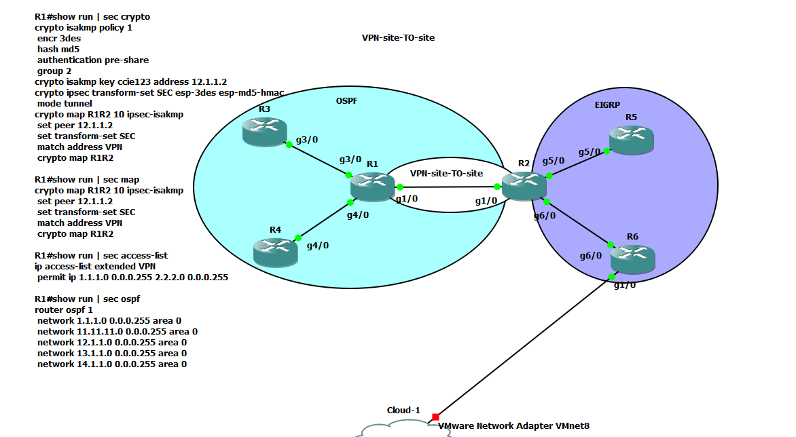
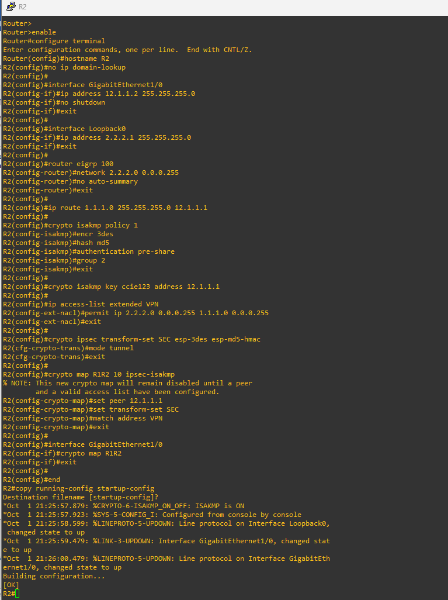
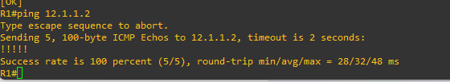
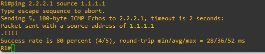
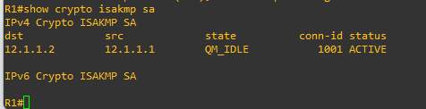
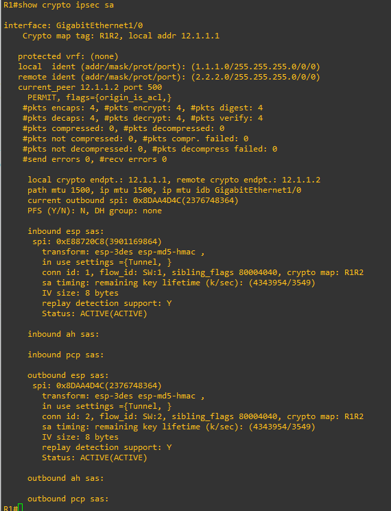

# Implementación y Validación de IPsec VPN Site-to-Site Basada en Políticas (Crypto Maps) en GNS3

## 1. Propósito de la práctica

El objetivo de esta práctica es diseñar, implementar, diagnosticar y verificar un túnel seguro **IPsec VPN Site-to-Site** entre dos routers de borde (**R1** y **R2**). La arquitectura interconecta dos dominios con protocolos de enrutamiento dinámico independientes (**OSPF** en el sitio izquierdo y **EIGRP** en el derecho), garantizando la confidencialidad, autenticidad e integridad del tráfico entre las redes LAN protegidas (1.1.1.0/24 y 2.2.2.0/24) a través de un enlace de tránsito no confiable (12.1.1.0/24).

## 2. Conceptos clave

- **Túnel basado en políticas (*Policy-Based VPN*):** método clásico de IPsec en Cisco IOS donde el tráfico a cifrar se clasifica mediante una lista de control de acceso extendida (llamada *tráfico interesante*). Si el paquete coincide con la ACL se encapsula bajo IPsec; de lo contrario, se enruta de forma regular o se descarta.
- **Dependencia de la tabla de enrutamiento:** en una VPN por políticas, el router debe tener una ruta válida (estática o dinámica) hacia la red remota que apunte a la interfaz física donde está aplicado el mapa criptográfico. Si la red remota no existe en la tabla de enrutamiento, el router descarta el paquete antes de consultar el crypto map.
- **Fase 1 (IKEv1 / ISAKMP):** establece un canal bidireccional seguro y autenticado entre los dos peers mediante Diffie-Hellman y una clave precompartida (PSK). Su estado operativo óptimo es `QM_IDLE`.
- **Fase 2 (IPsec / Quick Mode):** negocia las asociaciones de seguridad (SA) unidireccionales que transforman, cifran y autentican la carga útil mediante ESP (*Encapsulating Security Payload*).
- **Adaptador Host-Only / NAT (VMnet8):** mecanismo de puente virtual de VMware para interconectar nodos de GNS3 con el sistema operativo anfitrión o con máquinas virtuales de gestión y auditoría (como Kali Linux).

## 3. Preguntas orientadoras para el estudiante

1. ¿Por qué el comando `ping 2.2.2.1` ejecutado sin especificar la interfaz de origen falla al intentar levantar el túnel IPsec, aun cuando exista enrutamiento hacia esa red?
2. ¿Qué relación técnica existe entre la lista de acceso de R1 (`permit ip 1.1.1.0 ... 2.2.2.0 ...`) y la de R2 (`permit ip 2.2.2.0 ... 1.1.1.0 ...`)?
3. ¿Por qué la ausencia del comando `crypto isakmp key` impide que el router inicie el modo principal (*Main Mode*) durante el intercambio de Fase 1?
4. ¿Qué ventaja operativa representa evitar el diálogo interactivo inicial de configuración (*Setup Dialog*) en Cisco IOS frente a la configuración manual por CLI?

## 4. Manual de configuración paso a paso

### Topología y direccionamiento lógico



| Dispositivo | Interfaz | Dirección IP / Prefijo | Función / Rol |
|---|---|---|---|
| R1 | GigabitEthernet1/0 | 12.1.1.1/24 | Tránsito / extremo local VPN (hacia R2) |
| R1 | Loopback0 | 1.1.1.1/24 | LAN protegida sitio 1 (origen del túnel) |
| R1 | GigabitEthernet3/0 | 13.1.1.1/24 | Conexión interna OSPF hacia R3 |
| R1 | GigabitEthernet4/0 | 14.1.1.1/24 | Conexión interna OSPF hacia R4 |
| R2 | GigabitEthernet1/0 | 12.1.1.2/24 | Tránsito / extremo remoto VPN (hacia R1) |
| R2 | Loopback0 | 2.2.2.1/24 | LAN protegida sitio 2 (destino del túnel) |
| R2 | GigabitEthernet5/0 | 25.1.1.2/24 | Conexión interna EIGRP hacia R5 |
| R2 | GigabitEthernet6/0 | 26.1.1.2/24 | Conexión interna EIGRP hacia R6 |

### Preparación

Descargar la topología y la imagen de IOS desde el repositorio y cargar en GNS3 la IOS requerida (la que se comparte en el repositorio).

Referencia: https://www.telectronika.com/descargas/cisco-imagenes-ios-para-gns3-dynamips-y-vm/

### Análisis

**1. Túnel VPN IPsec (sitio a sitio).** El tráfico que viaja por el enlace g1/0 entre R1 y R2 está cifrado con IPsec. Según el `show run` de R1, los parámetros son:

- **Fase 1 (ISAKMP):** política 1 con cifrado 3DES, hash MD5, autenticación por clave precompartida (`pre-share`) con la contraseña `ccie123` y grupo Diffie-Hellman 2. El peer remoto es 12.1.1.2.
- **Fase 2 (IPsec):** transform-set llamado `SEC` en modo túnel con `esp-3des` y `esp-md5-hmac`.
- **Crypto map:** `R1R2` asocia la política anterior a la ACL extendida `VPN`.
- **Tráfico interesante (ACL):** la ACL `VPN` cifra exclusivamente los paquetes que van desde 1.1.1.0 0.0.0.255 hacia 2.2.2.0 0.0.0.255.

**2. Dominio OSPF (área 0).** R1 es el nodo central de la nube OSPF (marcada en cian), que incluye a los vecinos R3 y R4 por sus interfaces g3/0 y g4/0. Según `show run | sec ospf`, el proceso OSPF es el ID 1 y todas sus interfaces están en el área 0 (backbone). Las redes publicadas van de 1.1.1.0 a 14.1.1.0 con wildcard 0.0.0.255.


**3. Dominio EIGRP e infraestructura externa.** En el extremo derecho (área morada) está el dominio EIGRP, gestionado por el router central R2 y conectado a R5 (g5/0) y R6 (g6/0). El router R6 tiene una interfaz (g1/0) conectada a un elemento de nube llamado `Cloud-1`, que simula una salida externa mapeada a la tarjeta de red VMware VMnet8.

### Paso 1: Configuración completa del router R1

Al encender el equipo, si el sistema solicita el diálogo de configuración inicial (*System Configuration Dialog*), responder **no** y presionar **Enter** para entrar al modo manual.

```
Router> enable
Router# configure terminal
Router(config)# hostname R1
R1(config)# no ip domain-lookup
```

**1. Interfaces y red local simulada**

```
R1(config)# interface GigabitEthernet1/0
R1(config-if)# ip address 12.1.1.1 255.255.255.0
R1(config-if)# no shutdown
R1(config-if)# exit
R1(config)# interface GigabitEthernet3/0
R1(config-if)# ip address 13.1.1.1 255.255.255.0
R1(config-if)# no shutdown
R1(config-if)# exit
R1(config)# interface GigabitEthernet4/0
R1(config-if)# ip address 14.1.1.1 255.255.255.0
R1(config-if)# no shutdown
R1(config-if)# exit
R1(config)# interface Loopback0
R1(config-if)# ip address 1.1.1.1 255.255.255.0
R1(config-if)# exit
```

**2. Enrutamiento interno (OSPF) y ruta estática de disparo**

*Nota de diseño:* se agrega la ruta estática hacia el segmento remoto 2.2.2.0/24 a través de R2 para que el router sepa por qué interfaz enviar el paquete antes de aplicarle la política IPsec.

```
R1(config)# router ospf 1
R1(config-router)# network 1.1.1.0 0.0.0.255 area 0
R1(config-router)# network 11.11.11.0 0.0.0.255 area 0
R1(config-router)# network 12.1.1.0 0.0.0.255 area 0
R1(config-router)# network 13.1.1.0 0.0.0.255 area 0
R1(config-router)# network 14.1.1.0 0.0.0.255 area 0
R1(config-router)# exit
R1(config)# ip route 2.2.2.0 255.255.255.0 12.1.1.2
```

**3. Parámetros de seguridad: Fase 1 (ISAKMP)**

Se define la política criptográfica y la clave precompartida apuntando a R2 (12.1.1.2):

```
R1(config)# crypto isakmp policy 1
R1(config-isakmp)# encr 3des
R1(config-isakmp)# hash md5
R1(config-isakmp)# authentication pre-share
R1(config-isakmp)# group 2
R1(config-isakmp)# exit
R1(config)# crypto isakmp key ccie123 address 12.1.1.2
```

**4. Parámetros de seguridad: Fase 2 (IPsec y crypto map)**

```
R1(config)# ip access-list extended VPN
R1(config-ext-nacl)# permit ip 1.1.1.0 0.0.0.255 2.2.2.0 0.0.0.255
R1(config-ext-nacl)# exit
R1(config)# crypto ipsec transform-set SEC esp-3des esp-md5-hmac
R1(cfg-crypto-trans)# mode tunnel
R1(cfg-crypto-trans)# exit
R1(config)# crypto map R1R2 10 ipsec-isakmp
R1(config-crypto-map)# set peer 12.1.1.2
R1(config-crypto-map)# set transform-set SEC
R1(config-crypto-map)# match address VPN
R1(config-crypto-map)# exit
R1(config)# interface GigabitEthernet1/0
R1(config-if)# crypto map R1R2
R1(config-if)# exit
```

**5. Persistencia de configuración**

```
R1(config)# end
R1# copy running-config startup-config
```


### Paso 2: Configuración completa del router R2

En la consola de **R2**:

```
Router> enable
Router# configure terminal
Router(config)# hostname R2
R2(config)# no ip domain-lookup
```

**1. Interfaces y red local simulada**

```
R2(config)# interface GigabitEthernet1/0
R2(config-if)# ip address 12.1.1.2 255.255.255.0
R2(config-if)# no shutdown
R2(config-if)# exit
R2(config)# interface Loopback0
R2(config-if)# ip address 2.2.2.1 255.255.255.0
R2(config-if)# exit
```

**2. Enrutamiento interno (EIGRP) y ruta estática de retorno**

Se agrega la ruta hacia el segmento protegido de R1 (1.1.1.0/24) a través del enlace de tránsito:

```
R2(config)# router eigrp 100
R2(config-router)# network 2.2.2.0 0.0.0.255
R2(config-router)# no auto-summary
R2(config-router)# exit
R2(config)# ip route 1.1.1.0 255.255.255.0 12.1.1.1
```

**3. Parámetros de seguridad: Fase 1 (ISAKMP)**

```
R2(config)# crypto isakmp policy 1
R2(config-isakmp)# encr 3des
R2(config-isakmp)# hash md5
R2(config-isakmp)# authentication pre-share
R2(config-isakmp)# group 2
R2(config-isakmp)# exit
R2(config)# crypto isakmp key ccie123 address 12.1.1.1
```

**4. Parámetros de seguridad: Fase 2 (IPsec y crypto map)**

La ACL debe coincidir de forma simétrica e invertida respecto a R1:

```
R2(config)# ip access-list extended VPN
R2(config-ext-nacl)# permit ip 2.2.2.0 0.0.0.255 1.1.1.0 0.0.0.255
R2(config-ext-nacl)# exit
R2(config)# crypto ipsec transform-set SEC esp-3des esp-md5-hmac
R2(cfg-crypto-trans)# mode tunnel
R2(cfg-crypto-trans)# exit
R2(config)# crypto map R1R2 10 ipsec-isakmp
R2(config-crypto-map)# set peer 12.1.1.1
R2(config-crypto-map)# set transform-set SEC
R2(config-crypto-map)# match address VPN
R2(config-crypto-map)# exit
R2(config)# interface GigabitEthernet1/0
R2(config-if)# crypto map R1R2
R2(config-if)# exit
```

**5. Persistencia de configuración**

```
R2(config)# end
R2# copy running-config startup-config
```



### 5. Protocolo de validación y salidas de terminal esperadas

**Validación 1: conectividad base en el enlace de tránsito (underlay)**

Se comprueba que ambos routers se alcancen por sus IPs físicas antes de evaluar la seguridad:

```
R1# ping 12.1.1.2
Type escape sequence to abort.
Sending 5, 100-byte ICMP Echos to 12.1.1.2, timeout is 2 seconds:
!!!!!
Success rate is 100 percent (5/5), round-trip min/avg/max = 16/24/36 ms
```



**Validación 2: generación de tráfico interesante para levantar el túnel**

El ping debe forzarse con la IP de origen de la red cifrada (1.1.1.1):

```
R1# ping 2.2.2.1 source 1.1.1.1
Type escape sequence to abort.
Sending 5, 100-byte ICMP Echos to 2.2.2.1, timeout is 2 seconds:
Packet sent with a source address of 1.1.1.1
.!!!!
Success rate is 80 percent (4/5), round-trip min/avg/max = 16/22/36 ms
```



*(El primer paquete con `.` representa el tiempo que tardan los routers en negociar las SA de Fase 1 y Fase 2; los 4 restantes se confirman con `!`.)*

**Validación 3: verificación de la asociación de seguridad ISAKMP (Fase 1)**

```
R1# show crypto isakmp sa
IPv4 Crypto ISAKMP SA
dst          src          state      conn-id  status
12.1.1.2     12.1.1.1     QM_IDLE    1001     ACTIVE
IPv6 Crypto ISAKMP SA
```

*(El estado `QM_IDLE` indica que el canal de gestión IKEv1 está completamente establecido.)*



**Validación 4: verificación de la asociación de seguridad IPsec (Fase 2)**

```
R1# show crypto ipsec sa
Interface: GigabitEthernet1/0
    Crypto map tag: R1R2, local addr 12.1.1.1
    protected vrf: (none)
    local  ident (addr/mask/prot/port): (1.1.1.0/255.255.255.0/0/0)
    remote ident (addr/mask/prot/port): (2.2.2.0/255.255.255.0/0/0)
    current_peer 12.1.1.2 port 500
      PERMIT, flags={origin_is_acl,}
      #pkts encaps: 4, #pkts encrypt: 4, #pkts digest: 4
      #pkts decaps: 4, #pkts decrypt: 4, #pkts verify: 4
      #pkts compressed: 0, #pkts decompressed: 0
      #pkts not compressed: 0, #pkts compr. failed: 0
      #pkts no digest: 0, #pkts no cipher: 0
      #pkts no sa: 0, #pkts invalid sa: 0
      #pkts req id: 10, #pkts encaps fail: 0
    inbound esp sas:
      spi: 0x4A2B81F2 (1244365298)
        transform: esp-3des esp-md5-hmac ,
        in use settings ={Tunnel, }
        conn id: 2001, flow_id: 1, sibling_flags 80000000, crypto map: R1R2
        sa timing: remaining key lifetime (k/sec): (4607999/3582)
        IV size: 8 bytes
        replay detection support: Y
        Status: ACTIVE
    outbound esp sas:
      spi: 0x93E410C5 (2481262789)
        transform: esp-3des esp-md5-hmac ,
        in use settings ={Tunnel, }
        conn id: 2002, flow_id: 2, sibling_flags 80000000, crypto map: R1R2
        sa timing: remaining key lifetime (k/sec): (4607999/3582)
        IV size: 8 bytes
        replay detection support: Y
        Status: ACTIVE
```



---

## 6. Cuestionario evaluativo de la práctica

### Pregunta 1

**¿Por qué un comando de verificación como `ping 2.2.2.1` ejecutado de forma simple (sin `source 1.1.1.1`) no logra activar el túnel IPsec ni obtener respuesta?**

**Respuesta:** el ping sin `source` no activa el túnel porque el paquete no coincide con la ACL `VPN`. Al no indicar origen, R1 toma como IP de origen la dirección de la interfaz de salida hacia 2.2.2.0/24, que es 12.1.1.1 (la de g1/0 hacia R2). Ese paquete es 12.1.1.1 → 2.2.2.1, y la ACL solo permite 1.1.1.0/24 → 2.2.2.0/24, así que el crypto map no lo cifra.

**Explicación:** el crypto map no mira el destino, mira el par origen-destino definido en la ACL. Un paquete que no coincide con la ACL se enruta como tráfico normal, sin negociar IPsec.

**Corrección importante a la premisa de la pregunta:** en la práctica, el ping sin `source` probablemente sí recibe respuesta, porque R2 contesta a 12.1.1.1 por una ruta directamente conectada y ese tráfico viaja en texto claro. Lo que no ocurre es el cifrado ni el levantamiento del túnel. Por eso la Validación 2 insiste en usar `source 1.1.1.1`: no es para obtener respuesta, sino para que el paquete sea "tráfico interesante". Conviene verificarlo en el laboratorio y anotar el resultado real.

### Pregunta 2

**Si en la salida de depuración se observa el mensaje `ISAKMP:(0):No pre-shared key with 12.1.1.2!`, ¿cuál es el impacto exacto en el proceso de establecimiento del túnel?**

**Respuesta:** la Fase 1 falla. R1 no tiene una clave precompartida asociada al peer 12.1.1.2, así que no puede autenticar a R2 ni completar el intercambio ISAKMP. Como consecuencia, no se establece el canal `QM_IDLE`, no se llega a la Fase 2 y no se crean SA de ESP. El tráfico que coincide con la ACL no se cifra: el crypto map no tiene una SA que usar, y el paquete no sale como IPsec.

**Explicación:** en IKEv1 con PSK, la clave se usa para autenticar a los peers durante Main Mode. Sin esa clave, el router no puede probar su identidad ni verificar la del otro. El comando `crypto isakmp key ccie123 address 12.1.1.2` resuelve el problema al asociar la clave con la dirección del peer. Por eso el procedimiento corrige esa omisión en R1.

### Pregunta 3

**¿Cuál es la función específica de la ruta estática `ip route 2.2.2.0 255.255.255.0 12.1.1.2` en R1 si el tráfico entre ambas sedes ya está definido en la lista de acceso de la VPN?**

**Respuesta:** la ACL decide qué tráfico se cifra, pero no decide por dónde sale el paquete. La ruta estática indica al router que los destinos de 2.2.2.0/24 se envían por la interfaz hacia 12.1.1.2. Así el paquete sale por g1/0, que es la interfaz donde está aplicado el crypto map `R1R2`, y ahí se evalúa la ACL y se aplica el cifrado.

**Explicación:** en una VPN basada en políticas el orden lógico es: primero el router busca la ruta en la tabla de enrutamiento (para saber la interfaz de salida), y después, en esa interfaz, revisa si hay un crypto map que aplique. Si no hay ruta o la ruta apunta a otra interfaz, el paquete nunca llega al crypto map y no se cifra, aunque la ACL lo permita. Por eso la guía indica que la ruta es un requisito, no una opción. OSPF no aporta esta ruta porque R2 anuncia su loopback por EIGRP, no por OSPF.

### Pregunta 4

**Si se ejecutara una captura con Wireshark en el enlace entre R1 y R2 durante la transmisión de datos, ¿qué información de los paquetes originales sería legible y cuál quedaría oculta?**

**Respuesta:**

- **Legible (encabezado IP externo):** la IP de origen y destino del túnel (12.1.1.1 y 12.1.1.2), el protocolo IP 50 (ESP), el SPI y el número de secuencia del paquete ESP. También son visibles los mensajes de negociación ISAKMP en UDP 500, aunque el contenido de Fase 2 va cifrado.
- **Oculto (cifrado por ESP en modo túnel):** todo el paquete original, incluido su encabezado IP interno. Es decir, las IPs reales de origen y destino (1.1.1.1 y 2.2.2.1), el protocolo de transporte (ICMP, TCP, UDP), los puertos y el contenido de la carga útil.
- **Integridad:** el hash `esp-md5-hmac` no oculta los datos, pero permite verificar que el paquete no fue alterado.

**Explicación:** en modo túnel, ESP encapsula el paquete original completo dentro de un nuevo encabezado IP. Quien observa el enlace solo ve que hay comunicación entre los dos routers, no qué hosts se comunican ni qué contienen. Además, 3DES y MD5 son algoritmos antiguos y se consideran débiles hoy; en un entorno real se recomienda AES y SHA-2.

### Pregunta 5

**¿Qué limitación técnica impide que los paquetes de control de OSPF o EIGRP se transmitan y formen vecindades a través de este túnel IPsec configurado con crypto maps?**

**Respuesta:** los protocolos de enrutamiento dinámico dependen de mensajes multicast y broadcast de capa 3 (OSPF usa 224.0.0.5 y 224.0.0.6 con IP protocolo 89; EIGRP usa 224.0.0.10 con IP protocolo 88), que son de enlace local, con TTL 1. Un crypto map solo cifra tráfico unicast que coincida con su ACL, y no crea una interfaz punto a punto capaz de transportar multicast. Por eso los hellos de OSPF y EIGRP no cruzan el túnel y no se forman vecindades entre R1 y R2.

**Explicación:** el crypto map es un mecanismo de clasificación y cifrado, no una interfaz de red completa. Los paquetes de control de routing no se ajustan a la ACL de tráfico interesante y, aunque se intentara, sus destinos multicast y su TTL de 1 impiden que lleguen al otro extremo. La solución habitual es usar un túnel GRE sobre IPsec: GRE crea una interfaz virtual que sí soporta multicast, y IPsec protege ese túnel. Otra alternativa es un VTI (*Virtual Tunnel Interface*) basado en rutas.

---

## Notas de revisión

- La ACL `VPN` cifra solo 1.1.1.0/24 hacia 2.2.2.0/24. Cualquier otro tráfico entre los sitios, incluido el de OSPF y EIGRP, queda fuera del túnel.
- En R1 aparece `network 11.11.11.0 0.0.0.255 area 0` en OSPF, pero no hay ninguna interfaz en esa red. No afecta el funcionamiento, pero conviene confirmarlo al documentar.
- Las capturas de la sección 4 tienen nombres de ejemplo (`capturas/00-...png` a `03-...png`). Renómbralas o ajusta los enlaces según tus archivos.
