# Laboratorio VPN IPsec sitio a sitio en GNS3

**Estudiante:** Julián Camilo Moreno Valderrama

**Herramientas:** GNS3 y routers Cisco 7200 con IOS 15.2(4)M7.

## Objetivo

Configurar una VPN entre R1 y R2 para proteger la comunicación entre las redes `1.1.1.0/24` y `2.2.2.0/24`. También comprobar las conexiones internas con OSPF y EIGRP.

## 1. Topología y direcciones

Organicé seis routers: R1, R3 y R4 usan OSPF; R2, R5 y R6 usan EIGRP. La VPN conecta R1 con R2.

**Topología inicial, antes de encender y configurar los routers.**

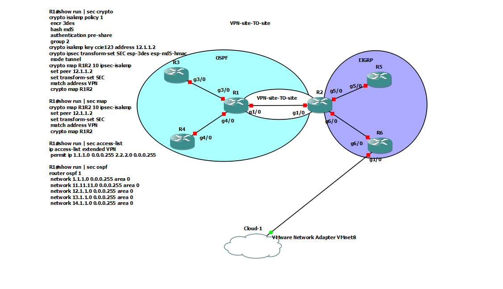

| Router | Interfaz | Dirección | Conexión |
| --- | --- | --- | --- |
| R1 | GigabitEthernet1/0 | `12.1.1.1/24` | R2 |
| R1 | Loopback0 | `1.1.1.1/24` | Red protegida de R1 |
| R1 | GigabitEthernet3/0 | `13.1.1.1/24` | R3 |
| R1 | GigabitEthernet4/0 | `14.1.1.1/24` | R4 |
| R2 | GigabitEthernet1/0 | `12.1.1.2/24` | R1 |
| R2 | Loopback0 | `2.2.2.1/24` | Red protegida de R2 |
| R2 | GigabitEthernet5/0 | `25.1.1.2/24` | R5 |
| R2 | GigabitEthernet6/0 | `26.1.1.2/24` | R6 |
| R3 | GigabitEthernet3/0 | `13.1.1.3/24` | R1 |
| R4 | GigabitEthernet4/0 | `14.1.1.4/24` | R1 |
| R5 | GigabitEthernet5/0 | `25.1.1.5/24` | R2 |
| R6 | GigabitEthernet6/0 | `26.1.1.6/24` | R2 |

Para R3, R4, R5 y R6 elegí direcciones disponibles dentro de la red de cada enlace. Las loopbacks son interfaces virtuales que representan las redes protegidas.

## 2. Interfaces y enlace entre R1 y R2

Asigné las direcciones y activé las interfaces con `no shutdown`. Revisé su estado con `show ip interface brief`.

**R1: enlace y Loopback0 en estado up/up.**

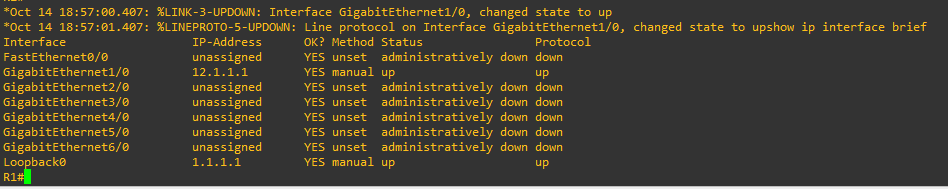

**R2: enlace y Loopback0 en estado up/up.**

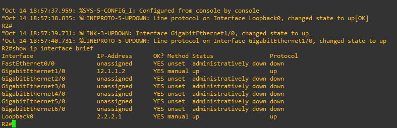

Desde R2 hice ping a `12.1.1.1`. Respondieron los cinco paquetes, por lo que el enlace entre los routers funcionaba.

**Ping de R2 a R1: 5 de 5 respuestas.**

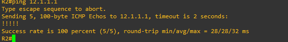

## 3. Rutas hacia la red remota

Agregué una ruta en cada router para llegar a la red del otro lado.

**En R1:**

```text
ip route 2.2.2.0 255.255.255.0 12.1.1.2
```

**En R2:**

```text
ip route 1.1.1.0 255.255.255.0 12.1.1.1
```

**R1 llega a la red 2.2.2.0/24 por R2.**

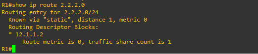

**R2 llega a la red 1.1.1.0/24 por R1.**

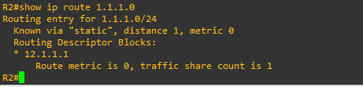

## 4. Configuración y prueba de la VPN

Configuré la misma clave y los parámetros de la guía en ambos routers. La lista de acceso (ACL) indica qué comunicación debe proteger la VPN.

| Configuración | Valor utilizado |
| --- | --- |
| Negociación de la VPN | IKEv1, política 1 |
| Clave compartida del laboratorio | `ccie123` |
| Cifrado y comprobación de integridad | 3DES y MD5 |
| Grupo Diffie-Hellman | 2 |
| Conjunto IPsec | `SEC`: `esp-3des esp-md5-hmac`, modo túnel |
| Mapa de la VPN | `R1R2`, secuencia 10, en `GigabitEthernet1/0` |
| Dirección del otro extremo | R1 usa `12.1.1.2`; R2 usa `12.1.1.1` |
| Redes protegidas | `1.1.1.0/24` y `2.2.2.0/24` |

Las configuraciones completas están disponibles por router: [R1](configs/R1.cfg), [R2](configs/R2.cfg), [R3](configs/R3.cfg), [R4](configs/R4.cfg), [R5](configs/R5.cfg) y [R6](configs/R6.cfg).

### Prueba desde R1

Usé la dirección de la loopback como origen para que el ping pasara por la VPN:

```text
ping 2.2.2.1 source 1.1.1.1
show crypto isakmp sa
show crypto ipsec sa
```

El ping respondió **5 de 5**. El estado `QM_IDLE` con `ACTIVE` confirmó que los routers habían establecido la negociación IKE.

**Ping entre las redes protegidas y estado IKE en R1.**

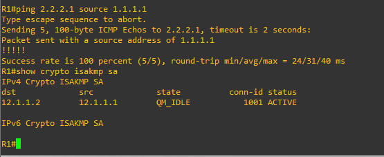

R1 registró **9 paquetes cifrados y 9 descifrados**, sin errores de envío o recepción.

**Contadores de tráfico protegido en R1.**

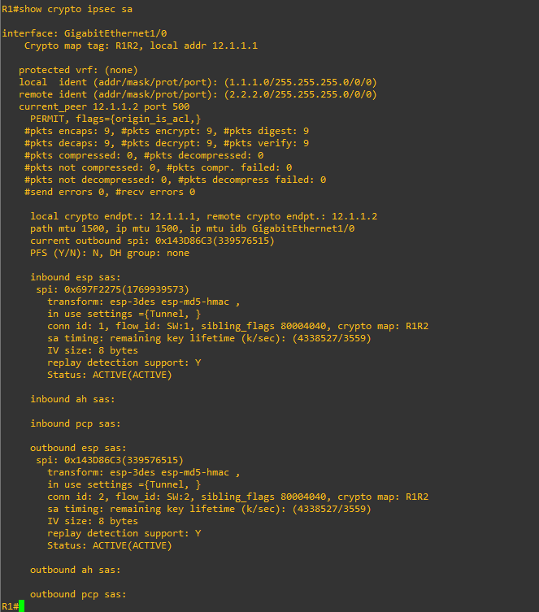

### Prueba desde R2

Repetí la prueba en sentido contrario:

```text
ping 1.1.1.1 source 2.2.2.1
show crypto isakmp sa
show crypto ipsec sa
```

El ping respondió **5 de 5**. R2 mostró **14 paquetes cifrados y 14 descifrados**, sin errores. Los contadores aumentan al realizar más pruebas.

**Ping y tráfico protegido desde R2.**

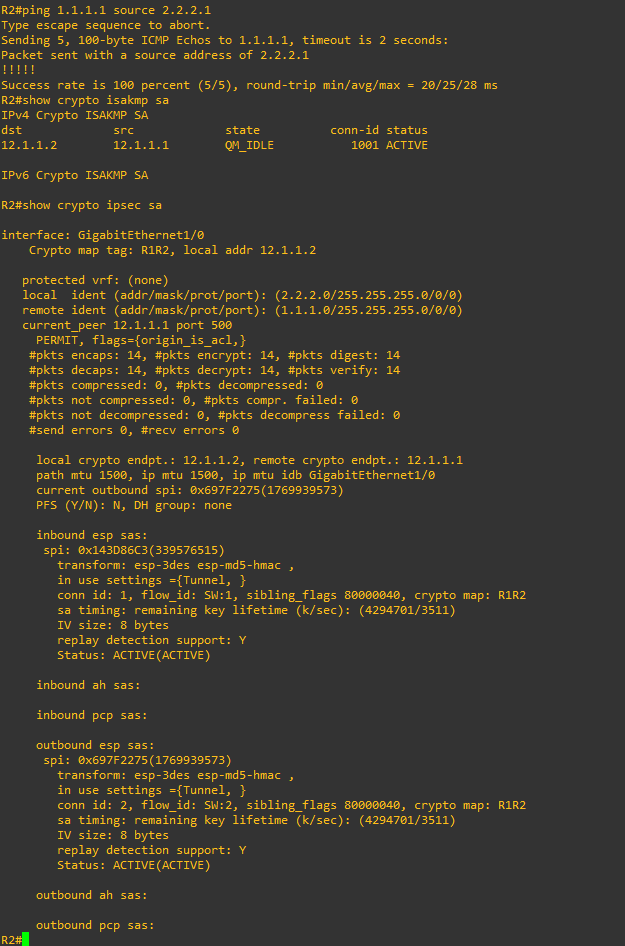

## 5. Prueba de OSPF

Configuré OSPF en el área 0 entre R1, R3 y R4. R1 reconoció a los otros dos routers en estado **FULL**, lo que confirma que completaron la conexión OSPF.

**Vecinos OSPF de R1.**

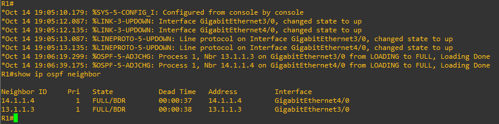

R3 aprendió la ruta hacia `1.1.1.1` y el ping respondió **5 de 5**.

**Ruta aprendida y ping desde R3.**

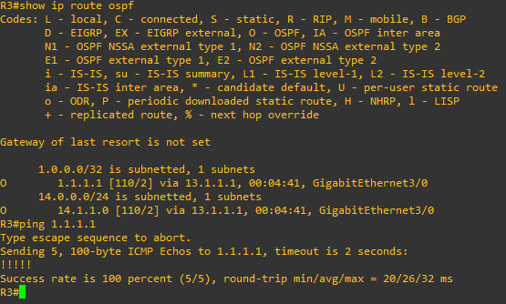

## 6. Prueba de EIGRP

Configuré EIGRP 100 entre R2, R5 y R6. R2 reconoció a R5 (`25.1.1.5`) y a R6 (`26.1.1.6`) como vecinos.

**Vecinos EIGRP de R2.**

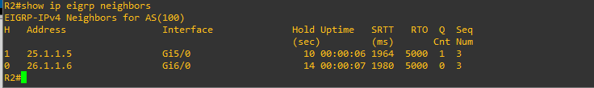

R5 aprendió la ruta hacia `2.2.2.0/24` y el ping a `2.2.2.1` respondió **5 de 5**.

**Ruta aprendida y ping desde R5.**

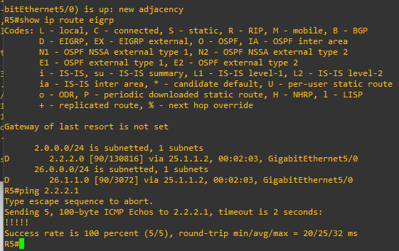

## 7. Respuestas a las preguntas

### Preguntas orientadoras

**1. ¿Por qué el ping sin indicar el origen no activa la VPN, aunque exista una ruta?**

Porque R1 usa `12.1.1.1` como origen y la VPN protege la red `1.1.1.0/24`. Al agregar `source 1.1.1.1`, el ping coincide con la ACL y activa la VPN.

**2. ¿Qué relación tienen las listas de acceso de R1 y R2?**

Protegen las mismas redes, pero invierten el origen y el destino. Así cubren la comunicación en ambos sentidos.

**3. ¿Por qué la falta de `crypto isakmp key` impide establecer la fase 1 (Main Mode)?**

Sin la clave compartida, los routers no pueden comprobar la identidad del otro. La fase 1 no se completa y la VPN no queda establecida.

**4. ¿Qué ventaja tiene omitir el diálogo inicial de configuración?**

Permite escribir directamente los comandos del laboratorio, en el orden necesario, sin pasar por las preguntas del asistente.

### Cuestionario de evaluación

**1. ¿Por qué un ping simple no activa el túnel ni garantiza una respuesta?**

Su origen queda fuera de la ACL de la VPN. Podría responder sin cifrado si las rutas lo permiten; para comprobar la VPN usé `ping 2.2.2.1 source 1.1.1.1`.

**2. ¿Qué significa el mensaje `No pre-shared key with 12.1.1.2!`?**

Indica que falta la clave compartida para ese router. La autenticación falla y no se establece la VPN; hay que configurar la misma clave en ambos extremos.

**3. ¿Para qué sirve la ruta estática si ya existe la ACL?**

La ruta indica por dónde enviar los paquetes. La ACL selecciona cuáles se deben cifrar. Se necesitan ambas para esta configuración.

**4. ¿Qué se vería en Wireshark durante el envío de datos por la VPN?**

Se verían las direcciones externas `12.1.1.1` y `12.1.1.2`, junto con el tráfico ESP. Las direcciones internas y el contenido original quedarían cifrados.

**5. ¿Por qué OSPF y EIGRP no forman vecinos a través de esta VPN?**

Sus mensajes de descubrimiento usan multicast y no coinciden con las redes seleccionadas por esta VPN. Para transportarlos entre los extremos se podría usar GRE protegido con IPsec.

## 8. Problemas y soluciones

| Problema | Cómo lo resolví |
| --- | --- |
| Apareció un aviso de exceso de capacidad del bus PCI. | Esperé el arranque y comprobé las interfaces. El aviso no impidió realizar las pruebas en GNS3. |
| PuTTY pegaba varios comandos en una sola línea. | Organicé el texto en Bloc de notas, con un comando por línea, y lo pegué de nuevo. |
| La configuración anterior no estaba guardada. | Volví a configurar los routers, ejecuté `write memory` en cada uno y conservé una copia de sus configuraciones. |

## 9. Resultado final

Comprobé la VPN entre las loopbacks de R1 y R2 con respuestas en ambos sentidos y contadores de cifrado activos. También verifiqué OSPF desde R3 y EIGRP desde R5. Guardé las configuraciones de los seis routers.
